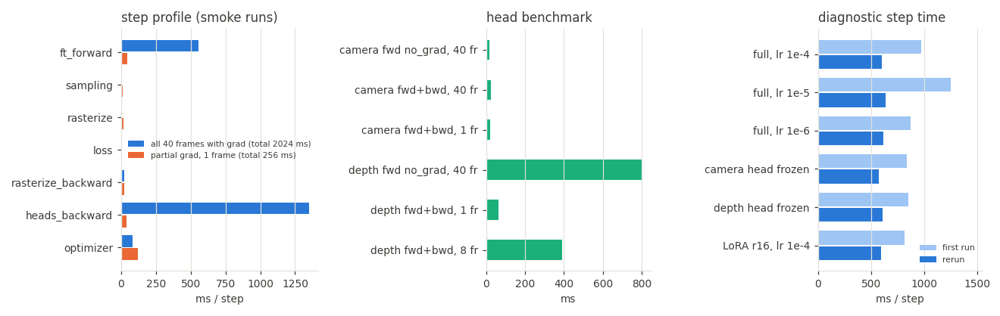
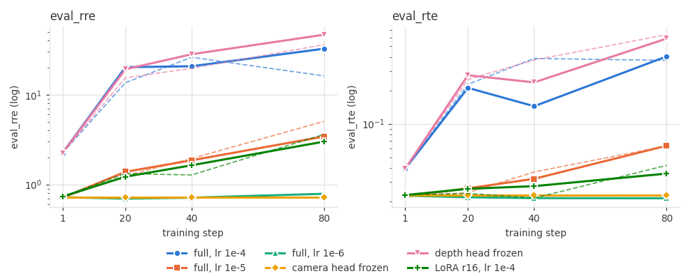
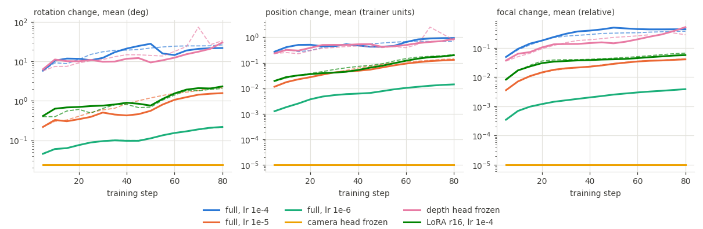
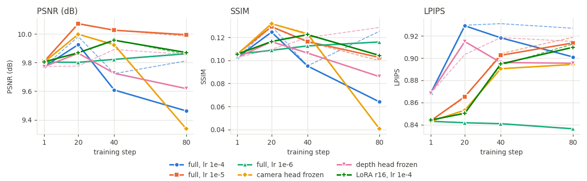

# VGGT head fine-tuning with gradients through a subset of frames per step

Status: implemented and smoke-tested (80 steps); no full run yet.

## Question

In the VGGT head fine-tuning mode (`--init_type vggt_ft`, see the `vggt_finetune` experiment), all 40 frames are
evaluated with gradients every step. Can the heads be evaluated under `no_grad` for most frames and with gradients
for only 1 (or m) frames per step, while the rendered Gaussians and cameras still come from all 40 frames, so that the
step is faster? What does it do to quality and to the camera error (`eval_rre`, `eval_rte`)?

## Baseline to compare against (measured, not part of this idea)

Full fine-tune smoke run (60 steps, GPU L40S, fp32, 8-frame chunks with checkpointing, mean over steps 20-59):

Per-section times of this run are in the left panel of `figures/timing.png` (blue bars; step_total 2024.2 ms,
heads_backward 1350.9 ms, ft_forward 554.3 ms).

LoRA run (r16, lr 1e-4, shared GPU 3): 1.75 s/it observed in the progress bar at steps ~290-1456. The run was cancelled
at step 1456 of 30000 on request (no profile, only the step-1 eval: eval_rre 0.735, eval_rte 0.0231), so arm 3 of
the `vggt_finetune` experiment has no result. Run directory:
`bonsai_2_n40_s42_c0.0_p100000_random_minfarthestpose_i40_gteval_vft-0.0001-lora16-both-k1000000-e1_steps30000`.

## Code facts the idea relies on

- Backbone (aggregator) tokens are cached; only the heads run per step.
- DPT depth/confidence head: frames are independent given their cached tokens and the head weights.
- Camera head: the trunk attends across the frames of the sequence, so frames interact.
- Gaussian means come from the unprojected depth of the pixel pool (7,169,120 candidates, 40 frames); the
  Gumbel-top-k mask selects 1M. With gradients for one frame only, only the selected Gaussians of that frame (and that
  frame's camera and confidence scores) receive gradient in that step.

## Design decisions (by the user)

1. Gradient frame: the single frame whose camera is rendered in that iteration (`batch_size=1` is asserted).
2. Camera head: runtime measured first (below). It is cheap, so the camera head runs with gradient on all 40 frames
   every step (the trunk attends across frames).
3. Frames without gradient: all 40 frames computed once and kept for the whole run (`vggt_refresh_every=0`, "N=0");
   N > 0 re-evaluates all frames without gradient every N steps (configurable, for speed-vs-accuracy plots).
4. No loss/gradient rescaling; Adam decides. The starting learning rate is `vggt_lr` (constant, no schedule).

Gaps filled by Claude (not decided by the user):
- The cache keeps each frame's latest output: when a frame is the gradient frame, its fresh (detached) means,
  confidence and depth are written back into the cache. Without write-back, evaluation and the PLY would only ever
  show the initial means.
- Evaluation and PLY export use the cache for means/confidence and the current camera head for the cameras.
- The extra losses (confidence loss, depth regularisation) are averaged over the gradient frame's pixels only.
- Partial mode is implemented for `vggt_means_source=depth` only (not the point head).
- The depth head for the single frame runs without activation checkpointing.
- Flags: `--vggt_partial_grad`, `--vggt_refresh_every N`; run directory token `pg{N}` after `vft-...`.

## Camera head runtime measurement

Standalone benchmark (`bench_heads.py`, random tokens of the real shapes, fp32, full parameters with grad, 8 repeats
after 3 warmups) on GPU 3 while it was also running the LoRA training run and another user's job (100% utilisation),
so the absolute times include contention:

Results in the middle panel of `figures/timing.png`: camera head fwd no_grad 40 frames 16.3 ms, fwd+bwd 40 frames
26.5 ms, fwd+bwd 1 frame 22.4 ms; depth head fwd no_grad 40 frames (chunks of 8) 803.3 ms, fwd+bwd 1 frame 65.2 ms,
fwd+bwd 8 frames 389.4 ms.

Parameters: camera head 216.2M, depth head 32.7M. Peak memory 9.1 GB.

## Smoke test (80 steps, full fine-tune of both heads, lr 1e-4, `--vggt_partial_grad`, refresh 0)

Single run on GPU 3 (shared, 100% utilisation from other jobs), bonsai seed 42, 1M Gaussians, sampling every step.
Mean over 60 steps after 20 warmup (`profile_vggt_ft.json`):

Per-section times in the left panel of `figures/timing.png` (orange bars; step_total 256.1 ms, ft_forward 45.5 ms,
heads_backward 40.9 ms, optimizer 121.2 ms).

Peak memory 17.9 GB. Eval (37 images): step 1: PSNR 9.77, SSIM 0.103, LPIPS 0.868, eval_rre 2.24, eval_rte 0.039;
step 80: PSNR 9.55, SSIM 0.111, LPIPS 0.902, eval_rre 45.67, eval_rte 0.357.

## Diagnostics: growth of eval_rre / eval_rte (80 steps)

Question: why do `eval_rre` / `eval_rte` increase within the first steps of head fine-tuning?

Common setup: bonsai, seed 42, 40 images, `--vggt_partial_grad` (refresh 0), 1M Gaussians sampled every step,
`vggt_conf_mode=both`, 80 steps, evals at steps 1, 20, 40, 80 (37 eval images), `--vggt_drift_every 5`. Run on GPU 3,
shared with the LoRA training run and another user's job, so `step_total_ms` includes contention. Launch scripts:
`diagnostics/diag.sh`, `diagnostics/diag2.sh`; tables generated by `diagnostics/collect.py` (`diagnostics/tables.md`);
camera drift per 5 steps in `diagnostics/drift_<run>.jsonl`. Result dirs are in the scratchpad
(`.../scratchpad/diag/<run>`), not kept.

| Run | Differs by |
|---|---|
| lr1e-4 | full heads, lr 1e-4 |
| lr1e-5 | full heads, lr 1e-5 |
| lr1e-6 | full heads, lr 1e-6 |
| freezecam | full heads, lr 1e-4, camera head frozen (`--vggt_freeze_camera`), depth head trained |
| freezedepth | full heads, lr 1e-4, depth head frozen (`--vggt_freeze_depth`), camera head trained; the user's "pcd head" was read as the depth head |
| lora | LoRA r16 on both heads, lr 1e-4 |

Densification baseline (`sampler_vs_densification`): first-eval `eval_rre` 0.73. All six runs were run twice with
identical settings (first run: `diagnostics/`, rerun: `diagnostics_rerun/`, after the LoRA training run was cancelled
and GPU 3 was idle at launch). In the figures solid lines/markers are the rerun, dashed lines the first run. Values are
in `diagnostics_metrics.csv` (PSNR, SSIM, LPIPS, `eval_rre`, `eval_rte`, `step_total_ms` per run, set and eval step),
`diagnostics/tables.md` and `diagnostics_rerun/tables.md` (also camera drift mean/max over the 40 cameras every 5
steps), and `diagnostics*/drift_<run>.jsonl`. Figures are made by `make_figures.py`; colours are categorical slots 1-6
of the dataviz default palette (the palette validator needs node, which is not installed here, so it was not run; every
series also has its own marker shape, legend, and the tables exist).

Step time (`step_total_ms`, rightmost panel of `figures/timing.png`): 571-639 ms in the rerun and 818-1253 ms in the
first run, which was taken while GPU 3 also ran the LoRA training run and another user's job. Peak memory 17.9 GB in
all runs.

Facts to note: the lr1e-4 run is a repeat of the 80-step smoke run above with identical settings (before the
`--vggt_freeze_*` / `--vggt_drift_every` options were added); its step-80 `eval_rre` was 45.67 there, 16.19 in the
first diagnostic run and 32.56 in the rerun (runs are not seeded for determinism). In freezecam the drift stays at
0.02 / 0.05 degrees rotation (mean / max) and 0 position and focal change. The LoRA 30000-step training run was
cancelled at step 1456 on request.

## Setup

To be filled when the arms of the full experiment are decided.

## Launch

To be filled.

## Run metadata

To be filled.

## Results

To be filled.

## Failed / missing runs, fixes, confounds

To be filled.

## Insights

To be filled by the user.
