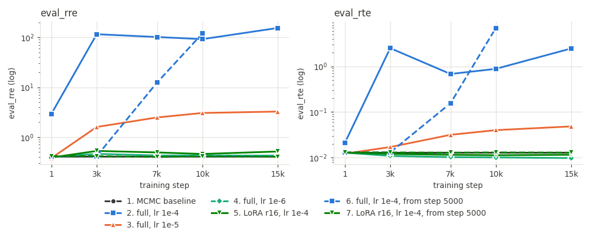
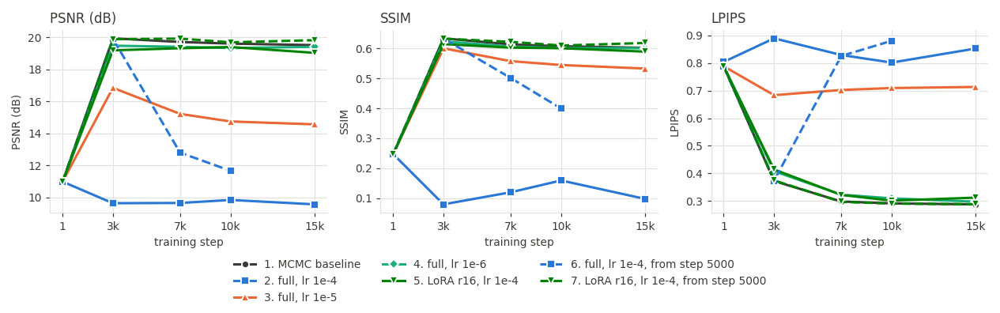
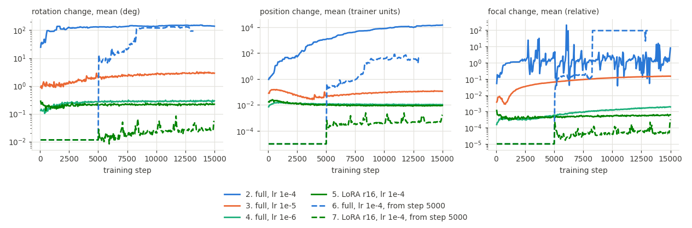

# Omega camera-head fine-tuning with MCMC densification (bonsai, 15k steps, 1 seed)

## Question

Can the cameras of the training views be refined by fine-tuning the VGGT-Omega camera head during normal 3DGS
training (MCMC densification, the delta pose optimiser off), "pose optimisation by fine-tuning instead of learning
residuals", compared with plain MCMC using the Omega cameras as they are? Variations: learning rate, full vs LoRA, and
delaying the start of the fine-tuning.

## Setup

- Scene: Mip-NeRF 360 `bonsai`, 40 training images, evaluation on the 37 eval images (`max_eval_images` /
  `eval_data_factor=2`), `gt_eval=True` (GT test cameras aligned with the current predicted train cameras;
  `eval_rre` / `eval_rte` against GT).
- Model: VGGT-Omega `vggt_omega_1b_512.pt` (original release, 512), "balanced" preprocessing, 40 images at 624x416
  (original 1559x1039, no padding or masks). Reconstruction `sampling_mode=random`, 100,000 points, `conf_thres=0`.
  The 416 reproduction checkpoint is implemented as the config option `omega_checkpoint=416` but is not on disk and was
  not used.
- Trainer: `examples/simple_trainer.py mcmc`, 15000 steps, seed 42, MCMC cap 1M, eval at steps 1, 3000, 7000, 10000,
  15000. Experiment `omega_camera_finetune` (group 101) in `experiment_runner.py`; all arms share one reconstruction.
- Camera fine-tuning (`examples/camera_finetune.py`): the Omega camera head (203.57M parameters, or LoRA r16) is run on
  the cached final-layer camera and register tokens of all 40 frames every step with gradient; the rendered view uses
  its own predicted camera (K from the field-of-view outputs scaled per axis to the image size, principal point at
  the centre). Before `camft_delay` the frozen initial prediction is used and the head is not trained; Adam is created at
  start-up but only moves parameters that have received gradients, so its state starts at the delay step. Constant lr,
  no warm-up. The Gaussians are not touched by the head.

| Arm | Differs by |
|---|---|
| 1. MCMC baseline | no fine-tuning, Omega cameras |
| 2. full, lr 1e-4 | `--camft`, full camera head |
| 3. full, lr 1e-5 | as 2 |
| 4. full, lr 1e-6 | as 2 |
| 5. LoRA r16, lr 1e-4 | `--camft_lora --camft_lora_rank 16` |
| 6. full, lr 1e-4, from step 5000 | `--camft_delay 5000` |
| 7. LoRA r16, lr 1e-4, from step 5000 | LoRA, `--camft_delay 5000` |

Arms 6 and 7 (the delayed twins of arms 2 and 5) were chosen by Claude; the user asked for a delay option without
naming the arms.

## Launch

```bash
cd ~/work/git/gsplat
export PATH=$HOME/.conda/envs/gsplat/bin:$PATH; unset PYTHONPATH
# reconstruction only (runs omega_infer.py in the vggt-omega env, COLMAP export in the vggt env)
python experiment_runner.py --experiment_names omega_camera_finetune --dataset_name bonsai --dataset_collections \
  --do_reconstruct --skip_splatting --skip_plotting --cuda_visible_devices 1
# 60-step smoke test (camft_delay 20)
python examples/simple_trainer.py mcmc --data_dir ../vggt/vggt_outputs/bonsai_2_n40_s42_omega_c0.0_p100000_random_minfarthestpose \
  --data_factor 1 --eval_data_factor 2 --max_train_cameras 40 --max_steps 60 --disable_viewer \
  --gt_train_data_dir ../vggt/data/360_v2/bonsai --gt_eval_data_dir ../vggt/data/360_v2/bonsai \
  --camft --camft_cache_file ../vggt/vggt_outputs/bonsai_2_cache_n40_s42_omega_minfarthestpose/raw_preds.pt \
  --camft_delay 20 --camft_lr 1e-4 --camft_drift_every 5 --eval_steps 1 20 60
# the experiment (GPUs 1 and 3, checked idle before launch)
python experiment_runner.py --experiment_names omega_camera_finetune --dataset_name bonsai --dataset_collections \
  --do_reconstruct --skip_plotting --cuda_visible_devices 1,3
# plots
python experiment_runner.py --experiment_names omega_camera_finetune --dataset_name bonsai --dataset_collections --plot_only
```

## Run metadata

- Code: committed together with this log (gsplat `examples/camera_finetune.py`, `examples/simple_trainer.py`,
  `examples/vggt_finetune.py`, `experiment_runner.py`; vggt `omega_infer.py`, `demo_colmap.py`, `reconstruct.py`,
  `reconstruct_args.py`, `plot_metrics.py`). Look up the commit with `git log` for this folder.
- Envs: reconstruction runs in conda `vggt`; Omega inference in `vggt-omega` (torch 2.6.0+cu124, Python 3.11) via
  `omega_infer.py`; trainer in `gsplat` (torch 2.10.0+cu130). Omega repo `~/work/git/vggt-omega` (commit `48b23c8`).
- Hardware: NVIDIA L40S; reconstruction and smoke test on GPU 1, the experiment on GPUs 1 and 3.
- Run directories (`results/vggt_outputs/`, gitignored), prefix `bonsai_2_n40_s42_omega_c0.0_p100000_random_minfarthestpose_i40_gteval_`:
  `steps15000`, `cft-0.0001-full-d0_steps15000`, `cft-1e-05-full-d0_steps15000`, `cft-1e-06-full-d0_steps15000`,
  `cft-0.0001-lora16-d0_steps15000`, `cft-0.0001-full-d5000_steps15000`, `cft-0.0001-lora16-d5000_steps15000`.
  Data dir `vggt_outputs/bonsai_2_n40_s42_omega_c0.0_p100000_random_minfarthestpose`, cache dir
  `vggt_outputs/bonsai_2_cache_n40_s42_omega_minfarthestpose`.
- Runner plots: `latest_plots/101_omega_camera_finetune_bonsai_latest_*` (not committed).

## Reconstruction and smoke test

- Omega reconstruction (`eval_results.json`): mean rotation error 0.413 deg, mean translation error 0.054583
  (alignment scale 9.305), 40 aligned cameras, 100,000 points.
- Init check of the camera head against the COLMAP cameras: pose_enc 0.00e+00, pos 6.2e-7, rot 3.0e-7, K 1.2e-4.
- Smoke test (60 steps, delay 20, full head, lr 1e-4): camera drift constant at 0.0115 deg (float32 acos noise) until
  step 20, 6.6 deg at step 25, 12.4 deg at step 45, 8.1 deg at step 60; `eval_rre` 0.413 at steps 1 and 20, 12.69 at step 60.

## Results

Numbers per arm and eval step are in `metrics.csv` (PSNR, SSIM, LPIPS, `eval_rre`, `eval_rte`, `num_GS`); camera drift
relative to the initial prediction (all 40 cameras, every 50 steps) in `drift_<run>.jsonl`; figures and tables are made
by `collect.py` and `make_figures.py`. Dashed lines are the delayed arms 6 and 7, same colour as their undelayed twin.
Baseline `eval_rre` is 0.413 and `eval_rte` 0.013 at every eval (the cameras are never changed).







Drift values below 1e-5 are drawn at 1e-5 (the delayed arms before step 5000); the drift of an unchanged head is
about 0.012 deg rotation (float32 noise of the angle computation).

## Failed / missing runs, fixes, confounds

- Arm 6 (full, lr 1e-4, from step 5000) crashed at about step 11935 of 15000 with
  `torch.AcceleratorError: CUDA error: invalid argument` in `torch.multinomial` inside the MCMC relocation
  (`gsplat/strategy/ops.py::_multinomial_sample`). It has evals at steps 1, 3000, 7000 and 10000 but not 15000, and no
  PLY; the cause was not investigated. All other runs completed.
- `val_steps` of the experiment definition was first written as [1, 1000, 3000, 5000, 7500, 10000, 12500, 15000], but the
  trainer evaluated at 1, 3000, 7000, 10000, 15000; the definition was changed to those steps after the runs.
- Single scene, single seed, no determinism check (the earlier VGGT diagnostics showed run-to-run differences for
  runs whose cameras move a lot). Other users' jobs may have shared the GPUs.
- Differences from the written plan: the Omega inference runs in the `vggt-omega` env through `omega_infer.py`, and the
  rest of the reconstruction in the `vggt` env (no pycolmap etc. installed into `vggt-omega`); no step profiler for the
  camera fine-tuning arms (speed from the progress bars: about 80 it/s baseline, 15 to 17 it/s camera fine-tuning arms).

## Insights

To be filled by the user.
