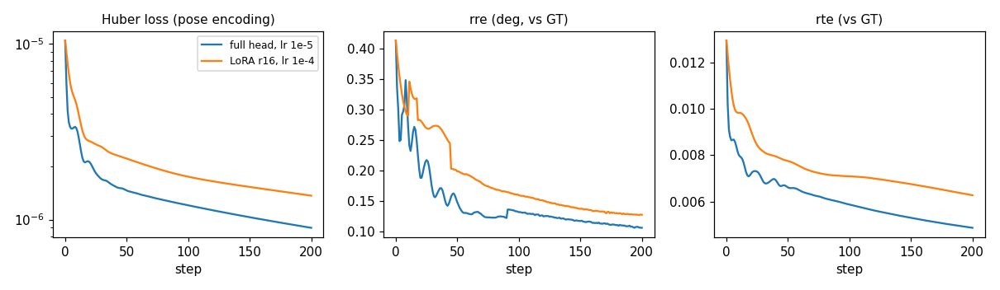
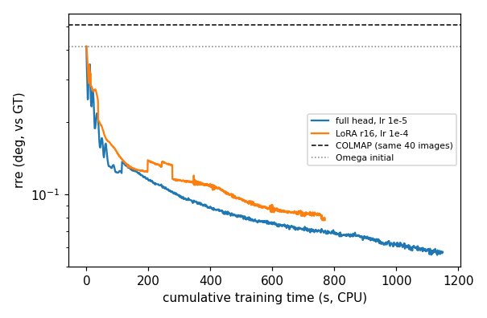
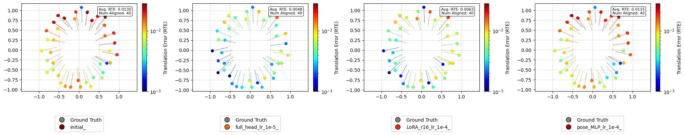
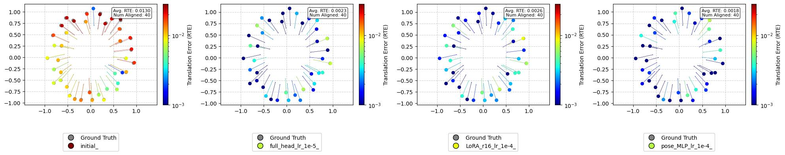

# Omega camera head fine-tuned directly against GT cameras (smoke test, no rendering)

## Question
Smoke test: fine-tune only the VGGT-Omega camera head against ground-truth camera poses, with the GT aligned to the
head's first (initial) output. No 3DGS training, no rendering. Also timing, more steps, a camera plot and a COLMAP reference.

## Setup
- Scene: Mip-NeRF 360 `bonsai`, 40 training images, Omega 512 checkpoint, reconstruction
  `bonsai_2_n40_s42_omega_c0.0_p100000_random_minfarthestpose` (cache `bonsai_2_cache_n40_s42_omega_minfarthestpose/raw_preds.pt`).
- Cached final-layer camera+register tokens of all 40 frames; the camera head runs on all 40 frames with gradient every step.
- Targets: GT cameras (`data/360_v2/bonsai`, factor 2) aligned once at step 0 to the initial predicted cameras with
  `stochastic_umeyama_alignment` on camera centres (scale s, R, t; GT rotations multiplied by R); then fixed.
  Targets are encoded as the 9-D Omega pose encoding (T, quaternion, fov_h, fov_w) in the Omega world frame
  (quaternion sign chosen to match the initial prediction). fov comes from the GT intrinsics scaled to the network
  resolution (624x416) per axis. Filled gap (not decided by the user): fov is part of the loss.
- Loss: Huber (`smooth_l1`) on the pose encoding, mean over all 40 x 9 values.
- Optimiser: Adam, constant lr. Filled gaps: 1000 steps; full head lr 1e-5; LoRA r16 (alpha 16) lr 1e-4.
- Metrics per step: mean rre (deg) / rte, GT aligned to the current predicted cameras (same `calculate_metrics` call as
  the trainer's `eval_rre`/`eval_rte`), trainer frame (`Parser(normalize=True)`), on the 40 training frames. Step 0 equals
  the Omega baseline (rre 0.4134, rte 0.01296).
- Timing per step: `t_train_s` = forward + backward + optimiser step; `t_eval_s` = re-predict cameras + loss + rre/rte (not training).
- Device: CPU (all four GPUs had other users' jobs at launch), 32 torch threads on a shared machine with load average ~48;
  the two arms ran one after the other. Seed 42.
- COLMAP reference: the existing COLMAP reconstruction of the same 40 images
  (`../vggt/colmap_outputs/bonsai_2_n40_s42_default_minfarthestpose_sharedcam`, shared camera), scored with
  `examples/colmap_reference_metrics.py` (same code path as above: `Parser(normalize=True)`, GT aligned to the predictions).
- Scripts: `examples/camera_head_gt_smoke.py`, `examples/colmap_reference_metrics.py`, `make_figures.py`, `make_camera_plot.py`.

## Launch
```bash
cd ~/work/git/gsplat
C="--device cpu --cache_file ../vggt/vggt_outputs/bonsai_2_cache_n40_s42_omega_minfarthestpose/raw_preds.pt \
   --data_dir ../vggt/vggt_outputs/bonsai_2_n40_s42_omega_c0.0_p100000_random_minfarthestpose \
   --gt_dir ../vggt/data/360_v2/bonsai --steps 1000 --snapshots 200 1000"
CUDA_VISIBLE_DEVICES= env -u PYTHONPATH $HOME/.conda/envs/gsplat/bin/python examples/camera_head_gt_smoke.py $C --lr 1e-5 --out full_lr1e-5.jsonl
CUDA_VISIBLE_DEVICES= env -u PYTHONPATH $HOME/.conda/envs/gsplat/bin/python examples/camera_head_gt_smoke.py $C --lora --lr 1e-4 --out lora16_lr1e-4.jsonl
# COLMAP reference
CUDA_VISIBLE_DEVICES= env -u PYTHONPATH $HOME/.conda/envs/gsplat/bin/python examples/colmap_reference_metrics.py \
  ../vggt/colmap_outputs/bonsai_2_n40_s42_default_minfarthestpose_sharedcam ../vggt/data/360_v2/bonsai
# figures (camera plot runs in the vggt env, from ~/work/git)
python experiments/2026-11-11_camera_head_gt_smoke/make_figures.py
env -u PYTHONPATH ~/.conda/envs/vggt/bin/python gsplat/experiments/2026-11-11_camera_head_gt_smoke/make_camera_plot.py 200   # and 1000
```

## Run metadata
- gsplat: commit `cf01bf02` + uncommitted changes (`--snapshots`/timing in `camera_head_gt_smoke.py`, committed with this update); vggt: `add5873`.
- Env: conda `gsplat`, shell `PYTHONPATH` unset; `vggt_omega` imported from `~/work/git/vggt-omega` (`48b23c8`).
- Files here: `full_lr1e-5.jsonl`, `lora16_lr1e-4.jsonl` (per step), `*.log`, `*_cameras.npz` (initial cameras, cameras at steps 200 and 1000, GT),
  `first_200step_run/` (the earlier 200-step run without timing; its step-200 values are identical to this run's step-200 values).

## Results
Per-step loss, rre, rte and training time per step. Dashed/dotted lines: COLMAP on the same 40 images and the Omega initial prediction:



rre against cumulative training time (forward + backward + optimiser step only; per-step evaluation time excluded):



Mean over the 40 train frames (loss / rre deg / rte):

| Step | Full head lr 1e-5 | LoRA r16 lr 1e-4 |
|---|---|---|
| 0 | 1.05e-5 / 0.4134 / 0.01296 | 1.05e-5 / 0.4134 / 0.01296 |
| 50 | 1.46e-6 / 0.1482 / 0.00661 | 2.23e-6 / 0.1989 / 0.00775 |
| 100 | 1.21e-6 / 0.1320 / 0.00587 | 1.76e-6 / 0.1596 / 0.00709 |
| 200 | 8.99e-7 / 0.1064 / 0.00486 | 1.37e-6 / 0.1277 / 0.00627 |
| 500 | 4.69e-7 / 0.0765 / 0.00343 | 6.78e-7 / 0.1104 / 0.00371 |
| 1000 | 2.22e-7 / 0.0574 / 0.00235 | 3.22e-7 / 0.0780 / 0.00262 |

Reference (same 40 images, same metric code):

| Cameras | rre (deg) | rte |
|---|---|---|
| COLMAP (40 images, shared camera) | 0.5092 | 0.05524 |
| Omega initial prediction | 0.4131 | 0.01296 |

rre is independent of the world normalisation; rte depends on it (`Parser(normalize=True)` of each reconstruction). The
vggt repo's own `eval_results.json` for the same COLMAP run reports rte 0.2305 in a different frame.

Timing (CPU, 1000 steps; seconds per step):

| Arm | train mean / median / min / max | eval mean | total wall time |
|---|---|---|---|
| Full head lr 1e-5 (203.6M trainable params) | 1.150 / 1.097 / 0.799 / 3.019 | 0.372 | 1522.9 s |
| LoRA r16 lr 1e-4 | 0.770 / 0.709 / 0.489 / 3.440 | 0.398 | 1169.2 s |

Camera plots (`plot_extrinsics` from `vggt/plot_cameras.py`, RTE colours; GT aligned to each series' predictions with Umeyama;
left to right: initial prediction, full head, LoRA; GT frustums drawn with the initial predicted intrinsics, shape only):




## GPU vs CPU timing (40 images)
Same fine-tuning (1000 steps, same arguments, seed 42) on one NVIDIA L40S (GPU 0, idle at launch; `--device cuda`, run 14 Nov 14:37 to 14:40 through
`queue_gpu_timing.sh`, which waited for an idle GPU) vs the CPU runs above. Output files: `gpu_full.*`, `gpu_lora.*` (jsonl, log, cameras npz) in this folder.

| Arm | Device | train mean / median / min / max (s/step) | eval mean (s) | total wall time | step-1000 rre / rte |
|---|---|---|---|---|---|
| Full head lr 1e-5 | CPU | 1.150 / 1.097 / 0.799 / 3.019 | 0.372 | 1522.9 s | 0.0574 / 0.00235 |
| Full head lr 1e-5 | GPU | 0.063 / 0.052 / 0.050 / 0.130 | 0.028 | 93.2 s | 0.0568 / 0.00235 |
| LoRA r16 lr 1e-4 | CPU | 0.770 / 0.709 / 0.489 / 3.440 | 0.398 | 1169.2 s | 0.0780 / 0.00262 |
| LoRA r16 lr 1e-4 | GPU | 0.025 / 0.025 / 0.022 / 0.110 | 0.026 | 51.0 s | 0.0780 / 0.00265 |

The GPU trajectories are close to but not identical with the CPU ones (e.g. step 0 loss 1.05e-5 in both; step-1000 values above).
The GPU timing includes `torch.cuda.synchronize` around the training step; the CPU runs shared a machine with load average ~48.

## 255 training images (CPU)
Same fine-tuning on the 255-image Omega reconstruction (`bonsai_2_n255_s42_omega_c0.0_p100000_random_farthestpose`, cache
`bonsai_2_cache_n255_s42_omega_farthestpose/raw_preds.pt`), CPU, 32 threads on a shared machine, 1000 steps, snapshots at 200 and 1000, seed 42, run one arm after the other
as part of the `omega_cameras_7k_full` pipeline (see `../2026-11-13_omega_cameras_7k/README.md`). Files in `n255/`: `*.jsonl`, `*.log`, `*_cameras.npz`.
Step 0 equals the 255-image Omega baseline (rre 0.3993, rte 0.01156).

Mean over the 255 frames (loss / rre deg / rte):

| Step | Full head lr 1e-5 | LoRA r16 lr 1e-4 |
|---|---|---|
| 0 | 7.20e-6 / 0.3993 / 0.01156 | 7.20e-6 / 0.3993 / 0.01156 |
| 50 | 1.58e-6 / 0.1692 / 0.00637 | 2.19e-6 / 0.2120 / 0.00746 |
| 100 | 1.32e-6 / 0.1530 / 0.00572 | 1.85e-6 / 0.1779 / 0.00701 |
| 200 | 1.08e-6 / 0.1364 / 0.00507 | 1.39e-6 / 0.1541 / 0.00591 |
| 500 | 7.76e-7 / 0.1198 / 0.00439 | 8.54e-7 / 0.1363 / 0.00477 |
| 1000 | 5.50e-7 / 0.1084 / 0.00391 | 5.48e-7 / 0.1253 / 0.00422 |

Timing (CPU, 1000 steps; seconds per step):

| Arm | train mean / median / min / max | eval mean | total wall time |
|---|---|---|---|
| Full head lr 1e-5 | 10.015 / 9.960 / 8.646 / 12.207 | 2.646 | 12667.1 s |
| LoRA r16 lr 1e-4 | 9.377 / 9.344 / 8.334 / 11.697 | 3.635 | 13019.8 s |

## Failed / missing runs, confounds
- No failed runs. The first 200-step run was repeated inside the 1000-step runs (restarted once, a few minutes in, to add
  camera snapshots at steps 200 and 1000).
- Only the 40 training frames are in the loss and the metrics (no held-out views); the GT alignment is fitted on the same
  40 camera centres that are evaluated.
- Single seed, one lr per arm, CPU on a loaded shared machine (timings are affected by other users' jobs).
- The camera plot aligns GT with plain Umeyama on all 40 centres; the metrics use `stochastic_umeyama_alignment`.

## Insights
To be filled by the user.
