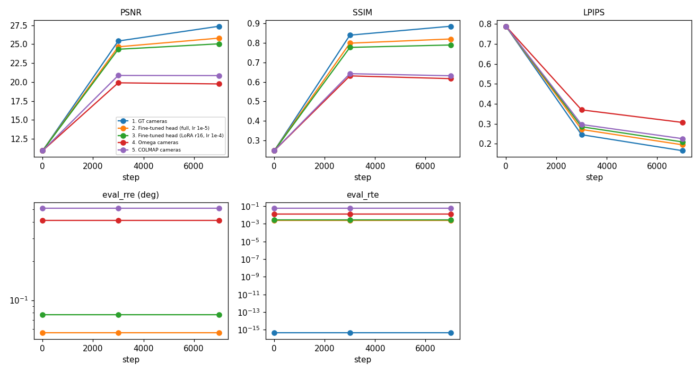
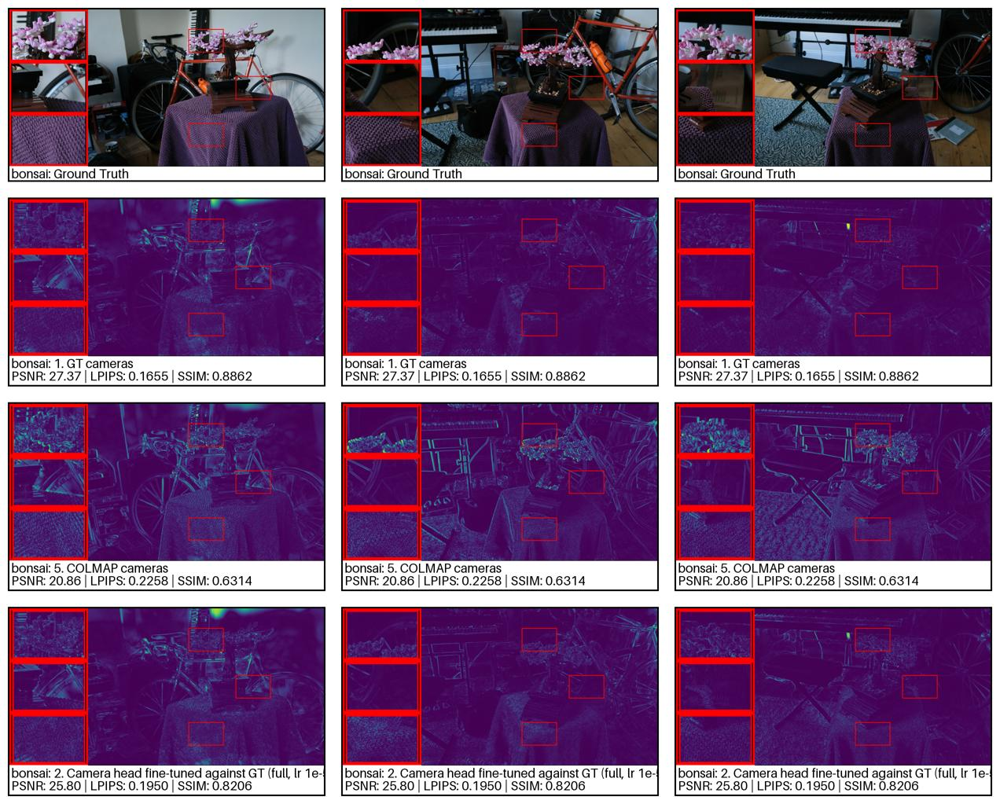
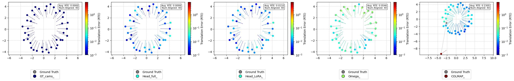
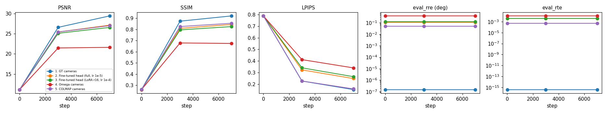
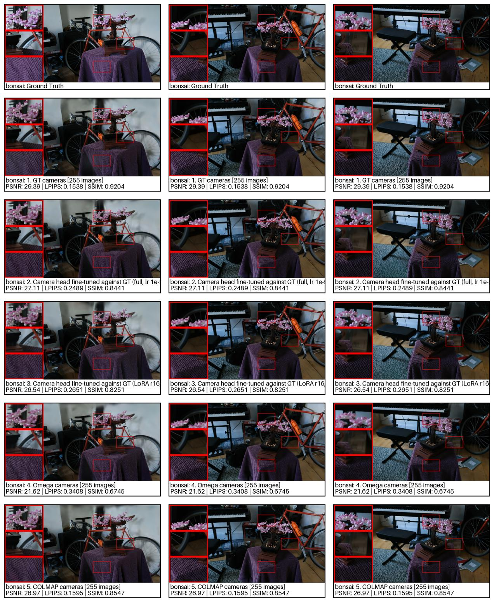
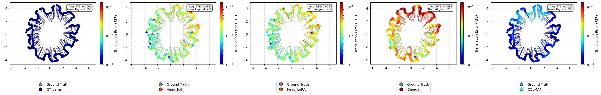

# 3DGS with five sets of cameras and the same Omega point cloud (bonsai, 7000 steps)

## Question
Train the same 3DGS scene for 7000 steps with each of five camera sets (cameras fixed during training): GT, camera head
fine-tuned against GT (full head and LoRA), Omega initial prediction, COLMAP.

## Setup
- Scene: Mip-NeRF 360 `bonsai`, 40 training images (`minfarthestpose`, seed 42), 30 evaluation images, `eval_data_factor=2`,
  `data_factor=1`. Experiment `omega_cameras_7k` (group 102) in `experiment_runner.py`.
- Trainer: `simple_trainer.py mcmc`, 7000 steps, MCMC densification with `cap_max=1_000_000`, no pose optimiser, no
  camera-head training, cameras fixed. Evaluation at steps 1, 3000, 7000 (trainer's fixed eval steps). PLY saved at 7000.
- Points: the same 100K random points of the VGGT-Omega reconstruction in every arm (`sampling_mode=random`).
  Intrinsics come from each arm's own camera source.
- Evaluation: `gt_eval`; GT test cameras are aligned to the (fixed) training cameras with Umeyama and `eval_rre`/`eval_rte`
  are measured against GT. They are therefore constant over steps within an arm.

| Arm | Cameras | How built |
|---|---|---|
| 1 | GT | `choice=combined`, `camera_src=gt`, `pcd_src=vggt` (Omega): GT cameras copied into the Omega reconstruction, points aligned to the cameras (global Umeyama) |
| 2 | Camera head fine-tuned against GT, full head lr 1e-5, step 1000 | `ft_cams=full`: `vggt/make_ft_cameras.py` writes a copy of the Omega reconstruction with the cameras (poses and fov-derived intrinsics) from `../2026-11-11_camera_head_gt_smoke/full_lr1e-5_cameras.npz` |
| 3 | Camera head fine-tuned against GT, LoRA r16 lr 1e-4, step 1000 | `ft_cams=lora`, `lora16_lr1e-4_cameras.npz` |
| 4 | Omega initial prediction | plain Omega reconstruction (`choice=vggt`, `model=omega`) |
| 5 | COLMAP (same 40 images, shared camera, `default` mode) | `choice=combined`, `camera_src=colmap`, `pcd_src=vggt` |

## Launch
(`queue_omega7k.sh` in this folder is the idle-GPU queue script that launched the 40-image trainers.) Reconstruction (CPU only, cached Omega and COLMAP reconstructions reused), then the trainers through a queue script that
waited for an idle GPU:
```bash
cd ~/work/git/gsplat
env -u PYTHONPATH PATH=$HOME/.conda/envs/gsplat/bin:$PATH python experiment_runner.py \
  --experiment_names omega_cameras_7k --dataset_name bonsai --dataset_collections \
  --do_reconstruct --skip_plotting --cuda_visible_devices 0
python experiments/2026-11-13_omega_cameras_7k/collect.py && python experiments/2026-11-13_omega_cameras_7k/make_figures.py
```

## Run metadata
- gsplat commit `0116ceee` (`ft_cams`, `omega_cameras_7k`); the `val_steps` of the experiment definition (listed 1, 1000, 3000, 5000, 7000 at run time,
  the trainer evaluates at 1, 3000, 7000) was corrected afterwards to `[1, 3000, 7000]` (committed with this log).
  vggt commit `34fc5bc` (contains `make_ft_cameras.py`).
- Envs: conda `gsplat` (trainer), `vggt` (reconstruction and camera variants), `PYTHONPATH` unset. Hardware: one GPU (index 0), launched 12 Nov 18:54, finished 19:09 (other users' jobs on the other GPUs).
- Run directories (`results/`, gitignored):
  - `combined_outputs/bonsai_2_n40_s42_omega_combined_gtcams_vggtpcd_amglobal_default_c0.0_p100000_random_minfarthestpose_sharedcam_i40_gteval_steps7000`
  - `vggt_outputs/bonsai_2_n40_s42_omega_c0.0_p100000_random_minfarthestpose_i40_gteval_ftcams-full_steps7000`
  - `vggt_outputs/bonsai_2_n40_s42_omega_c0.0_p100000_random_minfarthestpose_i40_gteval_ftcams-lora_steps7000`
  - `vggt_outputs/bonsai_2_n40_s42_omega_c0.0_p100000_random_minfarthestpose_i40_gteval_steps7000`
  - `combined_outputs/bonsai_2_n40_s42_omega_combined_colmapcams_vggtpcd_amglobal_default_c0.0_p100000_random_minfarthestpose_sharedcam_i40_gteval_steps7000`
- Raw numbers: `metrics.csv` (from `results/*/stats/val_step*.json`).

## Results


PSNR / SSIM / LPIPS at the evaluation steps, and the camera errors (constant over steps):

| Arm | Step 1 | Step 3000 | Step 7000 | eval_rre (deg) | eval_rte |
|---|---|---|---|---|---|
| 1. GT | 10.95 / 0.246 / 0.789 | 25.42 / 0.840 / 0.245 | 27.37 / 0.886 / 0.165 | 0.0000 | 0.00000 |
| 2. Full head lr 1e-5 | 10.95 / 0.246 / 0.789 | 24.65 / 0.799 / 0.272 | 25.80 / 0.821 / 0.195 | 0.0560 | 0.00235 |
| 3. LoRA r16 lr 1e-4 | 10.95 / 0.246 / 0.789 | 24.33 / 0.777 / 0.285 | 25.05 / 0.790 / 0.209 | 0.0775 | 0.00262 |
| 4. Omega initial | 10.95 / 0.246 / 0.789 | 19.90 / 0.631 / 0.370 | 19.76 / 0.617 / 0.307 | 0.4131 | 0.01296 |
| 5. COLMAP | 10.95 / 0.246 / 0.789 | 20.88 / 0.642 / 0.297 | 20.86 / 0.631 / 0.226 | 0.5092 | 0.05524 |

Renders (runner plot config of `omega_cameras_7k`: `render_nums=[0, 2, 5]`, `max_render_cols=3`, ground truth row, zoom boxes,
plain renders at step 7000; produced by `--plot_only`, copy of `latest_plots/102_omega_cameras_7k_bonsai_latest_renders.jpg`).
Rows: ground truth, then arms 1 to 5 (row order fixed in `vggt/plot_metrics.py`: the categorical order came from `list(set(...))`, now `dict.fromkeys`):



Cameras of the five sets (`make_camera_plot.py`, `plot_extrinsics` from `vggt/plot_cameras.py`, RTE-coloured; predicted cameras
from each run's `aligned_cameras.json`, i.e. aligned to the GT world, so the RTE values are in the GT frame and differ from
`eval_rte`; left to right: GT, full head, LoRA, Omega, COLMAP). Average RTE shown in the plots: GT 0.0000, full head
0.0099, LoRA 0.0110, Omega 0.0546, COLMAP 0.2305 (the same 40 training cameras in every panel); one COLMAP camera lies far from the others in the plot:



Gaussian count: 100,000 at step 1, 322,497 at step 3000, 1,000,000 at step 7000 in every arm.

## Failed / missing runs, confounds
- All five runs completed; no failed or missing runs.
- Single scene, single seed, one run per arm, no determinism check.
- The camera errors `eval_rre`/`eval_rte` are properties of the fixed cameras (they do not change during training).
- Camera sets differ in more than pose accuracy: each arm uses its own intrinsics (GT: the GT camera intrinsics as copied by `combine_clouds`; heads: fov of the head; COLMAP: shared camera focal; Omega: predicted fov).
- The point cloud is the Omega cloud in every arm; in arms 1 and 5 it is aligned to the cameras with a global Umeyama sim(3)
  (`combine_clouds`, mean RRE/RTE between the COLMAP and Omega cameras after alignment 0.72 deg / 0.256), in arms 2 and 3 the
  cameras were mapped into the Omega reconstruction frame with an exact similarity fitted on the initial cameras.
- The arm 2 and 3 cameras were fine-tuned against the same GT cameras used for the evaluation (on the 40 training frames).
- Variant 2/3 camera check: scoring the written variant against GT gave rre 0.056 / rte 0.002351 (full head), against 0.0574 / 0.002353 in the smoke test.
- All five arms train on the same 40 images (every data directory's `sparse/` model holds the same 40 images) and are evaluated on the same test images.
- The three evaluation steps are the trainer's fixed ones (the experiment definition listed 1000 and 5000 too; they were never evaluated).

## 255 training images (full set of cameras)
Same five-arm experiment with all 255 training images instead of 40. Experiment `omega_cameras_7k_full` (group 103) in
`experiment_runner.py`. "Full set" is read as the runner's training maximum (`int(292 * 7/8)` = 255 of the 292 bonsai images; the rest are the
evaluation images, `test_every=8`). Everything else as above: 7000 steps, MCMC cap 1M, frozen cameras, seed 42, 100K Omega points, evaluation
at steps 1, 3000, 7000, `eval_data_factor=2`.

Differences from the 40-image setup (facts):
- Image selection mode `farthestpose` (the runner switches from `minfarthestpose` when the training set is the maximum), not `minfarthestpose`.
- The VGGT 100-image cap of the runner is lifted for `model=omega` (the Omega reconstruction ran on all 255 images in one pass, no out-of-memory).
- Camera head fine-tuning, per arm 1000 steps, **on CPU** (decided by the user), against the GT cameras aligned once to the initial output
  (same `camera_head_gt_smoke.py` as the smoke test, outputs in `../2026-11-11_camera_head_gt_smoke/n255/`): full head lr 1e-5, LoRA r16 lr 1e-4,
  step-1000 snapshots used for arms 2 and 3. Camera-head results and timings: see the n255 tables in the smoke-test log.
- Arm 5 uses the existing COLMAP reconstruction of the 255 images (`bonsai_2_n255_s42_default_farthestpose_sharedcam`).

Launch (`pipeline_n255.py` in this folder; stages: Omega reconstruction on an idle GPU, the two CPU fine-tunings one after the other,
`reconstruct()` of arms 1, 2, 3 and 5, then the runner):
```bash
python examples/camera_head_gt_smoke.py --device cpu --cache_file ../vggt/vggt_outputs/bonsai_2_cache_n255_s42_omega_farthestpose/raw_preds.pt \
  --data_dir ../vggt/vggt_outputs/bonsai_2_n255_s42_omega_c0.0_p100000_random_farthestpose --gt_dir ../vggt/data/360_v2/bonsai \
  --steps 1000 --snapshots 200 1000 [--lr 1e-5 | --lora --lr 1e-4] --out experiments/2026-11-11_camera_head_gt_smoke/n255/<name>.jsonl
env -u PYTHONPATH PATH=$HOME/.conda/envs/gsplat/bin:$PATH python experiment_runner.py --experiment_names omega_cameras_7k_full \
  --dataset_name bonsai --dataset_collections --skip_plotting --cuda_visible_devices 0
python experiments/2026-11-13_omega_cameras_7k/collect.py 255   # in the gsplat env: make_figures.py 255
env -u PYTHONPATH ~/.conda/envs/vggt/bin/python make_camera_plot.py 255     # renders: runner --plot_only
```

Run metadata: gsplat `1e83b1a1` + uncommitted changes (`collect.py`/`make_figures.py`/`make_camera_plot.py` take the image count, committed with this section); vggt `1a439fd`.
Omega reconstruction started 14 Nov 14:34 on GPU 0 (other users' jobs on the other GPUs); CPU fine-tuning ran afterwards (12667 s and 13020 s);
the five 3DGS runs ran on GPU 0 from 21:46 and the runner exited with code 0 at 22:01. Raw numbers: `metrics_n255.csv`.
Run directories (`results/`): the same names as above with `n255`, `farthestpose` and `i255` (e.g.
`vggt_outputs/bonsai_2_n255_s42_omega_c0.0_p100000_random_farthestpose_i255_gteval_ftcams-full_steps7000`).



PSNR / SSIM / LPIPS and camera errors (255 images; camera errors constant over steps):

| Arm | Step 1 | Step 3000 | Step 7000 | eval_rre (deg) | eval_rte |
|---|---|---|---|---|---|
| 1. GT | 11.17 / 0.262 / 0.789 | 26.56 / 0.874 / 0.227 | 29.39 / 0.920 / 0.154 | 0.0000 | 0.00000 |
| 2. Full head lr 1e-5 | 11.17 / 0.262 / 0.788 | 25.41 / 0.810 / 0.324 | 27.11 / 0.844 / 0.249 | 0.1089 | 0.00390 |
| 3. LoRA r16 lr 1e-4 | 11.17 / 0.262 / 0.788 | 25.09 / 0.796 / 0.341 | 26.54 / 0.825 / 0.265 | 0.1258 | 0.00420 |
| 4. Omega initial | 11.17 / 0.262 / 0.788 | 21.47 / 0.679 / 0.412 | 21.62 / 0.675 / 0.341 | 0.3994 | 0.01160 |
| 5. COLMAP | 11.17 / 0.262 / 0.788 | 25.42 / 0.826 / 0.228 | 26.97 / 0.855 / 0.160 | 0.0515 | 0.00050 |

Renders (`render_nums=[0, 2, 5]`, 3 columns, step 7000; copy of `latest_plots/103_omega_cameras_7k_full_bonsai_latest_renders.jpg`; rows: ground truth, arms 1 to 5):



Cameras (same plot as for 40 images; Average RTE in the plots, GT frame: GT 0.0000, full head 0.0163, LoRA 0.0176, Omega 0.0481, COLMAP 0.0021; 255 cameras in every panel):



Gaussian count: 100,000 at step 1, 322,497 at step 3000, 1,000,000 at step 7000 in every arm.

Failed / missing runs, confounds (255 images):
- All five runs completed. One earlier launch of the pipeline script crashed at start-up on an import error (before any stage ran) and was relaunched.
- Single seed, no determinism check. Fine-tuning on CPU (32 threads, shared machine); on the 40-image case a GPU rerun of the same fine-tuning gave step-1000 rre 0.0568 (full) vs 0.0574 on CPU, so the cameras are not bit-identical across devices.
- Arms 2 and 3 cameras were fine-tuned against the same GT cameras used for the evaluation (on all 255 training frames).
- The 255-image runs differ from the 40-image runs in image selection mode, number of images, and the Omega reconstruction itself (all images in one pass), as listed above.
- The rte values depend on each reconstruction's world normalisation (see the smoke-test log).

## Insights
To be filled by the user.
