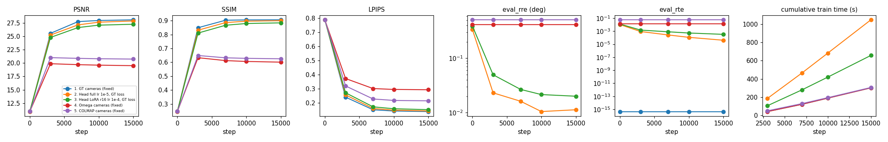
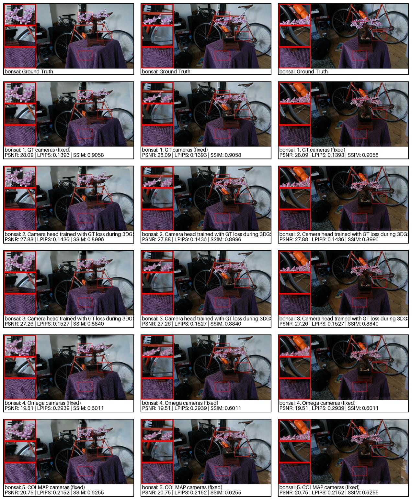

# Camera head trained during 3DGS with a GT camera loss (bonsai, 15000 steps)

## Question
Can the VGGT-Omega camera head be fine-tuned while the 3DGS scene is trained, with the GT cameras as the (only) loss signal for
the head, so that image metrics improve relative to the fixed Omega cameras? How much slower does training become on a GPU?
Fixed GT, Omega and COLMAP cameras are the baselines.

## Setup
- Scene: Mip-NeRF 360 `bonsai`, 40 training images (`minfarthestpose`, seed 42), `data_factor=1`, `eval_data_factor=2`.
  Experiment `omega_camft_gt_15k` (group 104) in `experiment_runner.py`.
- Trainer: `simple_trainer.py mcmc`, 15000 steps, MCMC densification with `cap_max=1_000_000`, no pose optimiser, the same 100K random
  Omega points in every arm (`sampling_mode=random`). Evaluation at steps 1, 3000, 7000, 10000, 15000 (trainer eval steps).
- Camera-head arms (`camft`, `camft_gt_loss`, delay 0): the head runs on all 40 frames every step with gradient. The rendered view's camera comes
  from the head but is detached, so the render loss trains only the Gaussians; the head is trained only with the GT loss, weight 1 (added to the
  total loss after `loss_multiplier`): Huber (`smooth_l1`) on the 9-D pose encoding (T, quaternion, fov_h, fov_w), the GT cameras aligned once
  to the head's initial output with Umeyama sim(3) on the camera centres (same targets as the smoke test,
  `camera_finetune.gt_pose_targets`). Adam constant lr: full head 1e-5, LoRA r16 (alpha 16) 1e-4. Abort if a training frame has no GT camera.
- Evaluation (`eval_all_frames`): every frame of the GT eval set (292 frames) that is not one of the 40 training frames: **252 evaluation images**,
  rendered with the GT cameras aligned (Umeyama on the 40 common frames) to the current training cameras. `eval_rre`/`eval_rte` are measured on the
  40 training cameras against GT (aligned to the current cameras, as in the earlier logs). In the fixed-camera arms they are constant.
- Timing: `train_time_s` in each `stats/val_step*.json` is the cumulative wall time of the training steps (CUDA-synchronised at the start and end
  of every step, evaluation excluded). It is measured identically in all arms.
- Camera-head arms need `raw_preds.pt` of the Omega reconstruction (cached camera tokens); the Omega, GT and COLMAP reconstructions were reused.

| Arm | Cameras |
|---|---|
| 1 | GT, fixed (`combined`, `camera_src=gt`, `pcd_src=vggt`) |
| 2 | Omega camera head, full, lr 1e-5, GT loss during 3DGS |
| 3 | Omega camera head, LoRA r16, lr 1e-4, GT loss during 3DGS |
| 4 | Omega initial cameras, fixed |
| 5 | COLMAP cameras, fixed (same 40 images, shared camera) |

## Launch
```bash
cd ~/work/git/gsplat
SKIP_SMOKE=1 experiments/2026-11-16_omega_camft_gt_15k/queue.sh   # waits for one idle GPU, then runs (GPU=<index> pins one):
#   env -u PYTHONPATH PATH=$HOME/.conda/envs/gsplat/bin:$PATH python experiment_runner.py --experiment_names omega_camft_gt_15k \
#     --dataset_name bonsai --dataset_collections --do_reconstruct --skip_plotting --cuda_visible_devices <gpu index>
python experiments/2026-11-16_omega_camft_gt_15k/collect.py && python experiments/2026-11-16_omega_camft_gt_15k/make_figures.py   # gsplat env
# renders: the runner with --plot_only, copy of latest_plots/104_omega_camft_gt_15k_bonsai_latest_renders.jpg
```

## Run metadata
- gsplat commit `b3530600` (experiment, `camft_gt_loss`, `eval_all_frames`, `train_time_s`, `eval_all` reset for the GT reference config);
  vggt commit `8be408e` (`eval_all` plot parameter). Conda `gsplat`, `PYTHONPATH` unset, server `gxp-l40s-2` (NVIDIA L40S GPUs shared with other users).
- Final runs: GPU 2, queue launched 16 Nov 15:35:42, runner exit 0 at 16:45:58, the five runs one after the other on that single GPU.
  At launch no process of another user was on GPU 2; I did not log other users' processes during the runs
  (when checked about 14 hours later other users' jobs were on GPU 2).
- Run directories (`results/`, gitignored), suffix `_evalall_steps15000`:
  - `combined_outputs/bonsai_2_n40_s42_omega_combined_gtcams_vggtpcd_amglobal_default_c0.0_p100000_random_minfarthestpose_sharedcam_i40_gteval_...`
  - `vggt_outputs/bonsai_2_n40_s42_omega_c0.0_p100000_random_minfarthestpose_i40_gteval_cft-1e-05-full-d0-gtloss_...`
  - `vggt_outputs/bonsai_2_n40_s42_omega_c0.0_p100000_random_minfarthestpose_i40_gteval_cft-0.0001-lora16-d0-gtloss_...`
  - `vggt_outputs/bonsai_2_n40_s42_omega_c0.0_p100000_random_minfarthestpose_i40_gteval_...`
  - `combined_outputs/bonsai_2_n40_s42_omega_combined_colmapcams_vggtpcd_amglobal_default_c0.0_p100000_random_minfarthestpose_sharedcam_i40_gteval_...`
- Raw numbers: `metrics.csv` (from `results/*/stats/val_step*.json`); per-step head drift: `stats/ft_drift.jsonl` of the head runs.

## Results


PSNR / SSIM / LPIPS over the 252 evaluation images (Gaussian count: 100,000 at step 1, 322,497 at 3000, 1,000,000 from 7000, in every arm):

| Arm | Step 1 | Step 3000 | Step 7000 | Step 10000 | Step 15000 |
|---|---|---|---|---|---|
| 1. GT (fixed) | 10.93 / 0.246 / 0.789 | 25.56 / 0.849 / 0.242 | 27.76 / 0.903 / 0.152 | 27.97 / 0.905 / 0.143 | 28.09 / 0.906 / 0.139 |
| 2. Head full, GT loss | 10.93 / 0.245 / 0.790 | 25.24 / 0.831 / 0.258 | 27.15 / 0.886 / 0.161 | 27.65 / 0.896 / 0.149 | 27.88 / 0.900 / 0.144 |
| 3. Head LoRA, GT loss | 10.93 / 0.246 / 0.789 | 24.80 / 0.810 / 0.272 | 26.65 / 0.867 / 0.173 | 27.09 / 0.879 / 0.159 | 27.26 / 0.884 / 0.153 |
| 4. Omega (fixed) | 10.93 / 0.246 / 0.789 | 19.88 / 0.633 / 0.373 | 19.70 / 0.612 / 0.302 | 19.61 / 0.606 / 0.296 | 19.51 / 0.601 / 0.294 |
| 5. COLMAP (fixed) | 10.93 / 0.246 / 0.789 | 21.02 / 0.649 / 0.321 | 20.88 / 0.632 / 0.228 | 20.81 / 0.629 / 0.218 | 20.75 / 0.626 / 0.215 |

Camera errors of the 40 training cameras against GT (`eval_rre` deg / `eval_rte`; rte depends on the world normalisation of each run):

| Arm | Step 1 | Step 3000 | Step 7000 | Step 10000 | Step 15000 |
|---|---|---|---|---|---|
| 1. GT | 0 / 0 | 0 / 0 | 0 / 0 | 0 / 0 | 0 / 0 |
| 2. Head full | 0.3365 / 0.01023 | 0.0231 / 0.00088 | 0.0161 / 0.00026 | 0.0104 / 0.00011 | 0.0113 / 0.00004 |
| 3. Head LoRA | 0.3908 / 0.01246 | 0.0496 / 0.00146 | 0.0267 / 0.00080 | 0.0214 / 0.00052 | 0.0200 / 0.00032 |
| 4. Omega (fixed) | 0.4131 / 0.01296 | same | same | same | 0.4131 / 0.01296 |
| 5. COLMAP (fixed) | 0.5092 / 0.05524 | same | same | same | 0.5092 / 0.05524 |

(Step 1 is after the first update of the head; in the smoke test the initial Omega error is 0.4134 / 0.01296 at step 0.)

Training time (`train_time_s`, cumulative wall time of the training steps, one GPU):

| Arm | 3000 steps | 7000 | 10000 | 15000 | mean per step over 15000 | ratio to arm 4 (15000) |
|---|---|---|---|---|---|---|
| 1. GT (fixed) | 44 s | 123 s | 190 s | 303 s | 20.2 ms | 1.00 |
| 2. Head full, GT loss | 187 s | 465 s | 682 s | 1046 s | 69.7 ms | 3.46 |
| 3. Head LoRA, GT loss | 107 s | 280 s | 420 s | 657 s | 43.8 ms | 2.18 |
| 4. Omega (fixed) | 43 s | 122 s | 190 s | 302 s | 20.1 ms | 1.00 |
| 5. COLMAP (fixed) | 51 s | 130 s | 195 s | 306 s | 20.4 ms | 1.01 |

Renders (`render_nums=[0, 2, 5]`, 3 columns, step 15000, evaluation frames; rows: ground truth, arms 1 to 5):



## Failed / missing runs, confounds
- The final five runs completed. Earlier attempts, all discarded:
  - A first launch failed immediately in the runner on a config assertion (`eval_all needs gt_eval`: the GT reference config the runner builds with `choice=gt` resets `gt_eval`); fixed by also resetting `eval_all` there (the 60-step trainer smoke test before it had passed).
  - A relaunch passed the wrong GPU index to the runner, so about 2 minutes of trainers ran on a GPU I did not intend to use (physical GPU 0, another user's job on it); killed, no results kept.
  - A set of runs on GPU 3 (shared with other users' processes) was completed for run 1 and partially for run 2, then cancelled by the user; the user then asked to delete the runs that ran alongside other jobs. Their result directories were deleted and everything was rerun on GPU 2.
- Timing: other users' jobs on the same machine (CPU, other GPUs) are not controlled; GPU 2 had no other user's process at launch, and the three fixed-camera arms' times agree within 1.4% (302 to 306 s), but I did not record other users' GPU 2 activity during the runs.
- The camera-head arms differ from the fixed arms in more than camera accuracy: the head's cameras move during training, the head adds a forward and backward pass over all 40 frames every step, and arms 2 and 3 are trained against the same GT cameras used in the evaluation (on the 40 training frames).
- Single scene, single seed, one run per arm.
- No camera plot of the head cameras was produced for this experiment (the trainer saves no camera snapshots, and no checkpoints were saved).
- The evaluation set (252 frames, all non-training frames) and the step count differ from the earlier logs (30 test frames, 7000 steps), so numbers are not comparable with those.

## Insights
To be filled by the user.
