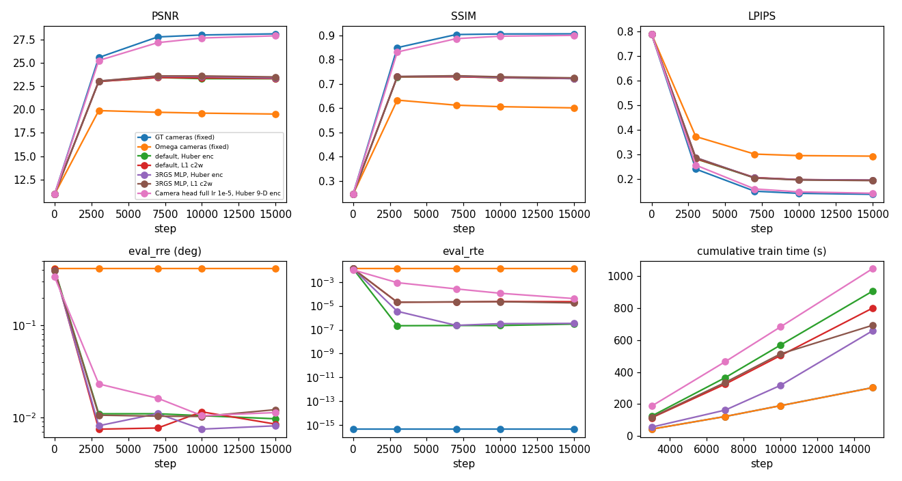
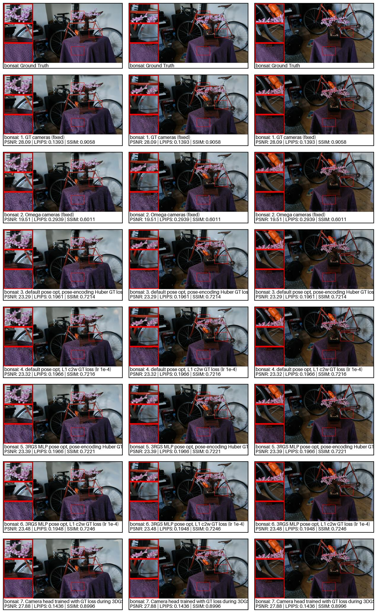
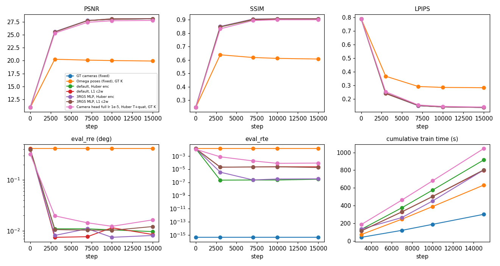
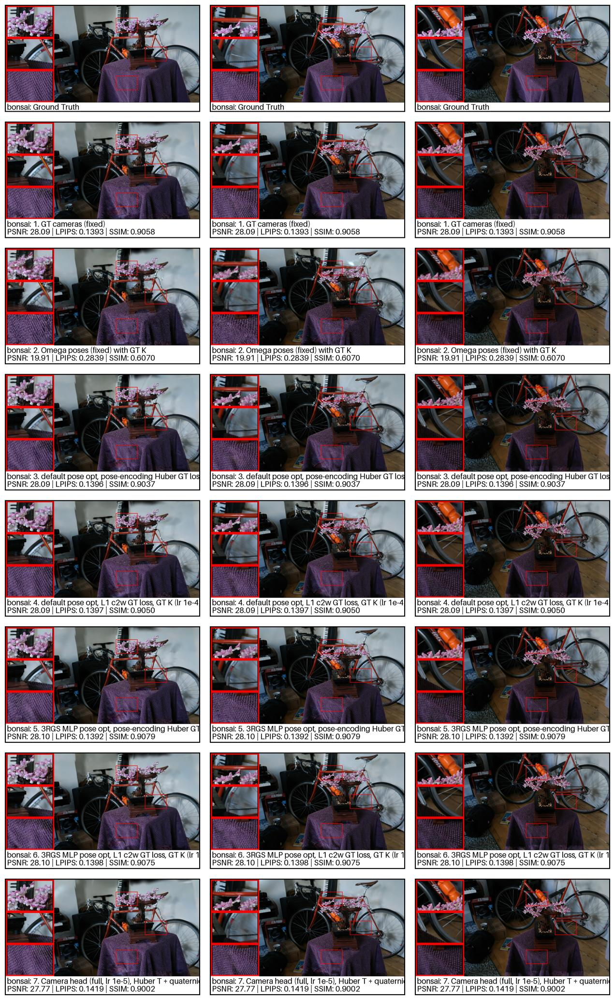

# gsplat pose-optimisation modules trained against GT poses, Omega vs GT intrinsics (bonsai, 15000 steps)

## Question
Two experiments in `experiment_runner.py`, both starting from the VGGT-Omega cameras:
1. `omega_pose_opt_loss` (group 105): how do the two gsplat pose-optimisation modules (`default` per-frame 6-D delta, `3rgs` MLP) behave when trained
   only against the GT poses, with two loss forms (Huber on the pose encoding, L1 on the c2w matrices)? Intrinsics: the Omega prediction.
2. `omega_pose_opt_gtk` (group 106, the K ablation): the same arms with the intrinsics fixed to the GT intrinsics, plus the Omega poses with GT intrinsics and no pose optimisation.

## Setup
- Scene, trainer, evaluation as in `experiments/2026-11-16_00_omega_camft_gt_15k` (bonsai, 40 training images `minfarthestpose` seed 42, `simple_trainer.py mcmc`, 15000 steps,
  MCMC `cap_max=1_000_000`, 100K random Omega points, evaluation on the 252 GT-eval frames that are not training frames, `eval_rre`/`eval_rte` on the 40 training cameras,
  `train_time_s` = cumulative CUDA-synchronised training-step time, evaluation excluded).
- Pose modules (`camft_module`, implemented in `MLPPoseFinetuner` in `examples/camera_finetune.py`): the camera head is frozen and not run; the module's output is applied to the initial Omega
  camera-to-world matrices. `default` = gsplat `CameraOptModule` (embedding per frame, 3-D position + 6-D rotation delta, zero-initialised); `3rgs` = `CameraOptModuleMLP` (as in the smoke test and arm 6
  of the previous experiment). Adam, lr 1e-4, no weight decay, constant, in all trained arms. The rendered view's camera is detached (the render loss trains only the Gaussians); the modules are trained only by the GT loss, weight 1,
  added after `loss_multiplier`.
- GT loss targets: the GT cameras aligned once to the initial Omega cameras (Umeyama sim(3) on the camera centres).
  - Huber: `smooth_l1` on the 7-D pose encoding (T, quaternion) of the Omega world frame (as in arm 6 before).
  - L1 c2w (`camft_gt_loss_type=l1_c2w`): mean absolute difference of the 3x4 camera-to-world matrices vs the aligned GT c2w, in the trainer's normalised frame.
- Intrinsics: in `omega_pose_opt_loss` the intrinsics stay at each frame's initial Omega prediction (no module changes them). In `omega_pose_opt_gtk` (`camft_gt_k`) the intrinsics of every
  rendered training view are the GT intrinsics of that frame (GT principal point included) scaled to the training image size, fixed. The maximum absolute difference to the Omega K entries is 32.55 px.
- The full camera head arm (7, `omega_pose_opt_loss` only) differs from the module arms in more than the module: it runs the head on all frames every step, its lr is 1e-5 (the earlier experiment's value, not 1e-4), its Huber loss is on all 9 pose-encoding dimensions including fov (the module arms use the 7 T + quaternion dimensions), and it was run on GPU 2 on 16 Nov. In `omega_pose_opt_gtk` arm 7 is a new run with GT K and the 7-dimension loss (fov dropped), so the two head arms differ in the loss dimensions as well as in K.
- Reused results (same config as earlier runs, skipped by the runner): GT cameras fixed (also the first arm of `omega_pose_opt_gtk`), Omega cameras fixed, and the 3RGS + Huber arm with Omega K
  (arm 6 of `omega_camft_gt_15k`, run on GPU 0 on 17 Nov 06:43 to 07:00). The GT baseline and Omega baseline were not asked for specifically; I added them to the first experiment (and GT fixed to the second).
- Extra run options introduced for this experiment: `camft_module` (`default` | `fixed`; `camft_mlp` = 3RGS), `camft_gt_loss_type`, `camft_gt_k`.

| `omega_pose_opt_loss` | Cameras / loss |
|---|---|
| 1 | GT cameras, fixed |
| 2 | Omega cameras, fixed |
| 3 | default module, Huber on pose encoding |
| 4 | default module, L1 c2w |
| 5 | 3RGS MLP, Huber on pose encoding (reused) |
| 6 | 3RGS MLP, L1 c2w |
| 7 | Camera head (full, lr 1e-5), Huber on the 9-D pose encoding incl. fov (reused; arm 2 of `omega_camft_gt_15k`, added after the first write-up) |

| `omega_pose_opt_gtk` (all with GT K) | Cameras / loss |
|---|---|
| 1 | GT cameras, fixed (reused) |
| 2 | Omega poses, fixed |
| 3 | default module, Huber |
| 4 | default module, L1 c2w |
| 5 | 3RGS MLP, Huber |
| 6 | 3RGS MLP, L1 c2w |
| 7 | Camera head (full, lr 1e-5, no LoRA), Huber on T + quaternion (fov dropped), GT K (`camft_gt_no_fov`, `camft_gt_k`); run 17 Nov 18:51 to 19:14 on GPU 0 through the same queue |
| 7 | Camera head (full, lr 1e-5, no LoRA), Huber on T + quaternion (fov dropped), GT K (`camft_gt_no_fov`, `camft_gt_k`; run 17 Nov 18:51 to 19:14 on GPU 0, same queue) |

## Launch
```bash
cd ~/work/git/gsplat
experiments/2026-11-17_00_omega_pose_opt_modules/queue.sh   # polls for a GPU at 0% utilisation with >= 6000 MiB free (GPU=<index> skips the wait), then:
#   env -u PYTHONPATH PATH=$HOME/.conda/envs/gsplat/bin:$PATH python experiment_runner.py --experiment_names omega_pose_opt_loss omega_pose_opt_gtk \
#     --dataset_name bonsai --dataset_collections --do_reconstruct --skip_plotting --cuda_visible_devices <gpu index>
python experiments/2026-11-17_00_omega_pose_opt_modules/collect.py && python experiments/2026-11-17_00_omega_pose_opt_modules/make_figures.py   # gsplat env
# renders: the runner with --plot_only for both experiments; copies of latest_plots/105_..._latest_renders.jpg and 106_..._latest_renders.jpg
```

## Run metadata
- gsplat commits `c4346fbd` (modules, loss type, GT K, experiments) and `9bfb7ad6` (queue polling); vggt `8be408e`. Conda `gsplat`, `PYTHONPATH` unset, server `gxp-l40s-2` (NVIDIA L40S, shared with other users).
- Runs: GPU 0, queue launched 17 Nov 12:26:11, runner exit 0 at 15:09:53; the trained arms one after the other. GPU 0 held another user's model server (`llama serve`, ~30 GB) during the runs and showed 95 to 100%
  utilisation at the two checks I made; other users' activity during the runs was not logged. The queue started the job when GPU 0 showed 0% utilisation on two consecutive checks.
- Run directories (`results/`, gitignored), suffix `_evalall_steps15000`, under `vggt_outputs/bonsai_2_n40_s42_omega_c0.0_p100000_random_minfarthestpose_i40_gteval_`: `cft-0.0001-pdef-d0-gtloss`, `cft-0.0001-pdef-d0-gtl1c2w`,
  `cft-0.0001-mlp-d0-gtloss` (reused), `cft-0.0001-mlp-d0-gtl1c2w`, `cft-0.0001-fixed-d0-gtk`, `cft-0.0001-pdef-d0-gtloss-gtk`, `cft-0.0001-pdef-d0-gtl1c2w-gtk`, `cft-0.0001-mlp-d0-gtloss-gtk`,
  `cft-0.0001-mlp-d0-gtl1c2w-gtk`; baselines: the GT-camera `combined_outputs/...gtcams...` run and `vggt_outputs/..._gteval_evalall_steps15000` (Omega fixed).
- Raw numbers: `metrics.csv` (from `results/*/stats/val_step*.json`).

## Results
PSNR / SSIM / LPIPS over the 252 evaluation images.

### `omega_pose_opt_loss` (Omega intrinsics)


| Arm | Step 1 | Step 3000 | Step 7000 | Step 10000 | Step 15000 |
|---|---|---|---|---|---|
| 1. GT (fixed) | 10.93 / 0.246 / 0.789 | 25.56 / 0.849 / 0.242 | 27.76 / 0.903 / 0.152 | 27.97 / 0.905 / 0.143 | 28.09 / 0.906 / 0.139 |
| 2. Omega (fixed) | 10.93 / 0.246 / 0.789 | 19.88 / 0.633 / 0.373 | 19.70 / 0.612 / 0.302 | 19.61 / 0.606 / 0.296 | 19.51 / 0.601 / 0.294 |
| 3. default, Huber | 10.94 / 0.246 / 0.789 | 23.00 / 0.729 / 0.283 | 23.42 / 0.730 / 0.206 | 23.30 / 0.725 / 0.199 | 23.29 / 0.721 / 0.196 |
| 4. default, L1 c2w | 10.95 / 0.246 / 0.789 | 22.99 / 0.729 / 0.284 | 23.42 / 0.729 / 0.207 | 23.38 / 0.726 / 0.199 | 23.32 / 0.722 / 0.197 |
| 5. 3RGS MLP, Huber | 10.93 / 0.246 / 0.789 | 23.04 / 0.730 / 0.288 | 23.56 / 0.732 / 0.206 | 23.52 / 0.727 / 0.199 | 23.39 / 0.722 / 0.197 |
| 6. 3RGS MLP, L1 c2w | 10.93 / 0.246 / 0.789 | 23.04 / 0.730 / 0.288 | 23.59 / 0.733 / 0.205 | 23.59 / 0.729 / 0.198 | 23.48 / 0.725 / 0.195 |
| 7. Camera head, full lr 1e-5 | 10.93 / 0.245 / 0.789 | 25.24 / 0.831 / 0.257 | 27.15 / 0.886 / 0.161 | 27.65 / 0.896 / 0.149 | 27.88 / 0.900 / 0.144 |

`eval_rre` (deg) / `eval_rte` of the 40 training cameras against GT (rte depends on the world normalisation of each run):

| Arm | Step 1 | Step 3000 | Step 7000 | Step 10000 | Step 15000 |
|---|---|---|---|---|---|
| 1. GT | 0 / 0 | 0 / 0 | 0 / 0 | 0 / 0 | 0 / 0 |
| 2. Omega (fixed) | 0.4131 / 1.30e-2 | same | same | same | 0.4131 / 1.30e-2 |
| 3. default, Huber | 0.4050 / 1.29e-2 | 0.0109 / 2.1e-7 | 0.0109 / 2.3e-7 | 0.0104 / 2.2e-7 | 0.0096 / 3.0e-7 |
| 4. default, L1 c2w | 0.4053 / 1.28e-2 | 0.0074 / 2.0e-5 | 0.0077 / 2.1e-5 | 0.0115 / 2.3e-5 | 0.0084 / 2.2e-5 |
| 5. 3RGS MLP, Huber | 0.3970 / 1.30e-2 | 0.0081 / 3.5e-6 | 0.0110 / 2.3e-7 | 0.0074 / 3.2e-7 | 0.0081 / 3.4e-7 |
| 6. 3RGS MLP, L1 c2w | 0.3975 / 1.30e-2 | 0.0106 / 2.0e-5 | 0.0103 / 2.2e-5 | 0.0102 / 2.2e-5 | 0.0121 / 1.8e-5 |
| 7. Camera head, full lr 1e-5 | 0.3365 / 1.02e-2 | 0.0231 / 8.8e-4 | 0.0161 / 2.6e-4 | 0.0104 / 1.1e-4 | 0.0113 / 4.0e-5 |


(Renders: `render_nums=[0, 2, 5]`, step 15000, evaluation frames; rows: ground truth, arms 1 to 7.)

### `omega_pose_opt_gtk` (GT intrinsics)


| Arm | Step 1 | Step 3000 | Step 7000 | Step 10000 | Step 15000 |
|---|---|---|---|---|---|
| 1. GT (fixed) | 10.93 / 0.246 / 0.789 | 25.56 / 0.849 / 0.242 | 27.76 / 0.903 / 0.152 | 27.97 / 0.905 / 0.143 | 28.09 / 0.906 / 0.139 |
| 2. Omega poses (fixed), GT K | 10.94 / 0.246 / 0.789 | 20.26 / 0.639 / 0.368 | 20.09 / 0.618 / 0.293 | 20.00 / 0.612 / 0.286 | 19.91 / 0.607 / 0.284 |
| 3. default, Huber | 10.95 / 0.246 / 0.789 | 25.54 / 0.846 / 0.242 | 27.73 / 0.900 / 0.153 | 27.99 / 0.903 / 0.144 | 28.09 / 0.904 / 0.140 |
| 4. default, L1 c2w | 10.95 / 0.246 / 0.789 | 25.56 / 0.849 / 0.242 | 27.73 / 0.902 / 0.153 | 28.01 / 0.905 / 0.143 | 28.09 / 0.905 / 0.140 |
| 5. 3RGS MLP, Huber | 10.93 / 0.246 / 0.789 | 25.57 / 0.850 / 0.245 | 27.74 / 0.905 / 0.152 | 28.06 / 0.908 / 0.144 | 28.10 / 0.908 / 0.139 |
| 6. 3RGS MLP, L1 c2w | 10.93 / 0.246 / 0.789 | 25.52 / 0.848 / 0.245 | 27.73 / 0.903 / 0.153 | 28.09 / 0.907 / 0.144 | 28.10 / 0.908 / 0.140 |
| 7. Camera head, full lr 1e-5, GT K | 10.93 / 0.246 / 0.789 | 25.31 / 0.832 / 0.254 | 27.40 / 0.894 / 0.157 | 27.70 / 0.900 / 0.147 | 27.77 / 0.900 / 0.142 |

The `eval_rre` / `eval_rte` values of arms 3 to 6 equal those of the same module and loss in the table above (rows 3 to 6 there, to the printed precision): in these arms the cameras are trained only by the GT
loss and the rendered cameras are detached, so the camera trajectory does not depend on the intrinsics. Arm 2: 0.4134 / 1.30e-2 at every step.

`eval_rre` (deg) / `eval_rte` of arm 7 (Camera head, full lr 1e-5, GT K): 0.3232 / 1.0e-2 (step 1), 0.0197 / 7.4e-4 (3000), 0.0144 / 1.8e-4 (7000), 0.0123 / 7.6e-5 (10000), 0.0164 / 8.3e-5 (15000).


(Rows: ground truth, arms 1 to 7.)

### Training time
`train_time_s` at step 15000 and mean per step (cumulative wall time of the training steps; the GPU was shared with other users' jobs, see below):

| Arm | `omega_pose_opt_loss` | ms/step | `omega_pose_opt_gtk` | ms/step |
|---|---|---|---|---|
| 1. GT (fixed) | 303 s | 20.2 | 303 s | 20.2 |
| 2. Omega poses (fixed) | 302 s | 20.1 | 632 s | 42.1 |
| 3. default, Huber | 905 s | 60.4 | 915 s | 61.0 |
| 4. default, L1 c2w | 799 s | 53.3 | 799 s | 53.2 |
| 5. 3RGS MLP, Huber | 658 s (reused, run 17 Nov 06:43 to 07:00) | 43.9 | 802 s | 53.5 |
| 6. 3RGS MLP, L1 c2w | 692 s | 46.1 | 804 s | 53.6 |
| 7. Camera head, full lr 1e-5 | 1046 s (reused, GPU 2, 16 Nov) | 69.7 | 1044 s (GPU 0, 17 Nov 18:51 to 19:14) | 69.6 |

Arms 1 and 2 of `omega_pose_opt_loss` and the GT arm of `omega_pose_opt_gtk` are reused from the runs on GPU 2 (16 Nov).

## Failed / missing runs, confounds
- All runs completed; no failed attempts in this experiment. Before launching I ran a CPU check of the new code paths (both modules, both losses, GT K); the trainer itself was first run on the GPU in this experiment (no separate GPU smoke test).
- Timing: the trained arms ran on GPU 0 next to another user's model server and with unlogged activity of other users; the fixed Omega arm with GT K (632 s) is a run with no training of any pose module and
  took longer than the reused fixed Omega arm (302 s, run on GPU 2 on 16 Nov). The reused arms were run on different GPUs and days. Timings across arms are therefore not measured under the same conditions.
- The `default` arms use the `pose_opt` style delta embedding with Adam lr 1e-4 and no weight decay, not gsplat's `pose_opt_lr` / `pose_opt_reg` defaults or its lr schedule.
- The L1 c2w loss mixes rotation-matrix entries and translations in the normalised trainer frame; `eval_rte` is in the units of each run's world normalisation.
- Single scene, single seed, one run per arm.

## Insights
To be filled by the user.
