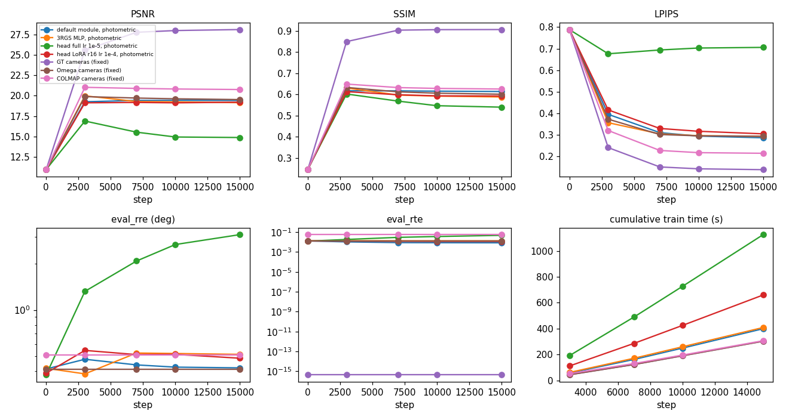
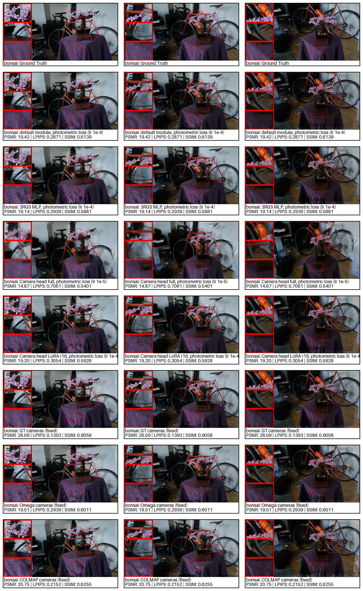
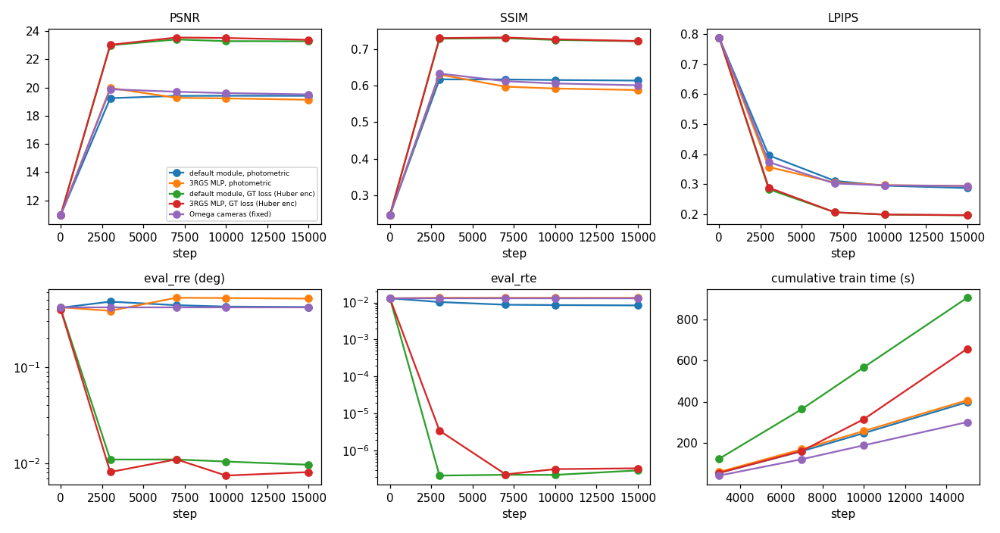
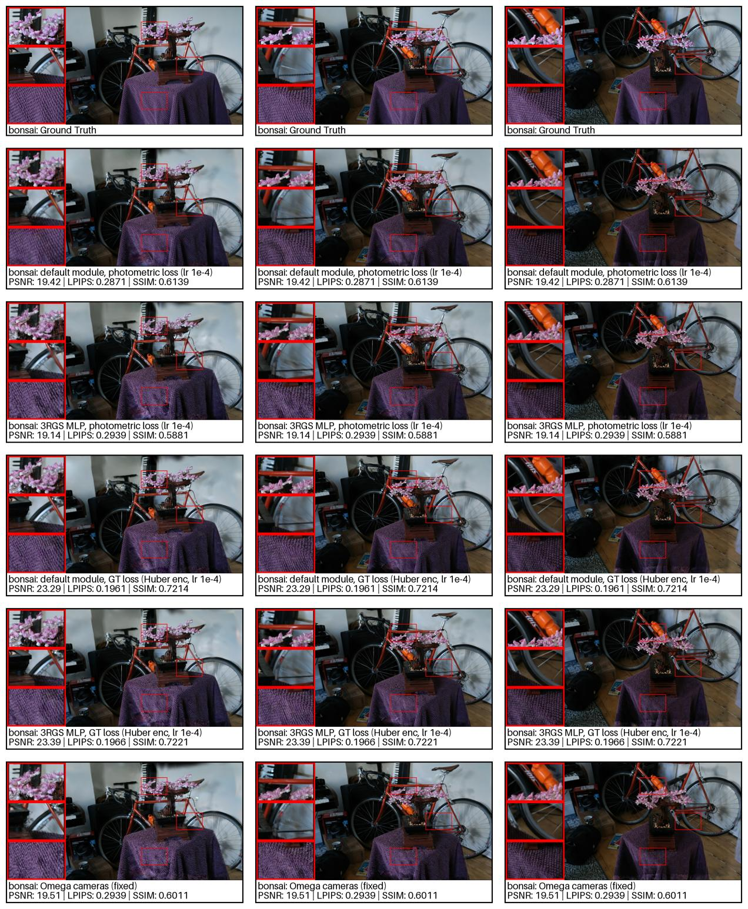
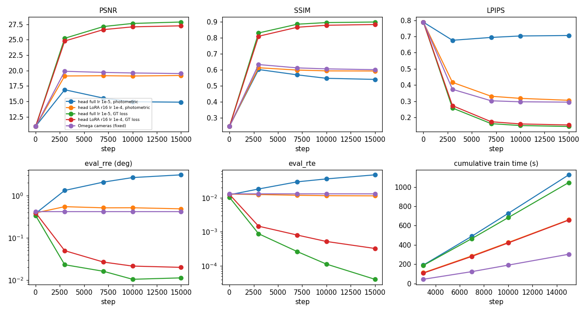
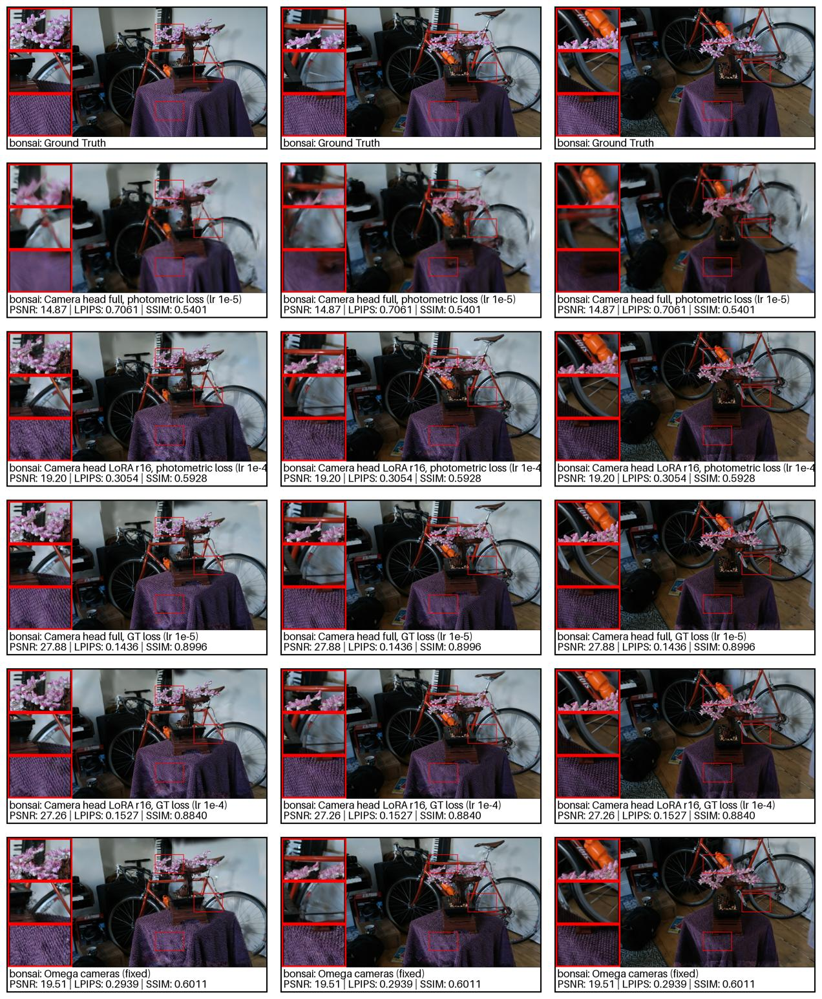

# Camera optimisation from the photometric loss only (no GT cameras), bonsai, 15000 steps

## Question
In the previous experiments the cameras were trained with GT-pose losses (`experiments/2026-11-16_00_omega_camft_gt_15k`, `experiments/2026-11-17_00_omega_pose_opt_modules`).
Here the only signal reaching the cameras is the photometric (render) loss, as in a setup where the GT cameras are unknown. Same optimisers, started from the Omega cameras:
default pose module, 3RGS MLP, full camera head, LoRA camera head. Three comparisons, each with its own runner experiment and section below:
1. `omega_photo_vs_fixed` (group 107): the four photometric arms vs fixed GT, Omega and COLMAP cameras.
2. `omega_photo_vs_gt_modules` (group 108): the two pose modules, photometric loss vs the GT-pose loss, with fixed Omega cameras.
3. `omega_photo_vs_gt_heads` (group 109): the full and LoRA camera head, photometric loss vs the GT-pose loss, with fixed Omega cameras.

## Setup
- Scene, trainer and evaluation as in `experiments/2026-11-16_00_omega_camft_gt_15k` (bonsai, 40 training images `minfarthestpose` seed 42, `simple_trainer.py mcmc`, 15000 steps, MCMC `cap_max=1_000_000`,
  100K random Omega points, evaluation on the 252 GT-eval frames that are not training frames, `eval_rre`/`eval_rte` of the 40 training cameras against GT, `train_time_s` = cumulative CUDA-synchronised
  training-step time without evaluation, camera drift log every 50 steps in `stats/ft_drift.jsonl`).
- Photometric arms (new; no `camft_gt_loss`): the optimiser's cameras are not detached, so the render loss gradient reaches them; there is no GT loss. Camera optimisation starts at step 0 (no delay), from the
  initial Omega cameras. Adam, constant lr, no weight decay.

| Arm | Optimiser | lr | Rendered intrinsics |
|---|---|---|---|
| default module | gsplat `CameraOptModule` (3-D position + 6-D rotation delta per frame, zero-initialised) on the Omega c2w | 1e-4 | initial Omega K |
| 3RGS MLP | `CameraOptModuleMLP` on the Omega c2w (as before) | 1e-4 | initial Omega K |
| head full | Omega camera head, all weights | 1e-5 | the head's own predicted K |
| head LoRA | Omega camera head, LoRA r16 (alpha 16) | 1e-4 | the head's own predicted K |

- Reused runs (same config as before, not rerun): GT cameras fixed, Omega cameras fixed, COLMAP cameras fixed (all from `omega_camft_gt_15k`, GPU 2, 16 Nov); GT-loss references from earlier experiments:
  default module and 3RGS MLP with the Huber GT loss on the 7-D pose encoding (`omega_pose_opt_loss`, Omega K); head full lr 1e-5 and head LoRA r16 lr 1e-4 with the Huber GT loss on the 9-D pose encoding incl. fov
  (`omega_camft_gt_15k`). In the GT-loss arms the render loss does not reach the cameras.

## Launch
```bash
cd ~/work/git/gsplat
experiments/2026-11-17_01_omega_photometric_pose_opt/queue.sh   # polls for a GPU at 0% utilisation with >= 6000 MiB free (GPU=<index> skips the wait), then:
#   env -u PYTHONPATH PATH=$HOME/.conda/envs/gsplat/bin:$PATH python experiment_runner.py \
#     --experiment_names omega_photo_vs_fixed omega_photo_vs_gt_modules omega_photo_vs_gt_heads --dataset_name bonsai --dataset_collections \
#     --do_reconstruct --skip_plotting --cuda_visible_devices <gpu index>
python experiments/2026-11-17_01_omega_photometric_pose_opt/collect.py && python experiments/2026-11-17_01_omega_photometric_pose_opt/make_figures.py   # gsplat env
# renders: the runner with --plot_only for the three experiments, copies of latest_plots/107_..., 108_..., 109_..._latest_renders.jpg
```

## Run metadata
- gsplat commit `6549112e` (experiments, photometric arms use existing `camft` options without `camft_gt_loss`), vggt `537df98`. Conda `gsplat`, `PYTHONPATH` unset, server `gxp-l40s-2` (NVIDIA L40S, shared with other users).
- Runs: GPU 0, queue launched 17 Nov 19:46:04, runner exit 0 at 20:54:35, the four new arms one after the other. The queue started when GPU 0 showed 0% utilisation on two consecutive checks; GPU 0 also held another user's
  model server (`llama serve`, ~30 GB) and other users' activity during the runs was not logged.
- New run directories (`results/vggt_outputs/`, gitignored) under `bonsai_2_n40_s42_omega_c0.0_p100000_random_minfarthestpose_i40_gteval_`, suffix `_evalall_steps15000`: `cft-0.0001-pdef-d0`, `cft-0.0001-mlp-d0`, `cft-1e-05-full-d0`, `cft-0.0001-lora16-d0`.
- Raw numbers: `metrics.csv` (column `section` = the comparison; reused runs appear in each section they belong to).

## Results
PSNR / SSIM / LPIPS over the 252 evaluation images; `eval_rre` (deg) / `eval_rte` of the 40 training cameras against GT (rte depends on the world normalisation of each run).

### 1. Photometric arms vs fixed cameras (`omega_photo_vs_fixed`)


| Arm | Step 1 | Step 3000 | Step 7000 | Step 10000 | Step 15000 |
|---|---|---|---|---|---|
| default module, photometric | 10.95 / 0.246 / 0.789 | 19.25 / 0.617 / 0.396 | 19.41 / 0.617 / 0.311 | 19.42 / 0.615 / 0.295 | 19.42 / 0.614 / 0.287 |
| 3RGS MLP, photometric | 10.94 / 0.246 / 0.789 | 19.98 / 0.630 / 0.357 | 19.27 / 0.597 / 0.305 | 19.23 / 0.592 / 0.297 | 19.14 / 0.588 / 0.294 |
| head full lr 1e-5, photometric | 10.95 / 0.247 / 0.788 | 16.89 / 0.602 / 0.676 | 15.53 / 0.569 / 0.694 | 14.93 / 0.547 / 0.703 | 14.87 / 0.540 / 0.706 |
| head LoRA lr 1e-4, photometric | 10.94 / 0.246 / 0.789 | 19.12 / 0.613 / 0.416 | 19.17 / 0.599 / 0.330 | 19.12 / 0.593 / 0.317 | 19.20 / 0.593 / 0.305 |
| GT (fixed) | 10.93 / 0.246 / 0.789 | 25.56 / 0.849 / 0.242 | 27.76 / 0.903 / 0.152 | 27.97 / 0.905 / 0.143 | 28.09 / 0.906 / 0.139 |
| Omega (fixed) | 10.93 / 0.246 / 0.789 | 19.88 / 0.633 / 0.373 | 19.70 / 0.612 / 0.302 | 19.61 / 0.606 / 0.296 | 19.51 / 0.601 / 0.294 |
| COLMAP (fixed) | 10.93 / 0.246 / 0.789 | 21.02 / 0.649 / 0.321 | 20.88 / 0.632 / 0.228 | 20.81 / 0.629 / 0.218 | 20.75 / 0.625 / 0.215 |

| Arm | Step 1 | Step 3000 | Step 7000 | Step 10000 | Step 15000 |
|---|---|---|---|---|---|
| default module, photometric | 0.4133 / 1.3e-2 | 0.4780 / 1.0e-2 | 0.4392 / 8.7e-3 | 0.4249 / 8.5e-3 | 0.4203 / 8.3e-3 |
| 3RGS MLP, photometric | 0.4175 / 1.3e-2 | 0.3840 / 1.3e-2 | 0.5249 / 1.3e-2 | 0.5210 / 1.3e-2 | 0.5144 / 1.3e-2 |
| head full, photometric | 0.3790 / 1.2e-2 | 1.3212 / 1.8e-2 | 2.0815 / 2.9e-2 | 2.6632 / 3.6e-2 | 3.0894 / 4.7e-2 |
| head LoRA, photometric | 0.3882 / 1.3e-2 | 0.5457 / 1.2e-2 | 0.5126 / 1.2e-2 | 0.5143 / 1.1e-2 | 0.4855 / 1.1e-2 |
| GT | 0 / 0 | 0 / 0 | 0 / 0 | 0 / 0 | 0 / 0 |
| Omega (fixed) | 0.4131 / 1.3e-2 | same | same | same | 0.4131 / 1.3e-2 |
| COLMAP (fixed) | 0.5092 / 5.5e-2 | same | same | same | 0.5092 / 5.5e-2 |


(Renders: `render_nums=[0, 2, 5]`, step 15000, evaluation frames; rows: ground truth, then the arms in the table order of the runner experiment: the four photometric arms, GT, Omega, COLMAP.)

### 2. Pose modules: photometric vs GT loss (`omega_photo_vs_gt_modules`)


| Arm | Step 1 | Step 3000 | Step 7000 | Step 10000 | Step 15000 |
|---|---|---|---|---|---|
| default, photometric | 10.95 / 0.246 / 0.789 | 19.25 / 0.617 / 0.396 | 19.41 / 0.617 / 0.311 | 19.42 / 0.615 / 0.295 | 19.42 / 0.614 / 0.287 |
| 3RGS MLP, photometric | 10.94 / 0.246 / 0.789 | 19.98 / 0.630 / 0.357 | 19.27 / 0.597 / 0.305 | 19.23 / 0.592 / 0.297 | 19.14 / 0.588 / 0.294 |
| default, GT loss | 10.94 / 0.246 / 0.789 | 23.00 / 0.729 / 0.283 | 23.42 / 0.730 / 0.206 | 23.30 / 0.725 / 0.199 | 23.29 / 0.721 / 0.196 |
| 3RGS MLP, GT loss | 10.93 / 0.246 / 0.789 | 23.04 / 0.730 / 0.288 | 23.56 / 0.732 / 0.206 | 23.52 / 0.727 / 0.199 | 23.39 / 0.722 / 0.197 |
| Omega (fixed) | 10.93 / 0.246 / 0.789 | 19.88 / 0.633 / 0.373 | 19.70 / 0.612 / 0.302 | 19.61 / 0.606 / 0.296 | 19.51 / 0.601 / 0.294 |

| Arm | Step 1 | Step 3000 | Step 7000 | Step 10000 | Step 15000 |
|---|---|---|---|---|---|
| default, photometric | 0.4133 / 1.3e-2 | 0.4780 / 1.0e-2 | 0.4392 / 8.7e-3 | 0.4249 / 8.5e-3 | 0.4203 / 8.3e-3 |
| 3RGS MLP, photometric | 0.4175 / 1.3e-2 | 0.3840 / 1.3e-2 | 0.5249 / 1.3e-2 | 0.5210 / 1.3e-2 | 0.5144 / 1.3e-2 |
| default, GT loss | 0.4050 / 1.3e-2 | 0.0109 / 2.1e-7 | 0.0109 / 2.2e-7 | 0.0104 / 2.2e-7 | 0.0096 / 2.9e-7 |
| 3RGS MLP, GT loss | 0.3970 / 1.3e-2 | 0.0081 / 3.5e-6 | 0.0110 / 2.3e-7 | 0.0074 / 3.2e-7 | 0.0081 / 3.4e-7 |


(Rows: ground truth, default photometric, 3RGS photometric, default GT loss, 3RGS GT loss, Omega fixed.)

### 3. Camera head: photometric vs GT loss (`omega_photo_vs_gt_heads`)


| Arm | Step 1 | Step 3000 | Step 7000 | Step 10000 | Step 15000 |
|---|---|---|---|---|---|
| head full lr 1e-5, photometric | 10.95 / 0.247 / 0.788 | 16.89 / 0.602 / 0.676 | 15.53 / 0.569 / 0.694 | 14.93 / 0.547 / 0.703 | 14.87 / 0.540 / 0.706 |
| head LoRA lr 1e-4, photometric | 10.94 / 0.246 / 0.789 | 19.12 / 0.613 / 0.416 | 19.17 / 0.599 / 0.330 | 19.12 / 0.593 / 0.317 | 19.20 / 0.593 / 0.305 |
| head full lr 1e-5, GT loss | 10.93 / 0.245 / 0.789 | 25.24 / 0.831 / 0.257 | 27.15 / 0.886 / 0.161 | 27.65 / 0.896 / 0.149 | 27.88 / 0.900 / 0.144 |
| head LoRA lr 1e-4, GT loss | 10.93 / 0.246 / 0.789 | 24.80 / 0.810 / 0.272 | 26.65 / 0.867 / 0.173 | 27.09 / 0.879 / 0.159 | 27.26 / 0.884 / 0.153 |
| Omega (fixed) | 10.93 / 0.246 / 0.789 | 19.88 / 0.633 / 0.373 | 19.70 / 0.612 / 0.302 | 19.61 / 0.606 / 0.296 | 19.51 / 0.601 / 0.294 |

| Arm | Step 1 | Step 3000 | Step 7000 | Step 10000 | Step 15000 |
|---|---|---|---|---|---|
| head full, photometric | 0.3790 / 1.2e-2 | 1.3212 / 1.8e-2 | 2.0815 / 2.9e-2 | 2.6632 / 3.6e-2 | 3.0894 / 4.7e-2 |
| head LoRA, photometric | 0.3882 / 1.3e-2 | 0.5457 / 1.2e-2 | 0.5126 / 1.2e-2 | 0.5143 / 1.1e-2 | 0.4855 / 1.1e-2 |
| head full, GT loss | 0.3365 / 1.0e-2 | 0.0231 / 8.8e-4 | 0.0161 / 2.6e-4 | 0.0104 / 1.1e-4 | 0.0113 / 4.0e-5 |
| head LoRA, GT loss | 0.3908 / 1.2e-2 | 0.0496 / 1.5e-3 | 0.0267 / 8.0e-4 | 0.0214 / 5.2e-4 | 0.0200 / 3.2e-4 |


(Rows: ground truth, head full photometric, head LoRA photometric, head full GT loss, head LoRA GT loss, Omega fixed.)

### Drift of the optimised cameras from the initial Omega cameras (`ft_drift.jsonl`, all 40 frames, trainer frame)
Rotation mean / max (deg), position mean / max (trainer-frame units), mean relative focal change, at steps 50 / 7550 / 15000:

| Arm (photometric) | Step 50 | Step 7550 | Step 15000 |
|---|---|---|---|
| default module | 0.047 / 0.069 deg, 0.00085 / 0.00103, 0 | 0.206 / 0.428 deg, 0.0089 / 0.0187, 0 | 0.221 / 0.480 deg, 0.0091 / 0.0183, 0 |
| 3RGS MLP | 0.122 / 0.128 deg, 0.0088 / 0.0088, 0 | 0.186 / 0.368 deg, 0.0103 / 0.0238, 0 | 0.190 / 0.360 deg, 0.0102 / 0.0244, 0 |
| head full lr 1e-5 | 0.675 / 1.352 deg, 0.060 / 0.082, 0.0032 | 2.093 / 4.011 deg, 0.057 / 0.080, 0.094 | 2.861 / 5.531 deg, 0.104 / 0.147, 0.150 |
| head LoRA lr 1e-4 | 0.294 / 0.504 deg, 0.0176 / 0.0266, 0.0012 | 0.232 / 0.629 deg, 0.0100 / 0.0217, 0.0006 | 0.215 / 0.565 deg, 0.0093 / 0.0195, 0.0006 |

### Training time
`train_time_s` at step 15000 and per step (GPU 0 shared with other users' jobs):

| Arm | 15000 steps | ms/step | Run |
|---|---|---|---|
| default module, photometric | 399 s | 26.6 | GPU 0, 17 Nov |
| 3RGS MLP, photometric | 408 s | 27.2 | GPU 0, 17 Nov |
| head full, photometric | 1126 s | 75.0 | GPU 0, 17 Nov |
| head LoRA, photometric | 660 s | 44.0 | GPU 0, 17 Nov |
| GT / Omega / COLMAP fixed | 303 / 302 / 306 s | 20.2 / 20.1 / 20.4 | GPU 2, 16 Nov |
| default / 3RGS, GT loss | 905 s / 658 s | 60.4 / 43.9 | GPU 0, 17 Nov (default) and 06:43 (3RGS) |
| head full / LoRA, GT loss | 1046 s / 657 s | 69.7 / 43.8 | GPU 2, 16 Nov |

## Failed / missing runs, confounds
- The four new runs completed; no failed attempts. Before launching, a CPU check showed that gradients reach the module parameters; the render-to-camera path was first run on the GPU in this experiment.
- Timing: new arms on GPU 0 next to another user's server with unlogged activity; reused runs on other GPUs/days, so the times are not measured under the same conditions.
- The GT-loss head arms use the Huber loss on the 9-D pose encoding including fov and render with the detached head K; the GT-loss module arms use 7 dimensions and Omega K. The photometric head arms render with the head's own K (not detached).
- Learning rates differ between module (1e-4) and full head (1e-5) arms; one run per arm, single seed, single scene.
- The reused GT, Omega and COLMAP runs, and the GT-loss references, come from different experiments (see Setup); nothing about them was rerun.

## Insights
To be filled by the user.
