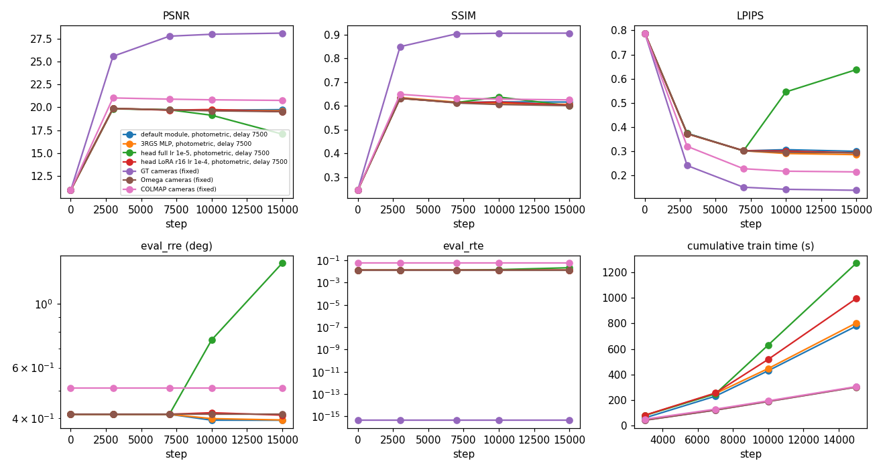
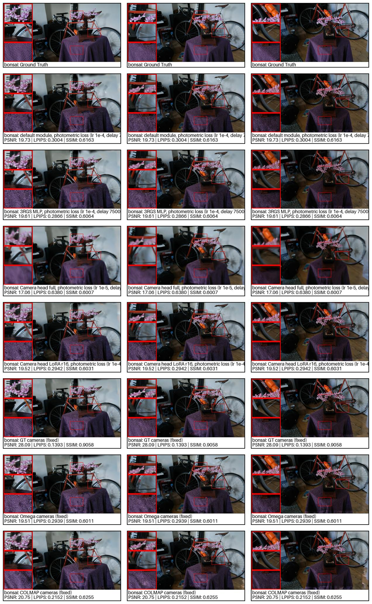
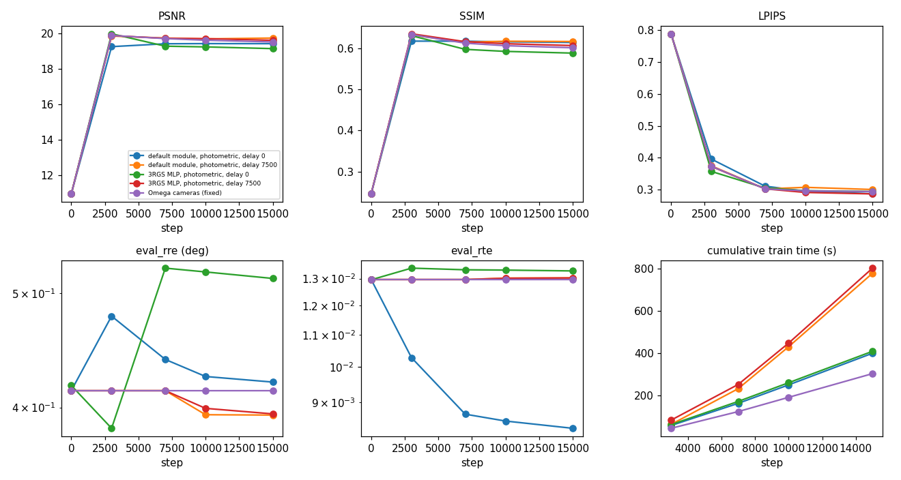
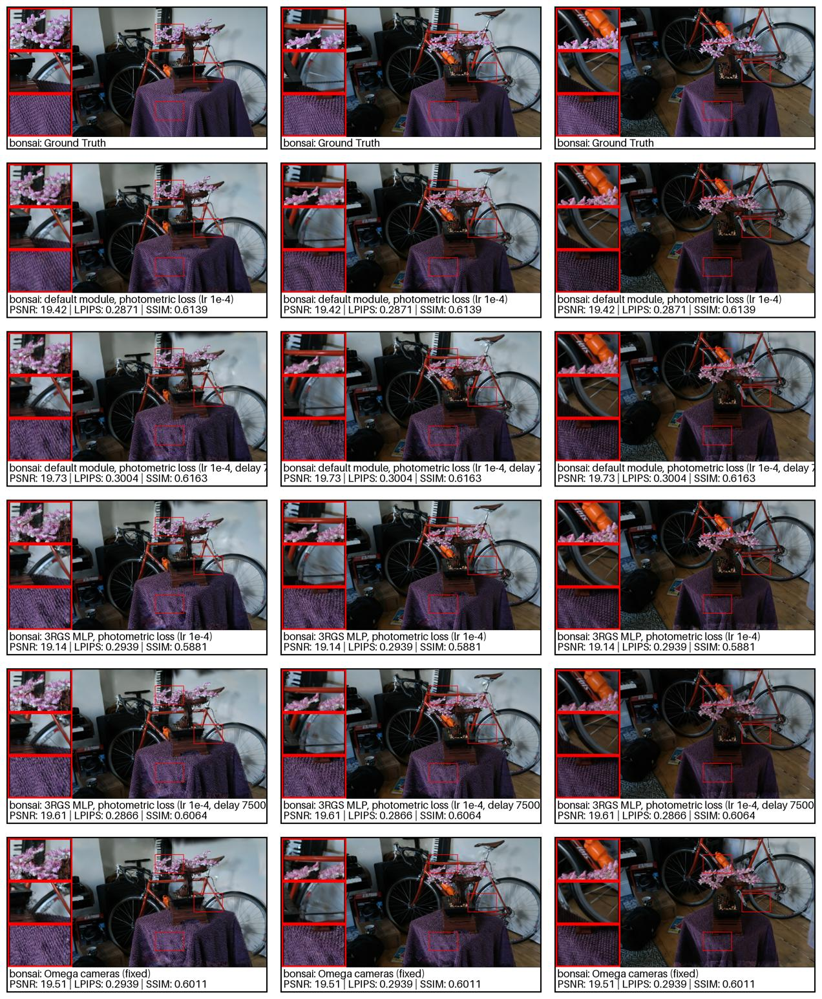
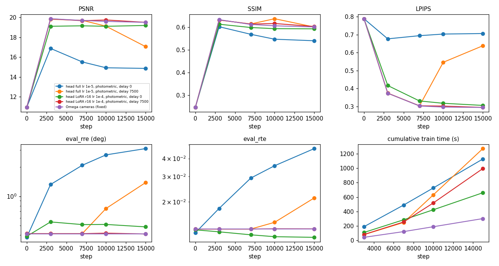
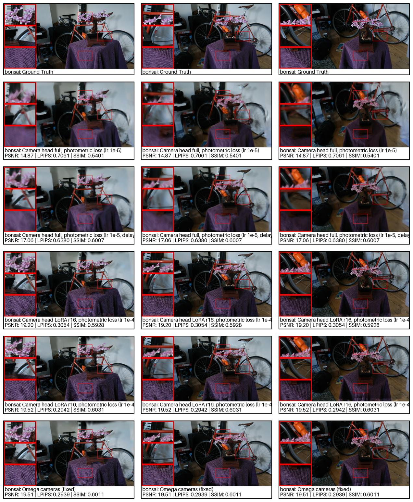

# Photometric-loss camera optimisation with delayed activation (step 7500 of 15000), bonsai

## Question
Repeat of the photometric-only camera optimisation of `experiments/2026-11-17_01_omega_photometric_pose_opt` with the optimiser activated at 50% of the steps (`camft_delay=7500`).
Three comparisons, each with its own runner experiment and section below:
1. `omega_photo_delay_vs_fixed` (group 110): the four delayed arms vs fixed GT, Omega and COLMAP cameras.
2. `omega_photo_delay_modules` (group 111): default module and 3RGS MLP, delay 0 vs delay 7500, with fixed Omega cameras.
3. `omega_photo_delay_heads` (group 112): full and LoRA camera head, delay 0 vs delay 7500, with fixed Omega cameras.

## Setup
- Same scene, trainer, arms, learning rates and evaluation as `experiments/2026-11-17_01_omega_photometric_pose_opt` (bonsai, 40 training images `minfarthestpose` seed 42, `simple_trainer.py mcmc`, 15000 steps,
  MCMC `cap_max=1_000_000`, 100K random Omega points, 252 GT-eval frames, `eval_rre`/`eval_rte`, `train_time_s`, drift log every 50 steps). Photometric loss only (no `camft_gt_loss`), Omega K for the module arms, the head's own K for the head arms.
- Delay (`--camft_delay 7500`): for steps 0 to 7499 the rendered cameras are the frozen initial Omega cameras (`ref_c2w`, `ref_K`), the module/head receives no gradient. From step 7500 the module/head output is used
  with gradient; Adam state is fresh (the optimiser exists from step 0 but only updates parameters that received gradients), constant lr, no warm-up. Gaussians (MCMC) train from step 0.
- Arms (delay 7500): default module lr 1e-4, 3RGS MLP lr 1e-4, head full lr 1e-5, head LoRA r16 lr 1e-4.
- Reused runs (not rerun): the delay-0 arms from `2026-11-17_01_omega_photometric_pose_opt`; fixed GT, Omega and COLMAP cameras from `2026-11-16_00_omega_camft_gt_15k`.
- The validation steps are the same as before (1, 3000, 7000, 10000, 15000); there is no evaluation at step 7500.

## Launch
```bash
cd ~/work/git/gsplat
experiments/2026-11-18_00_omega_photometric_delayed/queue.sh   # polls for a GPU at 0% utilisation with >= 6000 MiB free, then:
#   env -u PYTHONPATH PATH=$HOME/.conda/envs/gsplat/bin:$PATH python experiment_runner.py \
#     --experiment_names omega_photo_delay_vs_fixed omega_photo_delay_modules omega_photo_delay_heads --dataset_name bonsai --dataset_collections \
#     --do_reconstruct --skip_plotting --cuda_visible_devices <gpu index>
python experiments/2026-11-18_00_omega_photometric_delayed/collect.py && python experiments/2026-11-18_00_omega_photometric_delayed/make_figures.py   # gsplat env
# renders: the runner with --plot_only for the three experiments, copies of latest_plots/110_..., 111_..., 112_..._latest_renders.jpg
```

## Run metadata
- gsplat commit: parent `a5bfbc56`, the commit containing this log also adds the three experiments to `experiment_runner.py`; vggt `2cad22d`. Conda `gsplat`, `PYTHONPATH` unset, server `gxp-l40s-2` (NVIDIA L40S, shared with other users).
- Runs: GPU 0, queue launched 18 Nov 07:05:56, runner exit 0 at 08:39:56, the four arms one after the other (default module, 3RGS MLP, head full, head LoRA). GPU 0 showed 0% utilisation on two consecutive checks at the start;
  during the runs it also held another user's process (jsk62, ~29.6 GiB, 94-100% utilisation at the later checks); other users' activity was not logged.
- New run directories (`results/vggt_outputs/`, gitignored) under `bonsai_2_n40_s42_omega_c0.0_p100000_random_minfarthestpose_i40_gteval_`, suffix `_evalall_steps15000`: `cft-0.0001-pdef-d7500`, `cft-0.0001-mlp-d7500`, `cft-1e-05-full-d7500`, `cft-0.0001-lora16-d7500`.
- Raw numbers: `metrics.csv` (column `section`; reused runs appear in each section they belong to).

## Results
PSNR / SSIM / LPIPS over the 252 evaluation images; `eval_rre` (deg) / `eval_rte` of the 40 training cameras against GT.

### 1. Delayed arms vs fixed cameras (`omega_photo_delay_vs_fixed`)


| Arm | Step 1 | Step 3000 | Step 7000 | Step 10000 | Step 15000 |
|---|---|---|---|---|---|
| default module, delay 7500 | 10.95 / 0.246 / 0.789 | 19.85 / 0.632 / 0.375 | 19.73 / 0.615 / 0.302 | 19.69 / 0.617 / 0.307 | 19.73 / 0.616 / 0.300 |
| 3RGS MLP, delay 7500 | 10.93 / 0.246 / 0.789 | 19.87 / 0.635 / 0.373 | 19.72 / 0.616 / 0.302 | 19.70 / 0.611 / 0.291 | 19.61 / 0.606 / 0.287 |
| head full lr 1e-5, delay 7500 | 10.94 / 0.246 / 0.789 | 19.83 / 0.632 / 0.374 | 19.72 / 0.614 / 0.303 | 19.13 / 0.637 / 0.546 | 17.06 / 0.601 / 0.638 |
| head LoRA lr 1e-4, delay 7500 | 10.94 / 0.246 / 0.789 | 19.87 / 0.632 / 0.373 | 19.68 / 0.614 / 0.303 | 19.75 / 0.616 / 0.302 | 19.52 / 0.603 / 0.294 |
| GT (fixed) | 10.93 / 0.246 / 0.789 | 25.56 / 0.849 / 0.242 | 27.76 / 0.903 / 0.152 | 27.97 / 0.905 / 0.143 | 28.09 / 0.906 / 0.139 |
| Omega (fixed) | 10.93 / 0.246 / 0.789 | 19.88 / 0.633 / 0.373 | 19.70 / 0.612 / 0.302 | 19.61 / 0.606 / 0.296 | 19.51 / 0.601 / 0.294 |
| COLMAP (fixed) | 10.93 / 0.246 / 0.789 | 21.02 / 0.649 / 0.321 | 20.88 / 0.632 / 0.228 | 20.81 / 0.629 / 0.218 | 20.75 / 0.625 / 0.215 |

| Arm | Step 1 | Step 3000 | Step 7000 | Step 10000 | Step 15000 |
|---|---|---|---|---|---|
| default module, delay 7500 | 0.4133 / 1.3e-2 | 0.4133 / 1.3e-2 | 0.4133 / 1.3e-2 | 0.3943 / 1.3e-2 | 0.3941 / 1.3e-2 |
| 3RGS MLP, delay 7500 | 0.4133 / 1.3e-2 | 0.4133 / 1.3e-2 | 0.4133 / 1.3e-2 | 0.3993 / 1.3e-2 | 0.3950 / 1.3e-2 |
| head full, delay 7500 | 0.4134 / 1.3e-2 | 0.4134 / 1.3e-2 | 0.4134 / 1.3e-2 | 0.7494 / 1.4e-2 | 1.3836 / 2.1e-2 |
| head LoRA, delay 7500 | 0.4134 / 1.3e-2 | 0.4134 / 1.3e-2 | 0.4134 / 1.3e-2 | 0.4185 / 1.3e-2 | 0.4105 / 1.3e-2 |
| GT | 0 / 4.5e-16 | same | same | same | 0 / 4.5e-16 |
| Omega (fixed) | 0.4131 / 1.3e-2 | same | same | same | 0.4131 / 1.3e-2 |
| COLMAP (fixed) | 0.5092 / 5.5e-2 | same | same | same | 0.5092 / 5.5e-2 |


(Renders: `render_nums=[0, 2, 5]`, step 15000; rows: ground truth, default delayed, 3RGS delayed, head full delayed, head LoRA delayed, GT, Omega, COLMAP.)

### 2. Pose modules: delay 0 vs delay 7500 (`omega_photo_delay_modules`)


| Arm | Step 1 | Step 3000 | Step 7000 | Step 10000 | Step 15000 |
|---|---|---|---|---|---|
| default, delay 0 | 10.95 / 0.246 / 0.789 | 19.25 / 0.617 / 0.396 | 19.41 / 0.617 / 0.311 | 19.42 / 0.615 / 0.295 | 19.42 / 0.614 / 0.287 |
| default, delay 7500 | 10.95 / 0.246 / 0.789 | 19.85 / 0.632 / 0.375 | 19.73 / 0.615 / 0.302 | 19.69 / 0.617 / 0.307 | 19.73 / 0.616 / 0.300 |
| 3RGS MLP, delay 0 | 10.94 / 0.246 / 0.789 | 19.98 / 0.630 / 0.357 | 19.27 / 0.597 / 0.305 | 19.23 / 0.592 / 0.297 | 19.14 / 0.588 / 0.294 |
| 3RGS MLP, delay 7500 | 10.93 / 0.246 / 0.789 | 19.87 / 0.635 / 0.373 | 19.72 / 0.616 / 0.302 | 19.70 / 0.611 / 0.291 | 19.61 / 0.606 / 0.287 |
| Omega (fixed) | 10.93 / 0.246 / 0.789 | 19.88 / 0.633 / 0.373 | 19.70 / 0.612 / 0.302 | 19.61 / 0.606 / 0.296 | 19.51 / 0.601 / 0.294 |

| Arm | Step 1 | Step 3000 | Step 7000 | Step 10000 | Step 15000 |
|---|---|---|---|---|---|
| default, delay 0 | 0.4133 / 1.3e-2 | 0.4780 / 1.0e-2 | 0.4392 / 8.7e-3 | 0.4249 / 8.5e-3 | 0.4203 / 8.3e-3 |
| default, delay 7500 | 0.4133 / 1.3e-2 | 0.4133 / 1.3e-2 | 0.4133 / 1.3e-2 | 0.3943 / 1.3e-2 | 0.3941 / 1.3e-2 |
| 3RGS MLP, delay 0 | 0.4175 / 1.3e-2 | 0.3840 / 1.3e-2 | 0.5249 / 1.3e-2 | 0.5210 / 1.3e-2 | 0.5144 / 1.3e-2 |
| 3RGS MLP, delay 7500 | 0.4133 / 1.3e-2 | 0.4133 / 1.3e-2 | 0.4133 / 1.3e-2 | 0.3993 / 1.3e-2 | 0.3950 / 1.3e-2 |
| Omega (fixed) | 0.4131 / 1.3e-2 | same | same | same | 0.4131 / 1.3e-2 |


(Rows: ground truth, default delay 0, default delay 7500, 3RGS delay 0, 3RGS delay 7500, Omega fixed.)

### 3. Camera head: delay 0 vs delay 7500 (`omega_photo_delay_heads`)


| Arm | Step 1 | Step 3000 | Step 7000 | Step 10000 | Step 15000 |
|---|---|---|---|---|---|
| head full lr 1e-5, delay 0 | 10.95 / 0.247 / 0.788 | 16.89 / 0.602 / 0.676 | 15.53 / 0.569 / 0.694 | 14.93 / 0.547 / 0.703 | 14.87 / 0.540 / 0.706 |
| head full lr 1e-5, delay 7500 | 10.94 / 0.246 / 0.789 | 19.83 / 0.632 / 0.374 | 19.72 / 0.614 / 0.303 | 19.13 / 0.637 / 0.546 | 17.06 / 0.601 / 0.638 |
| head LoRA lr 1e-4, delay 0 | 10.94 / 0.246 / 0.789 | 19.12 / 0.613 / 0.416 | 19.17 / 0.599 / 0.330 | 19.12 / 0.593 / 0.317 | 19.20 / 0.593 / 0.305 |
| head LoRA lr 1e-4, delay 7500 | 10.94 / 0.246 / 0.789 | 19.87 / 0.632 / 0.373 | 19.68 / 0.614 / 0.303 | 19.75 / 0.616 / 0.302 | 19.52 / 0.603 / 0.294 |
| Omega (fixed) | 10.93 / 0.246 / 0.789 | 19.88 / 0.633 / 0.373 | 19.70 / 0.612 / 0.302 | 19.61 / 0.606 / 0.296 | 19.51 / 0.601 / 0.294 |

| Arm | Step 1 | Step 3000 | Step 7000 | Step 10000 | Step 15000 |
|---|---|---|---|---|---|
| head full, delay 0 | 0.3790 / 1.2e-2 | 1.3212 / 1.8e-2 | 2.0815 / 2.9e-2 | 2.6632 / 3.6e-2 | 3.0894 / 4.7e-2 |
| head full, delay 7500 | 0.4134 / 1.3e-2 | 0.4134 / 1.3e-2 | 0.4134 / 1.3e-2 | 0.7494 / 1.4e-2 | 1.3836 / 2.1e-2 |
| head LoRA, delay 0 | 0.3882 / 1.3e-2 | 0.5457 / 1.2e-2 | 0.5126 / 1.2e-2 | 0.5143 / 1.1e-2 | 0.4855 / 1.1e-2 |
| head LoRA, delay 7500 | 0.4134 / 1.3e-2 | 0.4134 / 1.3e-2 | 0.4134 / 1.3e-2 | 0.4185 / 1.3e-2 | 0.4105 / 1.3e-2 |
| Omega (fixed) | 0.4131 / 1.3e-2 | same | same | same | 0.4131 / 1.3e-2 |


(Rows: ground truth, head full delay 0, head full delay 7500, head LoRA delay 0, head LoRA delay 7500, Omega fixed.)

### Drift of the delayed arms from the initial Omega cameras (`ft_drift.jsonl`, 40 frames, trainer frame)
Rotation mean / max (deg), position mean / max (trainer-frame units), mean relative focal change. Steps 50 and 7500 are before the activation.

| Arm | Step 50 | Step 7500 | Step 7550 | Step 15000 |
|---|---|---|---|---|
| default module | 0.009 / 0.040 deg, 0 / 0, 0 | 0.009 / 0.040 deg, 0 / 0, 0 | 0.034 / 0.063 deg, 0.0006 / 0.0010, 0 | 0.075 / 0.196 deg, 0.0016 / 0.0045, 0 |
| 3RGS MLP | 0.009 / 0.040 deg, 0 / 0, 0 | 0.009 / 0.040 deg, 0 / 0, 0 | 0.009 / 0.040 deg, 0.0002 / 0.0002, 0 | 0.059 / 0.137 deg, 0.0009 / 0.0022, 0 |
| head full lr 1e-5 | 0.012 / 0.040 deg, 0 / 0, 0 | 0.012 / 0.040 deg, 0 / 0, 0 | 0.505 / 0.870 deg, 0.0165 / 0.0372, 0.0008 | 1.113 / 2.598 deg, 0.0843 / 0.1049, 0.0654 |
| head LoRA lr 1e-4 | 0.012 / 0.040 deg, 0 / 0, 0 | 0.012 / 0.040 deg, 0 / 0, 0 | 0.018 / 0.048 deg, 0.0006 / 0.0018, 0 | 0.016 / 0.056 deg, 0.0003 / 0.0012, 0 |

The non-zero rotation values before the activation (0.009 to 0.012 deg mean, constant from step 50 to 7500) are present in the drift log of all four delayed runs; position and focal change are 0 there.

### Training time
`train_time_s` at step 15000 (cumulative CUDA-synchronised, evaluation excluded):

| Arm | 15000 steps | ms/step | Run |
|---|---|---|---|
| default module, delay 7500 | 778 s | 51.9 | GPU 0, 18 Nov |
| 3RGS MLP, delay 7500 | 803 s | 53.5 | GPU 0, 18 Nov |
| head full, delay 7500 | 1270 s | 84.6 | GPU 0, 18 Nov |
| head LoRA, delay 7500 | 994 s | 66.3 | GPU 0, 18 Nov |
| default / 3RGS / full / LoRA, delay 0 | 399 / 408 / 1126 / 660 s | 26.6 / 27.2 / 75.0 / 44.0 | GPU 0, 17 Nov |
| GT / Omega / COLMAP fixed | 303 / 302 / 306 s | 20.2 / 20.1 / 20.4 | GPU 2, 16 Nov |

## Failed / missing runs, confounds
- The four new runs completed; no failed attempts.
- Timing: the new runs were on GPU 0 next to another user's process at 94-100% utilisation at the later checks; the delay-0 runs were on GPU 0 on 17 Nov and the fixed runs on GPU 2 on 16 Nov. The times were not measured under the same conditions.
- The delay-0 and fixed references come from other experiments and days (see Setup); nothing about them was rerun.
- No evaluation at step 7500.
- One run per arm, single seed, single scene; learning rates differ between module (1e-4) and full-head (1e-5) arms.

## Insights
To be filled by the user.
