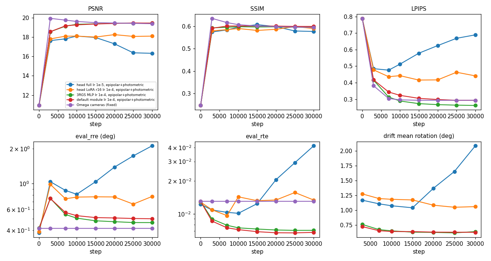
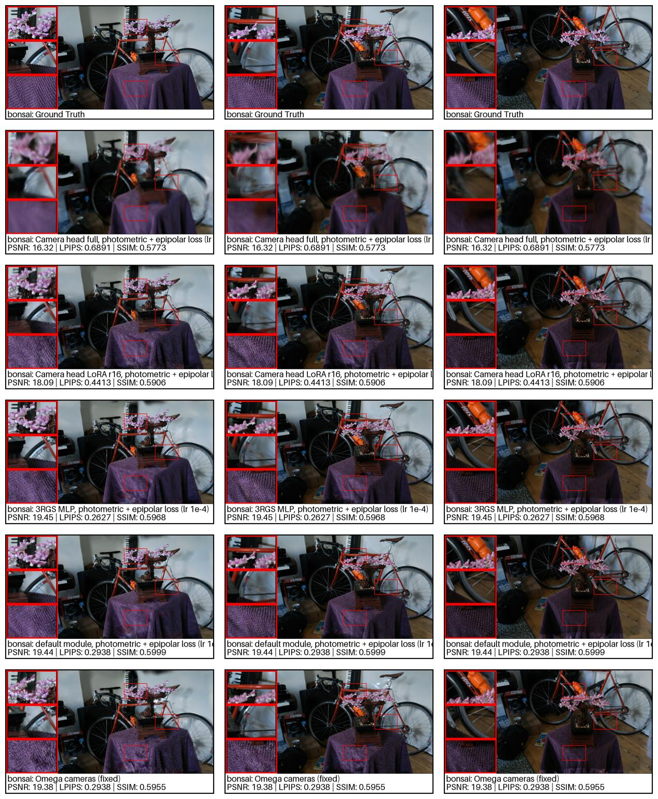
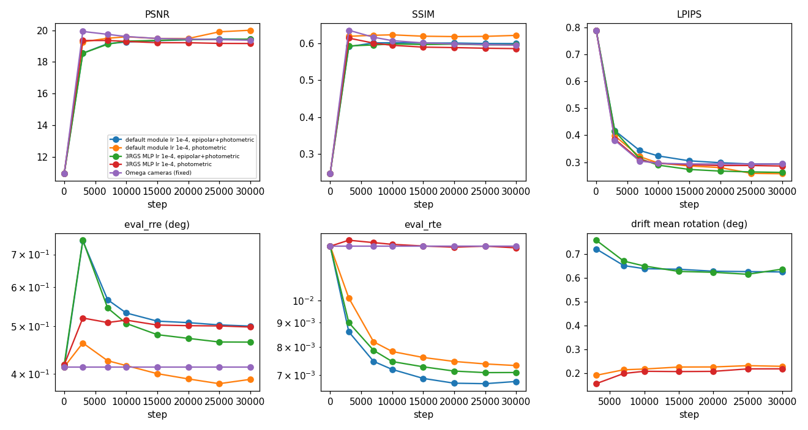
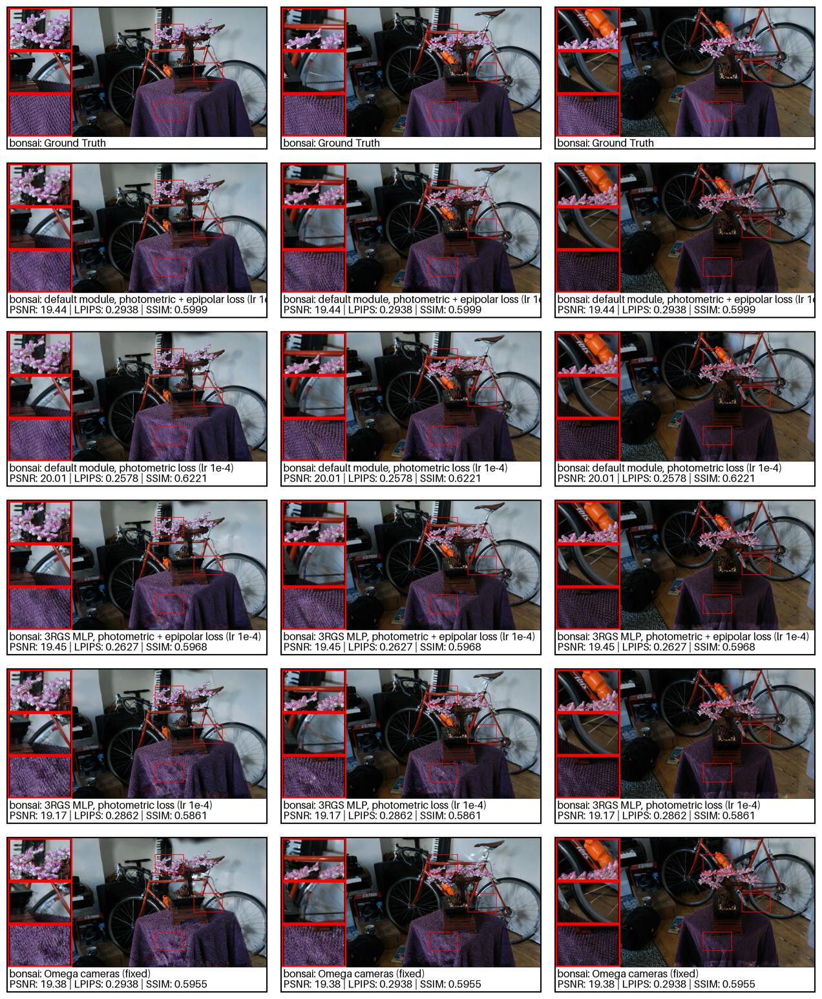
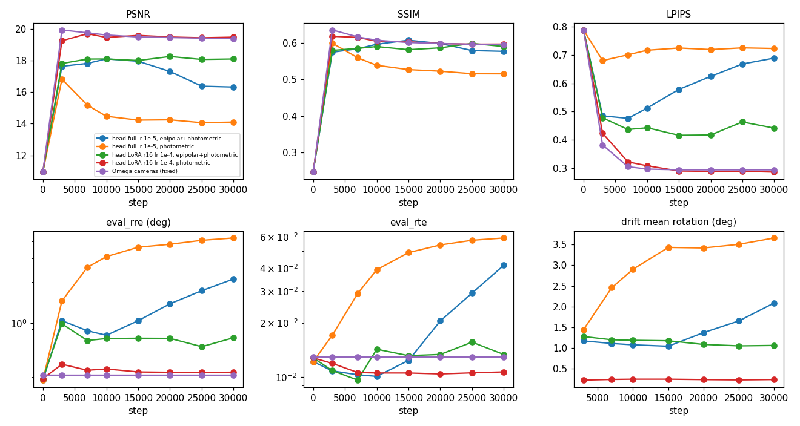
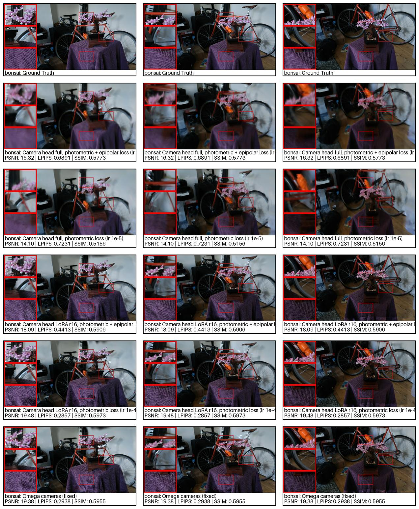

# Omega camera modules with the 3R-GS epipolar loss (2026-11-19)

## Question
Does adding the 3R-GS global epipolar loss (correspondences from the original VGGT track head) to the photometric loss change what the VGGT-Omega camera modules do when they are trained inside 3DGS training (MCMC, 30k steps), compared with photometric-only twins and fixed Omega cameras? Evaluation additionally includes the 3R-GS test-time pose optimisation of the eval views.

## Setup
- Scene bonsai (`data/360_v2/bonsai`), 40 train images, seed 42, 100k random initial points from the Omega reconstruction (`bonsai_2_n40_s42_omega_c0.0_p100000_random_minfarthestpose`), MCMC (cap 1M Gaussians), 30000 steps, `data_factor 1` (train), eval at `eval_data_factor 2`, `eval_all` (252 eval frames), GT-aligned `eval_rre`/`eval_rte`, drift log (`ft_drift.jsonl`).
- Camera modules trained from step 0 (`camft_delay 0`), constant lr: full camera head lr 1e-5; LoRA r16 on the head lr 1e-4; 3R-GS MLP module lr 1e-4; default (delta pose) module lr 1e-4. Photometric loss reaches the module in all arms.
- Epipolar loss (arms `*-epi2x3000`): weight 2.0, active for 0 < step < 3000, symmetrical epipolar distance (kornia `fundamental_from_projections`, `symmetrical_epipolar_distance`, not squared), `Σ(err·w)/Σ(mask·w)`; fundamental matrices from the current module poses and intrinsics (`P = K·inv(c2w)`); all 780 frame pairs.
- Correspondences (`vggt/track_pairs.py`, original VGGT track head, run once, cached in `vggt_outputs/<omega dir>/track_pairs.pt`): per query frame a fixed cell-centred grid of 425 points in the valid image box, tracked into all other frames; pair weight = `conf_i·conf_j / max(conf_i·conf_j)` per pair, mask = weight > 0.5 (mask fraction 0.103). Mask used only in the denominator (paper form).
- Test-time pose optimisation (`tpo_*` metrics, only at the final evaluation, step 30000): eval cameras = GT cameras aligned to the estimated train cameras, 100 iterations, lr 8e-4 exponentially decayed to 1%, `CameraOptModule(1)` zero-init, Scharr gradient-masked L1, Gaussians frozen; ported from 3R-GS `rgs3.trainer`.
- Intrinsics: trained in the head arms (full, LoRA); fixed at the initial Omega values in the MLP and default-module arms.
- Runs: 9 (4 epipolar arms, 4 photometric twins, fixed Omega cameras), grouped into the three experiments below (a run appears in every experiment that uses it).

## Commands
```bash
# gsplat env, from ~/work/git/gsplat (queue.sh in this folder)
env -u PYTHONPATH PATH=$HOME/.conda/envs/gsplat/bin:$PATH python experiment_runner.py \
  --experiment_names omega_epi_vs_fixed omega_epi_modules omega_epi_heads \
  --dataset_name bonsai --dataset_collections --do_reconstruct --skip_plotting \
  --cuda_visible_devices 0,1,2,3 --wait_gpu_idle
# plots / renders
python experiment_runner.py --experiment_names omega_epi_vs_fixed omega_epi_modules omega_epi_heads --dataset_name bonsai --dataset_collections --plot_only
python experiments/2026-11-19_00_omega_epipolar_loss/collect.py && python experiments/2026-11-19_00_omega_epipolar_loss/make_figures.py   # gsplat env
# renders: copies of latest_plots/113_..., 114_..., 115_..._latest_renders.jpg
```
`track_pairs.pt` is generated by the runner through `VGGT_PYTHON track_pairs.py` if missing (it existed beforehand from an earlier run on GPU 0).

## Run metadata
- gsplat commits `1ccd7aed` (epipolar loss, test-time pose opt, experiments 113–115), `e4a6262f` (`--wait_gpu_idle`); vggt commit `09b5c5a` (`track_pairs.py`). Uncommitted at launch: only unrelated files (the user's edit in `experiments/2026-11-17_01_omega_photometric_pose_opt/README.md`, untracked `latest_plots/`, `check_cache.json`).
- Hardware: server `gxp-l4-0`, 8× NVIDIA L4 (22.5 GiB); the runner used `--cuda_visible_devices 0,1,2,3`, up to 4 runs concurrently, `--wait_gpu_idle` (0% utilisation on two consecutive checks, 20 s apart, before each run). Runner start 2026-11-19 09:29:54 GMT, exit code 0 at 14:50:36 GMT.
- Environment: gsplat conda env, torch 2.10.0+cu130, kornia 0.8.2, evo 1.11.0; track pairs from the `vggt` env (torch 2.3.1, original VGGT).
- Result dirs (`results/vggt_outputs/bonsai_2_n40_s42_omega_c0.0_p100000_random_minfarthestpose_i40_gteval_<suffix>`), suffixes: `cft-1e-05-full-d0-epi2x3000_tpo_evalall_steps30000`, `cft-0.0001-lora16-d0-epi2x3000_…`, `cft-0.0001-mlp-d0-epi2x3000_…`, `cft-0.0001-pdef-d0-epi2x3000_…`, `cft-1e-05-full-d0_…`, `cft-0.0001-lora16-d0_…`, `cft-0.0001-mlp-d0_…`, `cft-0.0001-pdef-d0_…`, `tpo_evalall_steps30000` (fixed). Per-step numbers for all arms: `metrics.csv`.

## Failed / missing runs, changes between runs, confounds
- A first attempt on L40S GPU 0 of another server (launched 08:23 GMT, log `queue_first_attempt.log`) was cancelled by the user before any run finished (GPU shared with another user's process at the time; later restarted with `--wait_gpu_idle` and cancelled again to move to this server). Its partial files in the `full-d0-epi2x3000` result dir were overwritten by the rerun. No run failed on this server.
- All photometric twins and the fixed run are new 30k-step runs on this server (earlier 15k-step runs are not reused).
- Different hardware from the earlier Omega experiments (L4 vs L40S). Train times depend on how many runs shared the machine; GPU assignment per run is not recorded in the table.
- Track-head correspondences were computed with the aggregator weights in bf16 and the tracker under bf16 autocast, query points chunked by 50; 425 grid points (rounded from 417).
- Test-time pose optimisation is run only at the final evaluation and on the same 252-frame eval set used for the other metrics.
- Single seed per arm; no repeats.

## Results (step 30000, 252 eval frames)
`TPO` = after test-time pose optimisation of the eval views; `drift` = mean rotation difference of the module's train cameras from the initial Omega cameras.

### Epipolar arms vs fixed Omega cameras
| arm | PSNR | SSIM | LPIPS | eval_rre (deg) | eval_rte | TPO PSNR | TPO SSIM | TPO LPIPS | drift rot mean (deg) | #GS | train time (s) |
|---|---|---|---|---|---|---|---|---|---|---|---|
| head full lr 1e-5, epipolar+photometric | 16.32 | 0.577 | 0.689 | 2.112 | 0.0417 | 16.65 | 0.583 | 0.686 | 2.09 | 1000000 | 6592 |
| head LoRA r16 lr 1e-4, epipolar+photometric | 18.09 | 0.591 | 0.441 | 0.777 | 0.0134 | 22.82 | 0.718 | 0.331 | 1.06 | 1000000 | 3976 |
| 3RGS MLP lr 1e-4, epipolar+photometric | 19.45 | 0.597 | 0.263 | 0.464 | 0.0071 | 24.72 | 0.795 | 0.171 | 0.64 | 1000000 | 1721 |
| default module lr 1e-4, epipolar+photometric | 19.44 | 0.600 | 0.294 | 0.500 | 0.0068 | 25.01 | 0.793 | 0.195 | 0.63 | 1000000 | 1718 |
| Omega cameras (fixed) | 19.38 | 0.596 | 0.294 | 0.413 | 0.0130 | 22.24 | 0.697 | 0.241 | - | 1000000 | 1381 |





### Modules: epipolar+photometric vs photometric

| arm | PSNR | SSIM | LPIPS | eval_rre (deg) | eval_rte | TPO PSNR | TPO SSIM | TPO LPIPS | drift rot mean (deg) | #GS | train time (s) |
|---|---|---|---|---|---|---|---|---|---|---|---|
| default module lr 1e-4, epipolar+photometric | 19.44 | 0.600 | 0.294 | 0.500 | 0.0068 | 25.01 | 0.793 | 0.195 | 0.63 | 1000000 | 1718 |
| default module lr 1e-4, photometric | 20.01 | 0.622 | 0.258 | 0.390 | 0.0073 | 24.52 | 0.793 | 0.195 | 0.23 | 1000000 | 1741 |
| 3RGS MLP lr 1e-4, epipolar+photometric | 19.45 | 0.597 | 0.263 | 0.464 | 0.0071 | 24.72 | 0.795 | 0.171 | 0.64 | 1000000 | 1721 |
| 3RGS MLP lr 1e-4, photometric | 19.17 | 0.586 | 0.286 | 0.498 | 0.0129 | 23.43 | 0.740 | 0.201 | 0.22 | 1000000 | 1685 |
| Omega cameras (fixed) | 19.38 | 0.596 | 0.294 | 0.413 | 0.0130 | 22.24 | 0.697 | 0.241 | - | 1000000 | 1381 |





### Heads: epipolar+photometric vs photometric

| arm | PSNR | SSIM | LPIPS | eval_rre (deg) | eval_rte | TPO PSNR | TPO SSIM | TPO LPIPS | drift rot mean (deg) | #GS | train time (s) |
|---|---|---|---|---|---|---|---|---|---|---|---|
| head full lr 1e-5, epipolar+photometric | 16.32 | 0.577 | 0.689 | 2.112 | 0.0417 | 16.65 | 0.583 | 0.686 | 2.09 | 1000000 | 6592 |
| head full lr 1e-5, photometric | 14.10 | 0.516 | 0.723 | 4.241 | 0.0590 | 15.09 | 0.540 | 0.700 | 3.66 | 1000000 | 6659 |
| head LoRA r16 lr 1e-4, epipolar+photometric | 18.09 | 0.591 | 0.441 | 0.777 | 0.0134 | 22.82 | 0.718 | 0.331 | 1.06 | 1000000 | 3976 |
| head LoRA r16 lr 1e-4, photometric | 19.48 | 0.597 | 0.286 | 0.433 | 0.0107 | 23.13 | 0.728 | 0.217 | 0.23 | 1000000 | 3822 |
| Omega cameras (fixed) | 19.38 | 0.596 | 0.294 | 0.413 | 0.0130 | 22.24 | 0.697 | 0.241 | - | 1000000 | 1381 |





## Insights
To be filled by the user.
