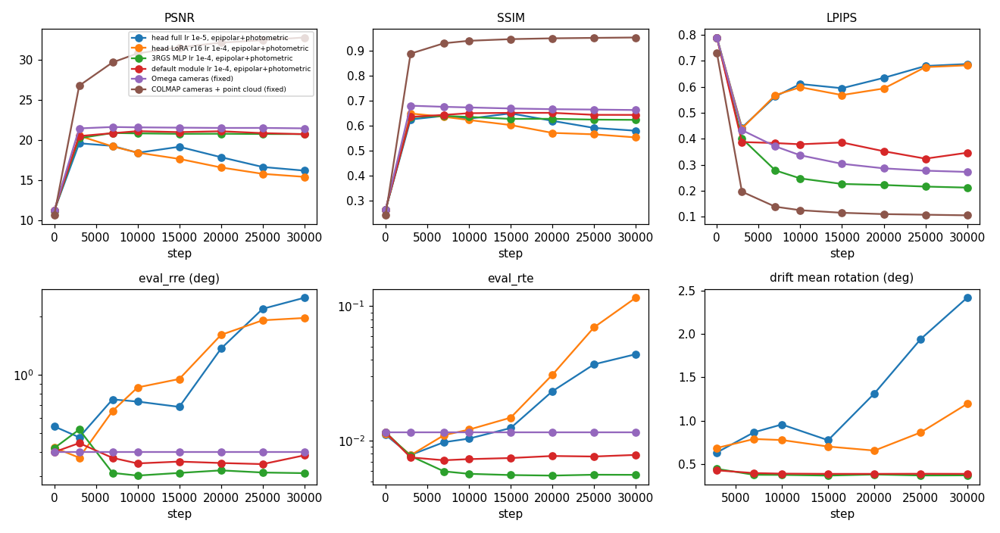
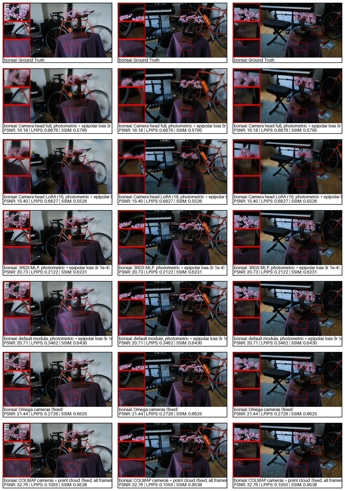
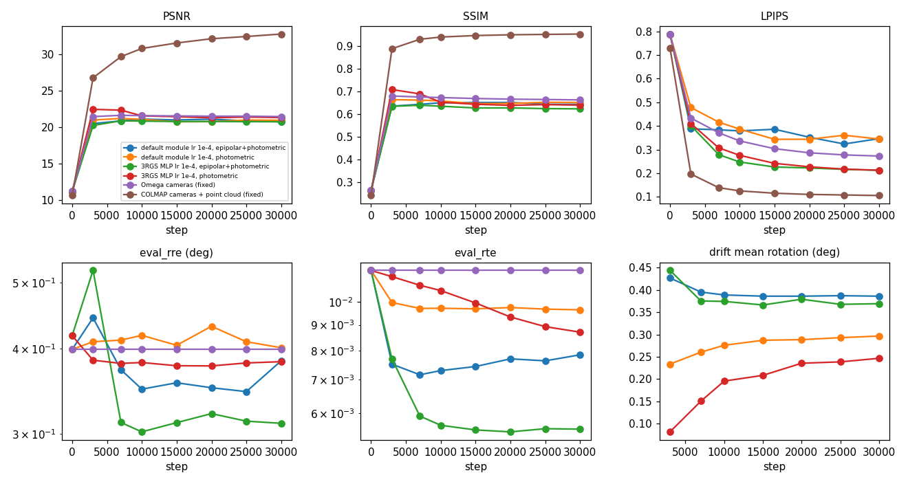
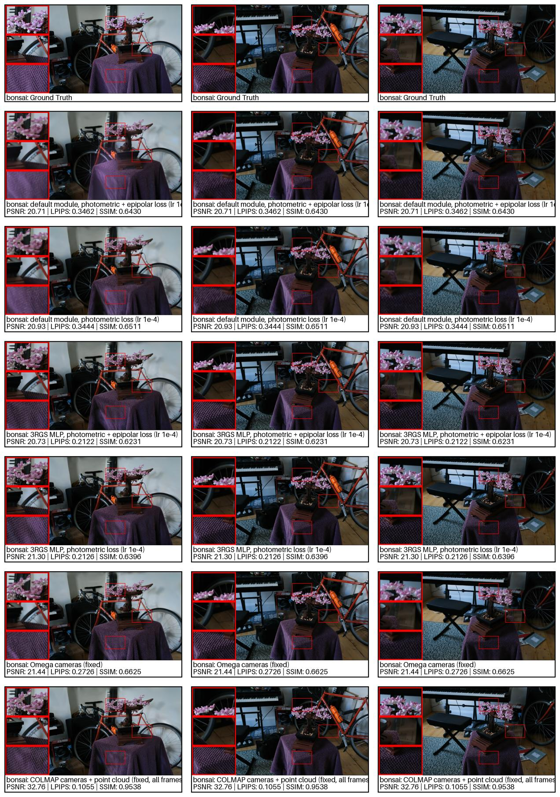
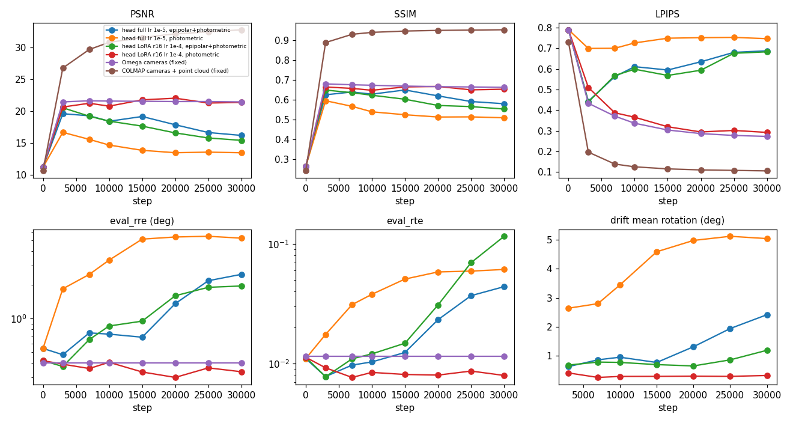
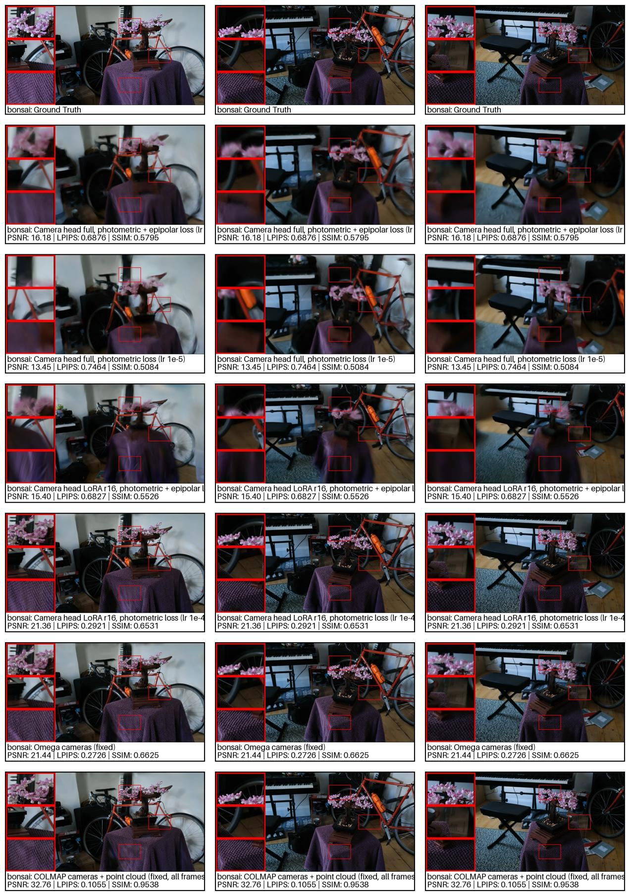

# Omega camera modules with the 3R-GS epipolar loss on all frames (2026-11-19)

Follow-up of `2026-11-19_00_omega_epipolar_loss` (40 train images): same arms and schedule on all non-test frames, a sparse pair graph, and a pure COLMAP reference. This log was produced by an unattended run: the design points the user did not decide are listed under "Gaps filled by Claude".

## Question
Same as the 40-image log: does adding the 3R-GS global epipolar loss (correspondences from the original VGGT track head) change what the VGGT-Omega camera modules do when trained inside 3DGS training (MCMC, 30k steps), compared with photometric-only twins and fixed cameras, now with all training frames. Evaluation includes the 3R-GS test-time pose optimisation of the eval views.

## Setup
- Scene bonsai (`data/360_v2/bonsai`, 292 images). Every 8th frame (sorted by name, index % 8 == 0; 37 frames) is a test frame; the other 255 frames are the training set (`num_images 255`, all of them). Seed 42.
- Omega reconstruction on the 255 train frames (512 checkpoint, images from `images_2`, 1559x1039), 100k random initial points from the Omega point cloud, MCMC (cap 1M Gaussians), 30000 steps, `data_factor 1` (train), `eval_data_factor 2`; `eval_all` evaluates every GT frame that is not a training frame = the 37 test frames; GT-aligned `eval_rre`/`eval_rte`, drift log.
- Camera modules and learning rates as in the 40-image log: full camera head lr 1e-5, LoRA r16 on the head lr 1e-4, 3R-GS MLP module lr 1e-4, default (delta pose) module lr 1e-4; trained from step 0, constant lr, photometric loss reaches the module in all arms. All 255 cameras are produced by the module each step.
- Epipolar loss (arms `*-epi2x3000k10`): as in the 40-image log (weight 2.0, steps 0 < step < 3000, symmetrical epipolar distance, `sum(err*w)/sum(mask*w)`, poses and intrinsics from the module).
- Correspondences (`vggt/track_pairs.py --knn 10`, original VGGT track head, run once, `vggt_outputs/bonsai_2_cache_n255_s42_omega_farthestpose/track_pairs_knn10.pt`): sparse pair graph, each frame paired with its 10 nearest frames by Euclidean distance between Omega camera centres (pair stored once, the lower-index frame is the query frame): 1482 pairs; 425 grid query points per query frame (cell-centred grid in the image box), tracked into the 10 neighbours with the VGGT aggregator seeing only the 11 frames of the window; weight = `conf_i*conf_j / max` per pair, mask = weight > 0.5 (mask fraction 0.576).
- Test-time pose optimisation: as in the 40-image log (100 iterations, lr 8e-4 decayed to 1%, `CameraOptModule(1)` zero-init, gradient-masked L1, Gaussians frozen), only at the final evaluation, on the 37 test frames.
- Pure COLMAP reference (`choice gt`): the dataset's COLMAP cameras and COLMAP sparse point cloud (206,613 points), all 255 training frames per the standard split (`data_factor 2` as for the dataset), MCMC 30000 steps, cameras fixed, same test set (37 frames) and test-time pose optimisation; no GT-alignment metrics (`eval_rre`/`eval_rte` are not defined for it).
- Runs: 10 (4 epipolar arms, 4 photometric twins, fixed Omega cameras, fixed COLMAP cameras), grouped into three experiments (116, 117, 118) as in the 40-image log.

## Commands
```bash
# gsplat env, from ~/work/git/gsplat (queue.sh in this folder)
env -u PYTHONPATH PATH=$HOME/.conda/envs/gsplat/bin:$PATH python experiment_runner.py \
  --experiment_names omega_epi_all_vs_fixed omega_epi_all_modules omega_epi_all_heads \
  --dataset_name bonsai --dataset_collections --do_reconstruct --skip_plotting \
  --cuda_visible_devices 0,1 --wait_gpu_idle
# track pairs (vggt env, GPU 1), written before the queue
python track_pairs.py --cache_file vggt_outputs/bonsai_2_cache_n255_s42_omega_farthestpose/raw_preds.pt \
  --image_dir vggt_outputs/bonsai_2_n255_s42_omega_c0.0_p100000_random_farthestpose/images \
  --out vggt_outputs/bonsai_2_cache_n255_s42_omega_farthestpose/track_pairs_knn10.pt --knn 10
# plots / renders
python experiment_runner.py --experiment_names omega_epi_all_vs_fixed omega_epi_all_modules omega_epi_all_heads --dataset_name bonsai --dataset_collections --plot_only
python experiments/2026-11-19_01_omega_epipolar_all_frames/collect.py && python experiments/2026-11-19_01_omega_epipolar_all_frames/make_figures.py   # gsplat env
# renders: copies of latest_plots/116_..., 117_..., 118_..._latest_renders.jpg
```

## Run metadata
- gsplat commits `1ccd7aed`, `e4a6262f` (epipolar loss, test-time pose opt, wait_gpu_idle) and `85fb2009` (experiments 116-118, `camft_epi_knn`); vggt commit `78cb698` (`track_pairs.py --knn`). Uncommitted at launch: only unrelated files (user's edit in `experiments/2026-11-17_01_omega_photometric_pose_opt/README.md`, `check_cache.json`, `profile_output.txt`, a `.vsix`).
- Hardware: server `gxp-l40s-2`, NVIDIA L40S (45 GiB); the runner used GPUs 0 and 1 (`--cuda_visible_devices 0,1`, `--wait_gpu_idle`); GPUs 2 and 3 had another user's processes and were not used. Runner start 2026-11-19 21:09:20 GMT, exit code 0 at 2026-11-20 02:36:11 GMT. Track pairs ran on GPU 1 (L40S), 255 query windows.
- Environment: same as the 40-image log (gsplat env torch 2.10.0+cu130, kornia 0.8.2; track pairs in the `vggt` env).
- Omega reconstruction on the 255 frames was not recomputed: `vggt_outputs/bonsai_2_n255_s42_omega_c0.0_p100000_random_farthestpose` and its cache `bonsai_2_cache_n255_s42_omega_farthestpose/raw_preds.pt` were created on 2026-11-14 (before the epipolar code). An fp32 Omega forward on these 255 frames needed 24.9 GiB peak on an L40S; on an L4 (22 GiB) the same forward ran out of memory (19.6 GiB allocated, failed allocation 1012 MiB).
- Result dirs: `results/vggt_outputs/bonsai_2_n255_s42_omega_c0.0_p100000_random_farthestpose_i255_gteval_<suffix>` with suffixes `cft-1e-05-full-d0-epi2x3000k10_tpo_evalall_steps30000`, `cft-0.0001-lora16-d0-epi2x3000k10_…`, `cft-0.0001-mlp-d0-epi2x3000k10_…`, `cft-0.0001-pdef-d0-epi2x3000k10_…`, `cft-1e-05-full-d0_…`, `cft-0.0001-lora16-d0_…`, `cft-0.0001-mlp-d0_…`, `cft-0.0001-pdef-d0_…`, `tpo_evalall_steps30000` (fixed); `results/gt_outputs/bonsai_2_n255_s42_i292_tpo_steps30000` (COLMAP). Per-step numbers: `metrics.csv`.

## Failed / missing runs, changes between runs, confounds
- No run failed; the log has no tracebacks. Smoke tests before the launch (60-step COLMAP arm, 100-step full-head epipolar arm on GPU 0) wrote result dirs `..._steps60` / `..._steps100` that are not part of the results.
- The log line "Invalid choice" at the start of `queue.log` comes from the reconstruct stage for the `choice gt` run (nothing is reconstructed for it).
- Eval set is the 37 test frames, not the 252 frames of the 40-image log; metrics are not on the same frames as that log.
- The COLMAP reference uses the dataset's COLMAP cameras and point cloud with `data_factor 2`, a different data path and initialisation (COLMAP point cloud instead of 100k random Omega points) from the Omega arms.
- Different hardware from the 40-image log (L40S vs L4); train times depend on how many runs shared the server (two at a time on GPUs 0 and 1).
- Track-head correspondences: aggregator in bf16 and tracker under bf16 autocast, query points chunked by 50, 425 grid points; each window contains 11 frames (the 40-image log used all 40 frames in one window).
- Test-time pose optimisation only at the final evaluation; single seed per arm.

## Gaps filled by Claude (not decided by the user)
- Distance for the nearest neighbours: Euclidean distance between camera centres (no view-direction term); pair stored once (lower-index query).
- Aggregator context for tracking restricted to the query frame plus its 10 neighbours.
- "Pure COLMAP" implemented as the dataset's COLMAP reconstruction (`choice gt`), not as a new COLMAP SfM run on the images.
- The COLMAP reference is evaluated on the standard test split (37 frames) as chosen by the user; same 30000 steps and test-time pose optimisation.
- Reused the 2026-11-14 Omega 255-frame reconstruction instead of recomputing it.
- Used two GPUs (0 and 1, the only ones free of other users); epipolar loss every step over all 1482 pairs.

## Results (step 30000, 37 test frames)
`TPO` = after test-time pose optimisation of the eval views; `drift` = mean rotation difference of the module's train cameras from the initial Omega cameras. `eval_rre`/`eval_rte` are the GT-aligned errors of the 255 train cameras.

### Epipolar arms vs fixed Omega and COLMAP cameras
| arm | PSNR | SSIM | LPIPS | eval_rre (deg) | eval_rte | TPO PSNR | TPO SSIM | TPO LPIPS | drift rot mean (deg) | #GS | train time (s) |
|---|---|---|---|---|---|---|---|---|---|---|---|
| head full lr 1e-5, epipolar+photometric | 16.18 | 0.579 | 0.688 | 2.496 | 0.0439 | 16.48 | 0.585 | 0.683 | 2.42 | 1000000 | 8064 |
| head LoRA r16 lr 1e-4, epipolar+photometric | 15.40 | 0.553 | 0.683 | 1.963 | 0.1155 | 15.93 | 0.562 | 0.672 | 1.19 | 1000000 | 6622 |
| 3RGS MLP lr 1e-4, epipolar+photometric | 20.73 | 0.623 | 0.212 | 0.311 | 0.0056 | 28.58 | 0.872 | 0.139 | 0.37 | 1000000 | 877 |
| default module lr 1e-4, epipolar+photometric | 20.71 | 0.643 | 0.346 | 0.384 | 0.0078 | 26.83 | 0.805 | 0.279 | 0.39 | 1000000 | 932 |
| Omega cameras (fixed) | 21.44 | 0.663 | 0.273 | 0.399 | 0.0116 | 25.77 | 0.797 | 0.234 | - | 1000000 | 629 |
| COLMAP cameras + point cloud (fixed) | 32.76 | 0.954 | 0.106 | - | - | 32.82 | 0.954 | 0.105 | - | 1000000 | 633 |





### Modules: epipolar+photometric vs photometric

| arm | PSNR | SSIM | LPIPS | eval_rre (deg) | eval_rte | TPO PSNR | TPO SSIM | TPO LPIPS | drift rot mean (deg) | #GS | train time (s) |
|---|---|---|---|---|---|---|---|---|---|---|---|
| default module lr 1e-4, epipolar+photometric | 20.71 | 0.643 | 0.346 | 0.384 | 0.0078 | 26.83 | 0.805 | 0.279 | 0.39 | 1000000 | 932 |
| default module lr 1e-4, photometric | 20.93 | 0.651 | 0.344 | 0.401 | 0.0096 | 26.71 | 0.806 | 0.283 | 0.30 | 1000000 | 886 |
| 3RGS MLP lr 1e-4, epipolar+photometric | 20.73 | 0.623 | 0.212 | 0.311 | 0.0056 | 28.58 | 0.872 | 0.139 | 0.37 | 1000000 | 877 |
| 3RGS MLP lr 1e-4, photometric | 21.30 | 0.640 | 0.213 | 0.383 | 0.0087 | 27.19 | 0.849 | 0.159 | 0.25 | 1000000 | 867 |
| Omega cameras (fixed) | 21.44 | 0.663 | 0.273 | 0.399 | 0.0116 | 25.77 | 0.797 | 0.234 | - | 1000000 | 629 |
| COLMAP cameras + point cloud (fixed) | 32.76 | 0.954 | 0.106 | - | - | 32.82 | 0.954 | 0.105 | - | 1000000 | 633 |





### Heads: epipolar+photometric vs photometric

| arm | PSNR | SSIM | LPIPS | eval_rre (deg) | eval_rte | TPO PSNR | TPO SSIM | TPO LPIPS | drift rot mean (deg) | #GS | train time (s) |
|---|---|---|---|---|---|---|---|---|---|---|---|
| head full lr 1e-5, epipolar+photometric | 16.18 | 0.579 | 0.688 | 2.496 | 0.0439 | 16.48 | 0.585 | 0.683 | 2.42 | 1000000 | 8064 |
| head full lr 1e-5, photometric | 13.45 | 0.508 | 0.746 | 5.264 | 0.0611 | 14.33 | 0.531 | 0.726 | 5.04 | 1000000 | 8185 |
| head LoRA r16 lr 1e-4, epipolar+photometric | 15.40 | 0.553 | 0.683 | 1.963 | 0.1155 | 15.93 | 0.562 | 0.672 | 1.19 | 1000000 | 6622 |
| head LoRA r16 lr 1e-4, photometric | 21.36 | 0.653 | 0.292 | 0.335 | 0.0080 | 27.09 | 0.828 | 0.240 | 0.33 | 1000000 | 6527 |
| Omega cameras (fixed) | 21.44 | 0.663 | 0.273 | 0.399 | 0.0116 | 25.77 | 0.797 | 0.234 | - | 1000000 | 629 |
| COLMAP cameras + point cloud (fixed) | 32.76 | 0.954 | 0.106 | - | - | 32.82 | 0.954 | 0.105 | - | 1000000 | 633 |





## Insights
To be filled by the user.
