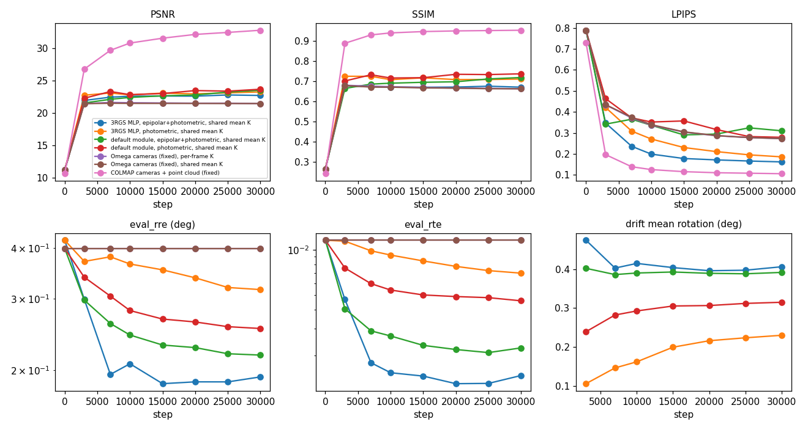
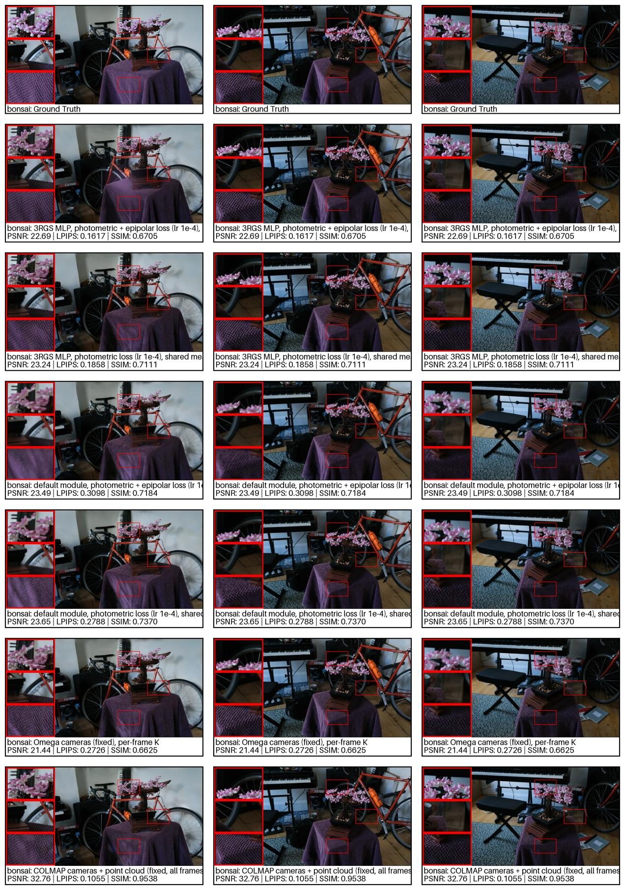
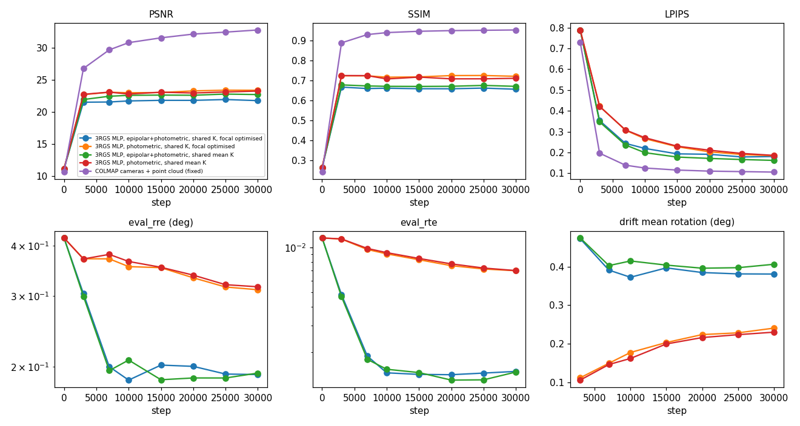
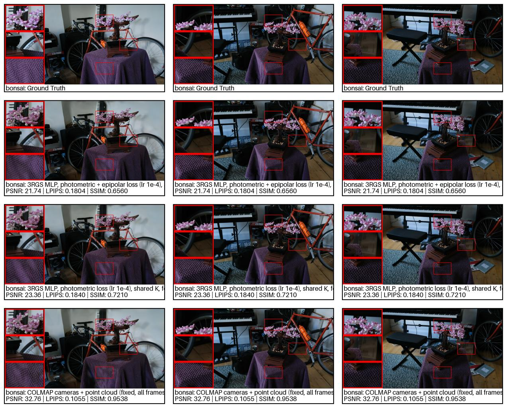
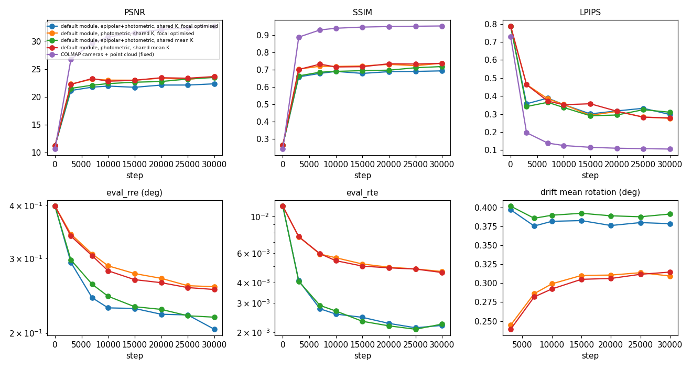
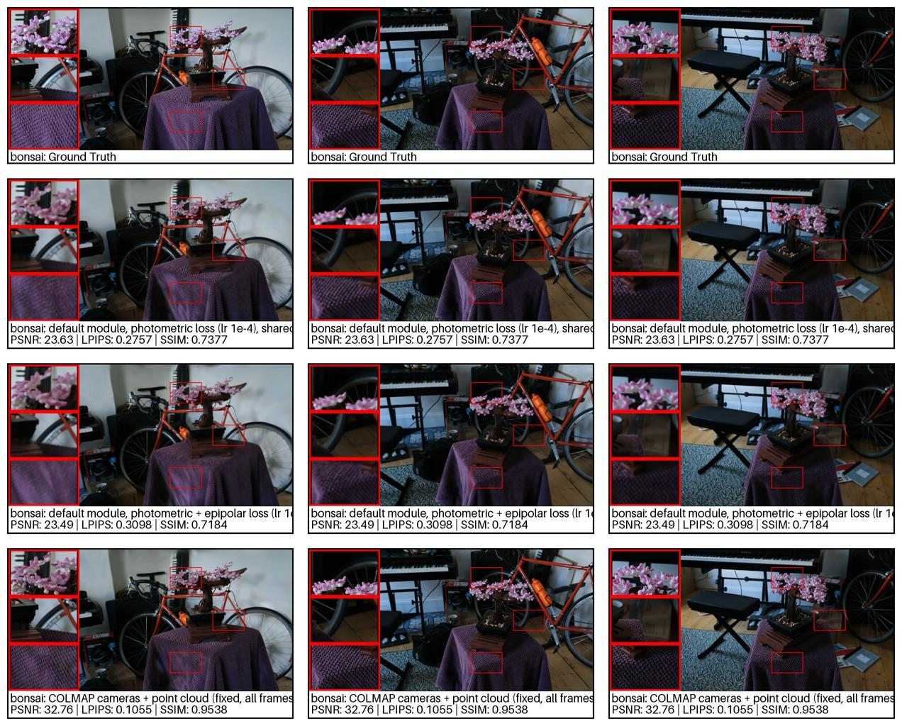
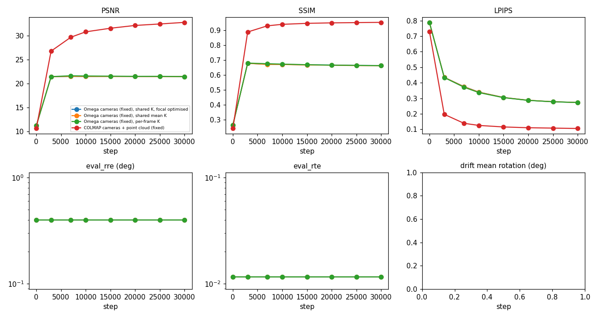
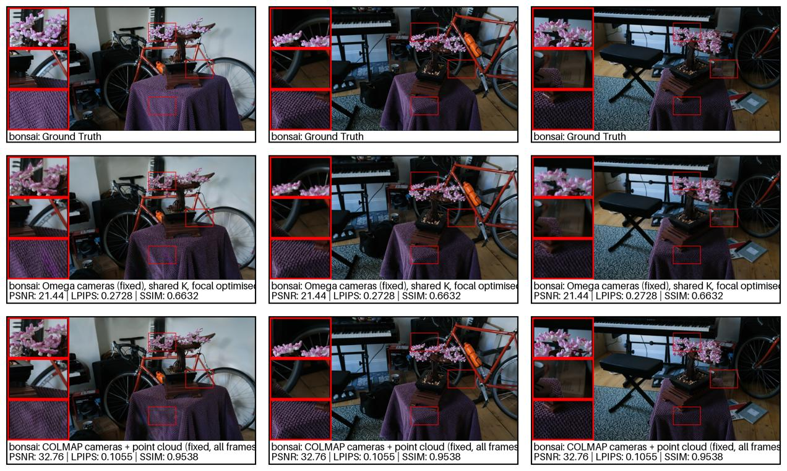

# Omega camera modules with a shared training K and 3R-GS focal optimisation (2026-11-20)

Follow-up of `2026-11-19_01_omega_epipolar_all_frames` (bonsai, all 255 train frames, same arms minus the camera-head arms). Experiments 120-123 (experiment 121 of the first version of this log was split into 121, 122, 123 by arm family).

## Question
The 3R-GS code renders with one shared K for all frames (the dataset's GT camera) and has an optional shared-focal optimisation (`intrinsics_opt`). In the previous log the Omega arms train with Omega's per-frame K. Here the training K is replaced by one shared K (the mean of Omega's per-frame K) and, in a second experiment, the focal of that shared K is optimised as in 3R-GS. The full camera head and LoRA arms are left out (training time); they are listed in `experiments/TODO.md`.

## Setup
- Scene bonsai, 255 train frames (every 8th frame is test), 37 test frames for evaluation (`eval_all`), seed 42, Omega 255-frame reconstruction and track pairs (`track_pairs_knn10.pt`, 10 nearest frames, 1482 pairs) exactly as in `2026-11-19_01_omega_epipolar_all_frames`; MCMC 30000 steps; test-time pose optimisation at the final evaluation; same module learning rates (3R-GS MLP lr 1e-4, default module lr 1e-4), epipolar loss weight 2.0 for steps 0-3000.
- `train_mean_k` (runs named `...meank...`): every training render and the epipolar loss use one K, the mean of the 255 training frames' K: fx 1617.47 (per-frame min 1585.64, max 1646.33), fy 1618.91, cx 779.50, cy 519.50. Evaluation frames keep their own K (the eval views' GT cameras and intrinsics, as before).
- `intrinsics_opt` (runs named `...intropt...`): the shared K as above with one trainable log-focal (fx = fy = exp(log f), initial f = (fx + fy)/2 = 1618.19), Adam lr 1e-4, principal point fixed at (779.5, 519.5), no regularisation (as the 3R-GS code with `focal_opt_lr 1e-4`, `pp_opt_lr 0`, no regularisation). The focal is used in every training render and in the epipolar loss. Its value is logged as `train/focal`; the final K is in the stats JSON (`train_fx`, `train_fy`).
- Arms, experiment 120 (shared mean K): 3R-GS MLP and default module, each epipolar+photometric and photometric; fixed Omega cameras with the shared mean K; references: fixed Omega cameras with per-frame K, COLMAP reference. Focal optimisation, three groups with the COLMAP reference in each: 121 (3R-GS MLP: epipolar+photometric and photometric with the focal optimised; the same two with the shared mean K as references), 122 (default module, same four arms), 123 (fixed Omega cameras with the focal optimised; references: fixed Omega with the shared mean K and with per-frame K).
- Runs: 10 new, plus 2 reused (fixed Omega with per-frame K and the COLMAP reference, from `2026-11-19_01_omega_epipolar_all_frames`, not re-run).

## Commands
```bash
# gsplat env, from ~/work/git/gsplat (queue.sh in this folder)
env -u PYTHONPATH PATH=$HOME/.conda/envs/gsplat/bin:$PATH python experiment_runner.py \
  --experiment_names omega_epi_meank omega_epi_intropt \
  --dataset_name bonsai --dataset_collections --do_reconstruct --skip_plotting \
  --cuda_visible_devices 0,1,2,3 --wait_gpu_idle
# plots / renders
python experiment_runner.py --experiment_names omega_epi_meank omega_epi_intropt_3rgs omega_epi_intropt_default omega_epi_intropt_omega --dataset_name bonsai --dataset_collections --plot_only
python experiments/2026-11-20_00_omega_epipolar_intrinsics/collect.py && python experiments/2026-11-20_00_omega_epipolar_intrinsics/make_figures.py   # gsplat env
# renders: copies of latest_plots/120_..., 121_..., 122_..., 123_..._latest_renders.jpg
```

## Run metadata
- gsplat commits `e98778dc` (`train_mean_k`, `intrinsics_opt`, experiments 120/121 as `omega_epi_ctr_*`) and `1febee95` (experiments renamed to `omega_epi_meank` / `omega_epi_intropt`; the runs were launched with the single experiment `omega_epi_intropt`, later split into `omega_epi_intropt_3rgs`, `_default`, `_omega` = 121, 122, 123 in the commit that regenerated this log; the run directories are the same); earlier base commits as in the previous log (`1ccd7aed`, `e4a6262f`, `85fb2009`); vggt commit `78cb698`. Uncommitted at launch: only unrelated files (the user's edit in `experiments/2026-11-17_01_omega_photometric_pose_opt/README.md`, `check_cache.json`, `profile_output.txt`, a `.vsix`).
- Hardware: server `gxp-l4-0` (ssh alias `dev-gpu-acs`), NVIDIA L4 (22.5 GiB), GPUs 0-3, 4 runs at a time, `--wait_gpu_idle`. Runner start 2026-11-20 07:31:19 GMT, exit code 0 at 09:37:51 GMT. The two reused runs were produced on `gxp-l40s-2` (L40S).
- Environment: same as the previous log (gsplat env torch 2.10.0+cu130, kornia 0.8.2).
- Smoke tests before the launch: 100-step runs of `mlp_epi` with the focal optimised and fixed Omega with the shared mean K (result dirs `..._steps100`, not part of the results).
- Result dirs: `results/vggt_outputs/bonsai_2_n255_s42_omega_c0.0_p100000_random_farthestpose_i255_gteval_<suffix>` with suffixes `cft-0.0001-mlp-d0-epi2x3000k10_meank_tpo_evalall_steps30000`, `cft-0.0001-mlp-d0_meank_...`, `cft-0.0001-pdef-d0-epi2x3000k10_meank_...`, `cft-0.0001-pdef-d0_meank_...`, `meank_tpo_evalall_steps30000` (fixed), and the same with `intropt` in place of `meank`; reused: `tpo_evalall_steps30000` (fixed per-frame K) and `results/gt_outputs/bonsai_2_n255_s42_i292_tpo_steps30000`. Per-step numbers: `metrics.csv`.

## Failed / missing runs, changes between runs, confounds
- No run failed; no tracebacks in `queue.log`.
- Counter scene: the planned counter version could not be started (Omega on the 210 counter frames ran out of memory on an L4: 20.5 GiB allocated, failed allocation 832 MiB). Bonsai was used instead; the counter plan is in `experiments/TODO.md`.
- Train times are not comparable across all rows: the fixed per-frame run and the COLMAP reference ran on L40S, the other rows on L4 with 4 concurrent runs.
- Measured in this session (`gsplat.rasterization` with a small random scene, GPU 1 of `gxp-l40s-2`): `K.grad` is `None` after `backward()` while the viewmat gradient is non-zero (max 33586). The photometric loss therefore does not reach the focal in these runs; only the epipolar loss does (active for steps 0-3000). Final focal values: 1628.8 and 1628.3 for the two epipolar arms, 1618.2 for the photometric arms and for the fixed Omega run (equal to the initial 1618.19).
- Eval frames use their own K (eval views of the GT dataset); this was assumed from the data flow in `simple_trainer.py` and not separately verified with a test.
- Single seed per arm; the evaluation set is 37 frames; the correspondence caveats of the previous log apply (bf16 track head, 425 grid points, windows of 11 frames).

## Gaps filled by Claude
- "Mean K" was implemented as the mean of Omega's per-frame K over the 255 training frames (not the GT K).
- `intrinsics_opt` implemented as one shared focal with fx = fy (the principal point fixed at the mean), initialised from the mean of fx and fy; it implies the shared mean K.
- The fixed Omega arm with the focal optimised was added as requested; in the module arms the shared K applies to rendering and to the epipolar loss; the module only learns poses.
- Experiment names do not mention the scene (experiments 121-123 use the same run directories as the earlier single experiment 121) (the scene is the `--dataset_name`).

## Results (step 30000, 37 test frames)
`TPO` = after test-time pose optimisation of the eval views. `eval_rre`/`eval_rte` are the GT-aligned errors of the 255 train cameras.

### Experiment 120: shared mean K
| arm | PSNR | SSIM | LPIPS | eval_rre (deg) | eval_rte | TPO PSNR | TPO SSIM | TPO LPIPS | final train fx / fy | train time (s) |
|---|---|---|---|---|---|---|---|---|---|---|
| 3RGS MLP, epipolar+photometric, shared mean K | 22.69 | 0.670 | 0.162 | 0.193 | 0.0015 | 30.71 | 0.927 | 0.120 | 1617.5 / 1618.9 | 1730 |
| 3RGS MLP, photometric, shared mean K | 23.24 | 0.711 | 0.186 | 0.316 | 0.0070 | 28.07 | 0.879 | 0.157 | 1617.5 / 1618.9 | 1728 |
| default module, epipolar+photometric, shared mean K | 23.49 | 0.718 | 0.310 | 0.218 | 0.0022 | 27.69 | 0.834 | 0.284 | 1617.5 / 1618.9 | 1849 |
| default module, photometric, shared mean K | 23.65 | 0.737 | 0.279 | 0.254 | 0.0046 | 28.05 | 0.845 | 0.253 | 1617.5 / 1618.9 | 1845 |
| Omega cameras (fixed), per-frame K | 21.44 | 0.663 | 0.273 | 0.399 | 0.0116 | 25.77 | 0.797 | 0.234 | per-frame | 629 |
| Omega cameras (fixed), shared mean K | 21.44 | 0.662 | 0.273 | 0.399 | 0.0116 | 26.08 | 0.809 | 0.233 | 1617.5 / 1618.9 | 1496 |
| COLMAP cameras + point cloud (fixed) | 32.76 | 0.954 | 0.106 | - | - | 32.82 | 0.954 | 0.105 | per-frame | 633 |





### Experiments 121-123: shared-focal optimisation, split by arm family (COLMAP reference in each)

#### Experiment 121: 3R-GS MLP module

| arm | PSNR | SSIM | LPIPS | eval_rre (deg) | eval_rte | TPO PSNR | TPO SSIM | TPO LPIPS | final train fx / fy | train time (s) |
|---|---|---|---|---|---|---|---|---|---|---|
| 3RGS MLP, epipolar+photometric, shared K, focal optimised | 21.74 | 0.656 | 0.180 | 0.191 | 0.0015 | 26.81 | 0.851 | 0.140 | 1628.8 / 1628.8 | 1749 |
| 3RGS MLP, photometric, shared K, focal optimised | 23.36 | 0.721 | 0.184 | 0.311 | 0.0070 | 27.79 | 0.874 | 0.156 | 1618.2 / 1618.2 | 1741 |
| 3RGS MLP, epipolar+photometric, shared mean K | 22.69 | 0.670 | 0.162 | 0.193 | 0.0015 | 30.71 | 0.927 | 0.120 | 1617.5 / 1618.9 | 1730 |
| 3RGS MLP, photometric, shared mean K | 23.24 | 0.711 | 0.186 | 0.316 | 0.0070 | 28.07 | 0.879 | 0.157 | 1617.5 / 1618.9 | 1728 |
| COLMAP cameras + point cloud (fixed) | 32.76 | 0.954 | 0.106 | - | - | 32.82 | 0.954 | 0.105 | per-frame | 633 |





#### Experiment 122: default module

| arm | PSNR | SSIM | LPIPS | eval_rre (deg) | eval_rte | TPO PSNR | TPO SSIM | TPO LPIPS | final train fx / fy | train time (s) |
|---|---|---|---|---|---|---|---|---|---|---|
| default module, epipolar+photometric, shared K, focal optimised | 22.35 | 0.693 | 0.297 | 0.204 | 0.0022 | 26.22 | 0.796 | 0.267 | 1628.3 / 1628.3 | 1876 |
| default module, photometric, shared K, focal optimised | 23.63 | 0.738 | 0.276 | 0.257 | 0.0047 | 27.98 | 0.846 | 0.249 | 1618.2 / 1618.2 | 1840 |
| default module, epipolar+photometric, shared mean K | 23.49 | 0.718 | 0.310 | 0.218 | 0.0022 | 27.69 | 0.834 | 0.284 | 1617.5 / 1618.9 | 1849 |
| default module, photometric, shared mean K | 23.65 | 0.737 | 0.279 | 0.254 | 0.0046 | 28.05 | 0.845 | 0.253 | 1617.5 / 1618.9 | 1845 |
| COLMAP cameras + point cloud (fixed) | 32.76 | 0.954 | 0.106 | - | - | 32.82 | 0.954 | 0.105 | per-frame | 633 |





#### Experiment 123: fixed Omega cameras

| arm | PSNR | SSIM | LPIPS | eval_rre (deg) | eval_rte | TPO PSNR | TPO SSIM | TPO LPIPS | final train fx / fy | train time (s) |
|---|---|---|---|---|---|---|---|---|---|---|
| Omega cameras (fixed), shared K, focal optimised | 21.44 | 0.663 | 0.273 | 0.399 | 0.0116 | 26.01 | 0.809 | 0.234 | 1618.2 / 1618.2 | 1502 |
| Omega cameras (fixed), shared mean K | 21.44 | 0.662 | 0.273 | 0.399 | 0.0116 | 26.08 | 0.809 | 0.233 | 1617.5 / 1618.9 | 1496 |
| Omega cameras (fixed), per-frame K | 21.44 | 0.663 | 0.273 | 0.399 | 0.0116 | 25.77 | 0.797 | 0.234 | per-frame | 629 |
| COLMAP cameras + point cloud (fixed) | 32.76 | 0.954 | 0.106 | - | - | 32.82 | 0.954 | 0.105 | per-frame | 633 |





## Insights
To be filled by the user.
