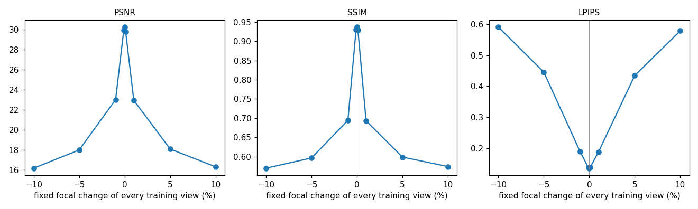
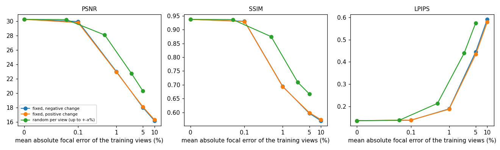
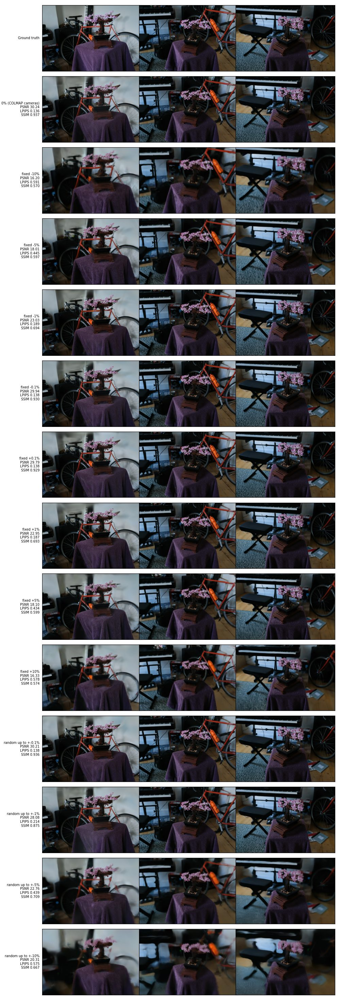

# 3DGS with COLMAP cameras and a wrong training focal (2026-11-23)

## Question
How do PSNR / SSIM / LPIPS of 3DGS with the dataset's COLMAP cameras change when the focal length of the training views is wrong (no focal optimisation)? One set with the same fixed focal change for every training view, one with per-view random changes.

## Setup
- Scene bonsai, the dataset's COLMAP cameras and COLMAP sparse point cloud (`choice gt`, `data_factor 2`), all 255 training frames (every 8th frame is test), 37 test frames for evaluation, seed 42, MCMC (cap 1M Gaussians), 7000 steps, no test-time pose optimisation, no pose optimisation.
- Focal change (`train_k_scale_pct`, `train_k_random_pct`): the training views' fx and fy are multiplied by 1 + p/100; the principal point is unchanged. The evaluation views keep their own (GT) K.
  - Fixed set: p in {-10, -5, -1, -0.1, +0.1, +1, +5, +10}%, the same for every training view, fx and fy equally.
  - Random set: per training view and independently for fx and fy, p ~ uniform(-x, +x) with x in {10, 5, 1, 0.1}%, drawn once with seed 42 (255 x 2 values) and kept fixed during training.
  - Baseline: 0% (unchanged COLMAP K).
- Runs: 13 (1 baseline, 8 fixed, 4 random), 7000 steps each, evaluation at the end (step 7000); the stats JSONs also hold an evaluation at step 3000.

## Commands
```bash
# gsplat env, from ~/work/git/gsplat (queue.sh in this folder), launched on dev-gpu-acs
env -u PYTHONPATH PATH=$HOME/.conda/envs/gsplat/bin:$PATH python experiment_runner.py \
  --experiment_names colmap_focal_error --dataset_name bonsai --dataset_collections --do_reconstruct --skip_plotting \
  --cuda_visible_devices 0,1,2,3 --wait_gpu_idle
# plots
python experiment_runner.py --experiment_names colmap_focal_error --dataset_name bonsai --dataset_collections --plot_only
python experiments/2026-11-23_00_colmap_focal_error/collect.py && python experiments/2026-11-23_00_colmap_focal_error/make_figures.py   # gsplat env
python experiments/2026-11-23_00_colmap_focal_error/make_renders.py   # render figure from the run directories (ground truth, 0% baseline, all fixed and random runs)
```

## Run metadata
- gsplat commit `3bbd0c57` (`train_k_scale_pct` / `train_k_random_pct`, experiment 124; trainer K accuracy logging). Uncommitted at launch: only unrelated files (the user's edit in `experiments/2026-11-17_01_omega_photometric_pose_opt/README.md`, `check_cache.json`, `profile_output.txt`, a `.vsix`).
- Hardware: `gxp-l4-0` (ssh alias `dev-gpu-acs`), NVIDIA L4 (22.5 GiB). First launch on GPUs 0,1 at 2026-11-23 09:18:06 GMT (log `queue_part1.log`), stopped at 09:37 GMT by killing the runner and its two running trainers (by PID) to use 4 GPUs; relaunch on GPUs 0-3 at 09:37:25 GMT (`queue.log`), exit code 0 at 09:59:09 GMT. The baseline and the fixed -1, -5, -10% runs finished in the first launch and were kept; the fixed +-0.1% runs were partial and were redone. The first launch's runner also reported exit code 0 (its log line is written after the kill).
- Environment: gsplat env, torch 2.10.0+cu130, same as the earlier logs.
- Result dirs: `results/gt_outputs/bonsai_2_n255_s42_i292_<token>_steps7000` with tokens none (baseline), `kfix-10`, `kfix-5`, `kfix-1`, `kfix-0.1`, `kfix+0.1`, `kfix+1`, `kfix+5`, `kfix+10`, `krand0.1`, `krand1`, `krand5`, `krand10`. Per-step numbers: `metrics.csv`. Smoke-test dirs `..._steps40` in the same folder are not part of the results.

## Failed / missing runs, changes between runs, confounds
- No run failed; no tracebacks in either log.
- Train times are not comparable across runs: 2 to 4 runs shared the machine at different times.
- Single seed per setting; the random changes are one draw per setting (seed 42), the realised mean absolute changes are listed in the table (e.g. 5.07% / 4.88% for the x = 10% draw).
- The random draws for different x are the same uniform draws scaled by x (same generator seed).
- The evaluation views keep their K; the test views' cameras are the dataset's COLMAP cameras.

## Results (step 7000, 37 test frames)
| training focal change | realised mean abs. change fx / fy (%) | PSNR | SSIM | LPIPS | #GS | train time (s) |
|---|---|---|---|---|---|---|
| 0% (COLMAP cameras) | 0.00 / 0.00 | 30.24 | 0.937 | 0.136 | 1000000 | 278 |
| fixed -10% | 10.00 / 10.00 | 16.20 | 0.570 | 0.591 | 1000000 | 417 |
| fixed -5% | 5.00 / 5.00 | 18.01 | 0.597 | 0.445 | 1000000 | 361 |
| fixed -1% | 1.00 / 1.00 | 23.03 | 0.694 | 0.189 | 1000000 | 283 |
| fixed -0.1% | 0.10 / 0.10 | 29.94 | 0.930 | 0.138 | 1000000 | 278 |
| fixed +0.1% | 0.10 / 0.10 | 29.79 | 0.929 | 0.138 | 1000000 | 282 |
| fixed +1% | 1.00 / 1.00 | 22.95 | 0.693 | 0.187 | 1000000 | 283 |
| fixed +5% | 5.00 / 5.00 | 18.10 | 0.599 | 0.434 | 1000000 | 356 |
| fixed +10% | 10.00 / 10.00 | 16.33 | 0.574 | 0.578 | 1000000 | 429 |
| random up to +-0.1% | 0.05 / 0.05 | 30.21 | 0.936 | 0.138 | 1000000 | 267 |
| random up to +-1% | 0.51 / 0.49 | 28.08 | 0.875 | 0.214 | 1000000 | 299 |
| random up to +-5% | 2.54 / 2.44 | 22.76 | 0.709 | 0.439 | 1000000 | 393 |
| random up to +-10% | 5.07 / 4.88 | 20.31 | 0.667 | 0.575 | 1000000 | 457 |





Renders of test views 0, 2, 5 (ground truth, the 0% COLMAP baseline, the 8 fixed and the 4 random runs; per-run PSNR / LPIPS / SSIM are the 37-frame means):



## Insights
To be filled by the user.
