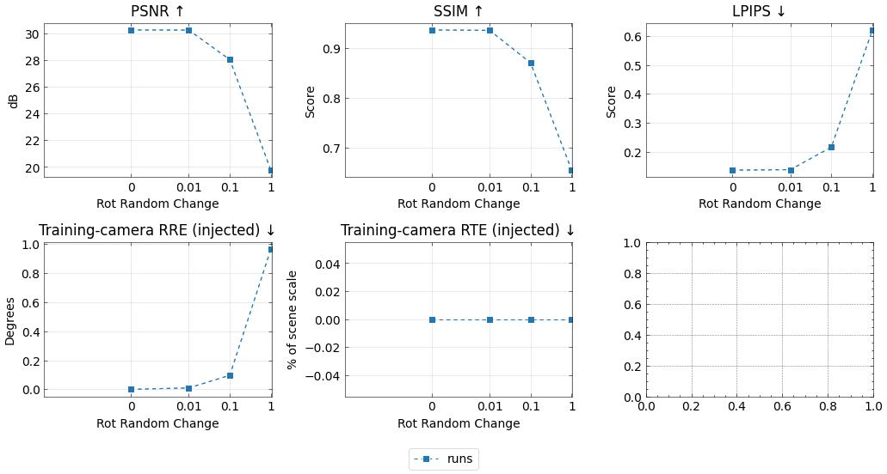
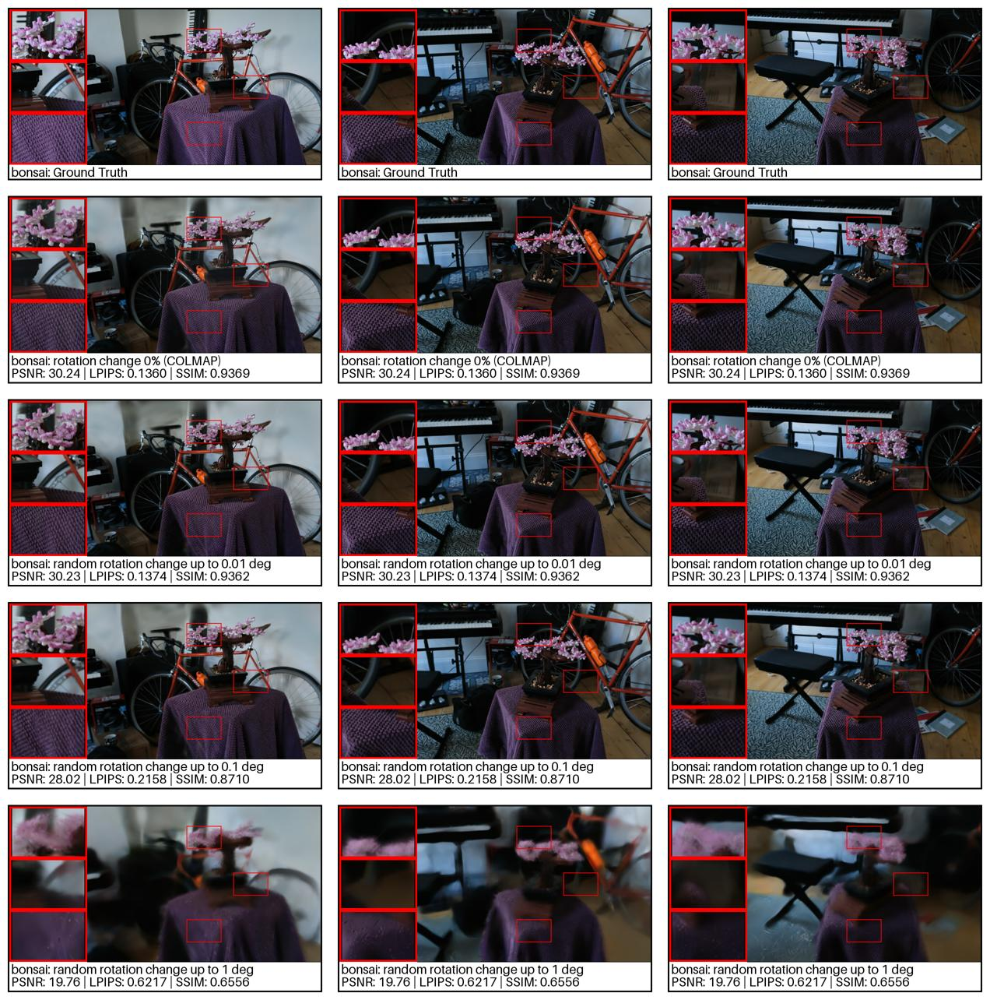

# 3DGS with COLMAP cameras and rotation errors in the training cameras (2026-11-23 / 2026-11-24)

## Question
How do PSNR / SSIM / LPIPS of 3DGS with the dataset's COLMAP cameras change when the training cameras' rotations carry random errors (no pose optimisation)?

## Setup
- Scene bonsai, the dataset's COLMAP cameras and COLMAP sparse point cloud (`choice gt`, `data_factor 2`), all 255 training frames (every 8th frame is test), 37 test frames, seed 42, MCMC (cap 1M Gaussians), 7000 steps, no test-time pose optimisation, no pose optimisation.
- Rotation error (`train_rot_random_deg`): per training view, a rotation built from three Euler angles (`xyz`), each drawn uniform(-x, +x) degrees, composed as R_train = R_gt @ R_err; the camera centre is unchanged. Drawn once with `train_pose_seed` 42 and kept fixed. Evaluation views use the dataset's GT poses.
- Levels in the final experiment definition: x in {0.01, 0.1, 1} degrees, plus the 0 baseline (existing run `bonsai_2_n255_s42_i292_steps7000`).
- The experiment was first defined with x in {0.1, 0.5, 1, 2, 5, 10}; on 2026-11-24 the user changed it to {0.01, 0.1, 1} (see "Failed / missing runs").

## Commands
```bash
# gsplat env, from ~/work/git/gsplat; queue.sh (both experiments), queue2.sh (rotation only), all launched on dev-gpu-acs
env -u PYTHONPATH PATH=$HOME/.conda/envs/gsplat/bin:$PATH python experiment_runner.py \
  --experiment_names colmap_rotation_error colmap_translation_error --dataset_name bonsai --dataset_collections --do_reconstruct --skip_plotting \
  --cuda_visible_devices 0,1,2,3 --wait_gpu_idle        # queue.sh and the rerun of it (queue_rerun.log)
env ... python experiment_runner.py --experiment_names colmap_rotation_error ... --cuda_visible_devices 0 --wait_gpu_idle   # queue2.sh, rotation 0.01 only
# plots
python experiment_runner.py --experiment_names colmap_rotation_error colmap_translation_error --dataset_name bonsai --dataset_collections --plot_only
python experiments/2026-11-23_01_colmap_rotation_error/collect.py   # gsplat env, writes metrics.csv
# figures/metrics.jpg and figures/renders.jpg: copies of the runner outputs in latest_plots/125_colmap_rotation_error_bonsai_latest_renders.jpg
```

## Run metadata
- gsplat commit `e70b2566` (rotation/translation errors, experiments 125/126) for all runs; the experiment definition levels were changed afterwards (uncommitted at the time of the 0.01 run: `experiment_runner.py` level change). vggt `37080ce`.
- Hardware: `gxp-l4-0` (ssh alias `dev-gpu-acs`), NVIDIA L4 (22.5 GiB). Launch 1 (GPUs 0-3, with the translation experiment): 2026-11-23 10:18:02 to 10:49:35 GMT. Rerun of the failed runs (GPUs 0-3): 12:04:24 to 12:20:48 GMT. Rotation 0.01: GPU 0, 2026-11-24 09:47:25 to 09:53:55 GMT.
- Environment: gsplat env, torch 2.10.0+cu130.
- Result dirs: `results/gt_outputs/bonsai_2_n255_s42_i292_rrand<x>_steps7000`, x in 0.01, 0.1, 1 (plotted); also present: `rrand0.5` (finished), `rrand2`, `rrand5`, `rrand10` (crashed, see below). `..._steps40` dirs are smoke tests. Per-step numbers: `metrics.csv`.

## Failed / missing runs, changes between runs, confounds
- Launch 1: `rrand2`, `rrand5`, `rrand10` (and translation `trand10`) ended with `torch.OutOfMemoryError` (CUDA) on the L4 (22 GiB). Rerun of the same four on the L4 at the same setup: all four OutOfMemoryError again (failed allocation 1.78-4.24 GiB, process memory 18.0-21.4 GiB).
- `rrand0.5` finished (PSNR 22.32, SSIM 0.691, LPIPS 0.476, realised mean 0.483 deg, max 0.76 deg, 423 s); it is not in the final level set and not plotted.
- Memory trace of the 10 degree setup on an L4 (separate run, `results/_diag/trace_rrand10.log`, per-step peak from `torch.cuda.max_memory_allocated`, extra logging only): baseline (0%) per-step peak 0.44 GiB at step 250 rising to 1.26 GiB from step 4000 (1,000,000 Gaussians); 10 degrees: 0.44 GiB up to step 1000, 0.77 / 1.20 / 1.65 / 1.90 GiB (max in the 200-step windows from 1200), 2.52 GiB (step 2000), 3.83, 5.54, 7.63 (2200-2600), 9.26 (3000), 15.27 (3400), 17.42 (3800), OOM at step 4201 (peak 17.55 GiB, allocated 9.18 GiB). Steps with peak over 2 GiB sit right after each refine step (every 100 steps), e.g. step 2201: peak 3.08 GiB (0.82 GiB the step before), Gaussians 450,997 -> 473,546. Median Gaussian max-scale at step 4000: 0.55 (baseline 0.0037); mean opacity 0.0010 (baseline 0.117); loss 0.23-0.27 (baseline 0.03).
- PyTorch allocation history at the first spike step (step 2101 of another 10 degree run, `results/_diag/snap_2101.pickle`): 3.07 GiB of the 3.64 GiB live at the peak is allocated in `isect_tiles` (`gsplat/cuda/_wrapper.py:504`, called from `rasterization`, `rendering.py:634`); the largest buffers are two of 0.96 GiB and two of 0.48 GiB.
- The trainer has no maximum Gaussian scale parameter; `scale_reg` (default 0, loss term on mean scale) and the MCMC `min_opacity` (default 0.005) exist; the runs use the defaults.
- The baseline run's stats JSONs (`bonsai_2_n255_s42_i292_steps7000`, made before the pose-error stats existed) were edited to add `train_rot_err_*` / `train_trans_err_*` = 0.0 so that the runner plots show the 0 point.
- Single seed; the realised rotation of each view is one draw per level. Train times differ because 1-4 runs shared the machine at different times.

## Results (step 7000, 37 test frames)
| training rotation error up to +-x deg per axis | realised mean / max rotation error (deg) | PSNR | SSIM | LPIPS | #GS | train time (s) |
|---|---|---|---|---|---|---|
| 0 (COLMAP cameras) | 0 / 0 | 30.24 | 0.937 | 0.136 | 1000000 | 278 |
| 0.01 | 0.0097 / 0.0152 | 30.23 | 0.936 | 0.137 | 1000000 | 283 |
| 0.1 | 0.0966 / 0.1522 | 28.02 | 0.871 | 0.216 | 1000000 | 308 |
| 1 | 0.9658 / 1.5188 | 19.76 | 0.656 | 0.622 | 1000000 | 479 |

Quality metrics (PSNR, SSIM, LPIPS) with the RRE / RTE of the training cameras (injected perturbation, mean over the 255 training views, `train_rre` / `train_rte`) against the nominal bound x; drawn by the runner / `plot_metrics.py` (copy of `latest_plots/125_colmap_rotation_error_bonsai_latest_full.jpg`; settings `merge_series`, `x_symlog` and the metrics `train_rre` / `train_rte` were added to the runner and `plot_metrics.py` for this):



Renders of test views 0, 2, 5 (ground truth, the 0% baseline and the three levels).



## Insights
- Scale regularisation (`scale_reg`) is something the user wants to try, but it would influence the metrics.
