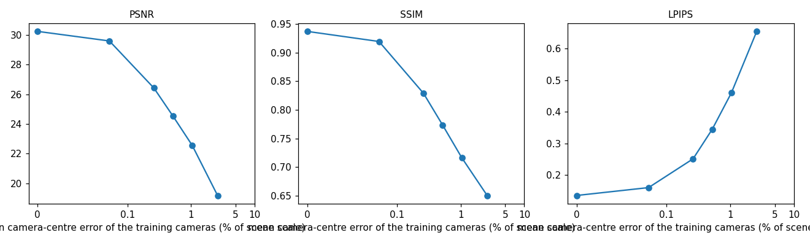
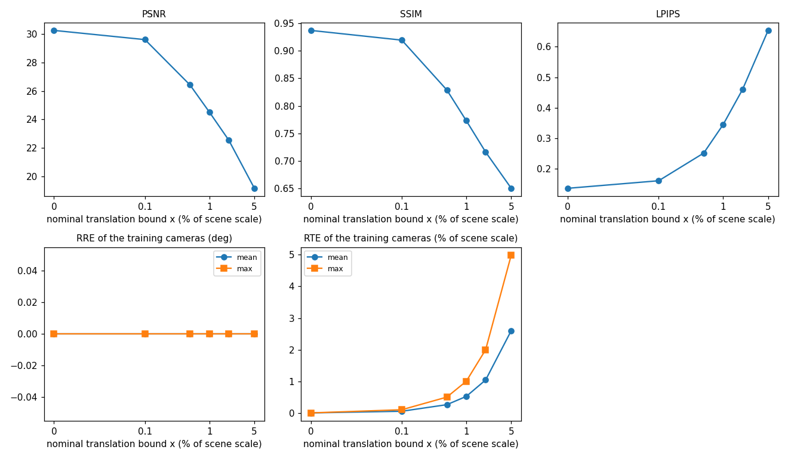
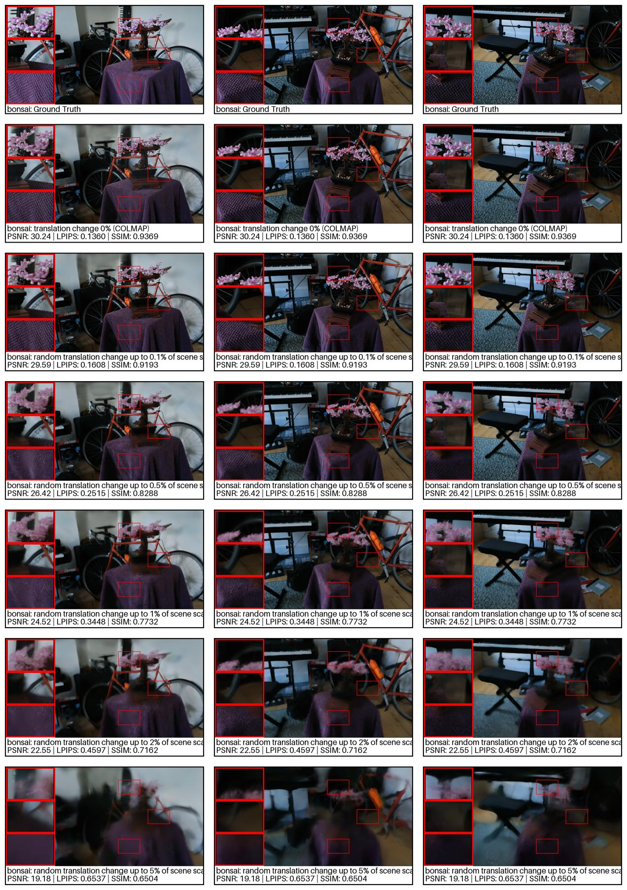

# 3DGS with COLMAP cameras and translation errors in the training cameras (2026-11-23)

## Question
How do PSNR / SSIM / LPIPS of 3DGS with the dataset's COLMAP cameras change when the training cameras' centres carry random errors (no pose optimisation)?

## Setup
- Scene bonsai, the dataset's COLMAP cameras and COLMAP sparse point cloud (`choice gt`, `data_factor 2`), all 255 training frames (every 8th frame is test), 37 test frames, seed 42, MCMC (cap 1M Gaussians), 7000 steps, no test-time pose optimisation, no pose optimisation.
- Translation error (`train_trans_random_pct`): scale s = the largest pairwise distance between the training camera centres (the two farthest cameras) = 2.1611 (COLMAP units). Per training view the camera centre is shifted by a random unit direction times uniform(0, x% of s); rotations are unchanged. Drawn once with `train_pose_seed` 42 and kept fixed. Evaluation views use the dataset's GT poses.
- Levels: x in {0.1, 0.5, 1, 2, 5, 10} % of s, plus the 0 baseline (existing run `bonsai_2_n255_s42_i292_steps7000`).

## Commands
```bash
# gsplat env, from ~/work/git/gsplat; queue.sh in ../2026-11-23_01_colmap_rotation_error (both experiments), launched on dev-gpu-acs
env -u PYTHONPATH PATH=$HOME/.conda/envs/gsplat/bin:$PATH python experiment_runner.py \
  --experiment_names colmap_rotation_error colmap_translation_error --dataset_name bonsai --dataset_collections --do_reconstruct --skip_plotting \
  --cuda_visible_devices 0,1,2,3 --wait_gpu_idle
# plots
python experiment_runner.py --experiment_names colmap_rotation_error colmap_translation_error --dataset_name bonsai --dataset_collections --plot_only
python experiments/2026-11-23_02_colmap_translation_error/collect.py && python experiments/2026-11-23_02_colmap_translation_error/make_figures.py   # gsplat env
# renders: copy of latest_plots/126_colmap_translation_error_bonsai_latest_renders.jpg
```

## Run metadata
- gsplat commit `e70b2566`, vggt `37080ce`. Uncommitted at launch: only unrelated files.
- Hardware: `gxp-l4-0` (ssh alias `dev-gpu-acs`), NVIDIA L4 (22.5 GiB), GPUs 0-3. Launch 1: 2026-11-23 10:18:02 to 10:49:35 GMT (shared with the rotation experiment, see its log); rerun of the failed run: 12:04:24 to 12:20:48 GMT.
- Environment: gsplat env, torch 2.10.0+cu130.
- Result dirs: `results/gt_outputs/bonsai_2_n255_s42_i292_trand<x>_steps7000`, x in 0.1, 0.5, 1, 2, 5, 10. Per-step numbers: `metrics.csv`. `..._steps40` dirs are smoke tests.

## Failed / missing runs, changes between runs, confounds
- `trand10` ended with `torch.OutOfMemoryError` (CUDA) on the L4 (22 GiB) in launch 1 and again in the rerun; no result for 10%.
- The memory trace of the rotation experiment (see its log) was not repeated for translation.
- Single seed; train times differ because 1-4 runs shared the machine at different times.

## Results (step 7000, 37 test frames)
| translation error up to x % of s | realised mean / max (% of s) | PSNR | SSIM | LPIPS | #GS | train time (s) |
|---|---|---|---|---|---|---|
| 0 (COLMAP cameras) | 0 / 0 | 30.24 | 0.937 | 0.136 | 1000000 | 278 |
| 0.1 | 0.052 / 0.100 | 29.59 | 0.919 | 0.161 | 1000000 | 288 |
| 0.5 | 0.260 / 0.499 | 26.42 | 0.829 | 0.252 | 1000000 | 318 |
| 1 | 0.521 / 0.999 | 24.52 | 0.773 | 0.345 | 1000000 | 342 |
| 2 | 1.041 / 1.998 | 22.55 | 0.716 | 0.460 | 1000000 | 400 |
| 5 | 2.603 / 4.994 | 19.18 | 0.650 | 0.654 | 1000000 | 456 |
| 10 | failed (OOM) | | | | | |



Quality metrics together with the RRE / RTE of the training cameras (mean and max over the 255 training views, from the injected perturbation; evaluation views use GT poses) against the nominal bound x:



Renders of test views 0, 2, 5 (ground truth, the 0% baseline and the levels that finished).



## Insights
To be filled by the user.
